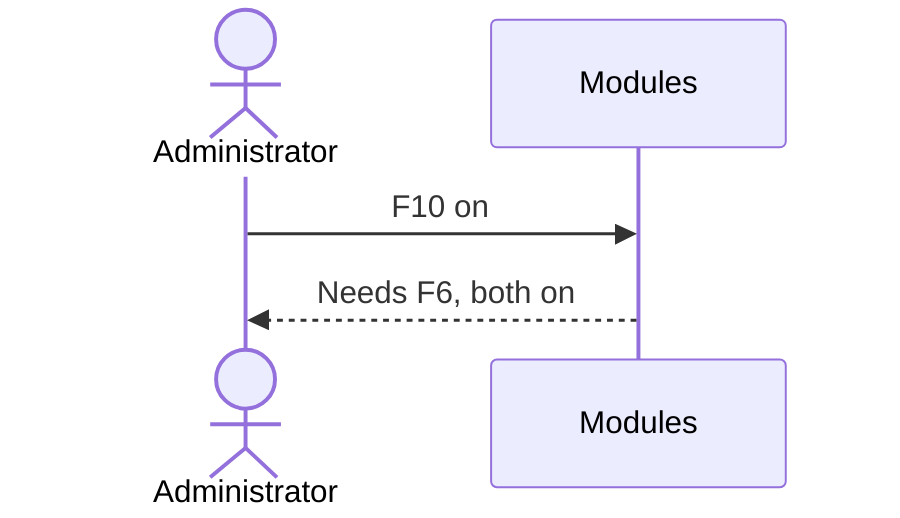

🏠 [Specs](../../../../README.md) › 🧩 [Functional capabilities](../../../README.md) ›
🧭 [F21 Onboarding and module activation](../../README.md) › 📝 [Use cases](../README.md) ›
📝 [Use cases: FL-F21-02 Modules](README.md) › 📝 UC-F21-04 Switch modules on in one click

# 📝 UC-F21-04 Switch modules on in one click

**Status:** ✅ specified

## Summary

The owner or administrator switches modules on in one click and sees what each adds.

## Personas

- [U07 Administrator](../../../../01-users/personas/u07-administrator.md)
- [U13 Owner](../../../../01-users/personas/u13-owner.md)

## Goal

Modules ready.

## Trigger

Need.

## Frequency

Occasional.

## Preconditions

- None.

## Postconditions

- Success: on.
- Failure: refused.

## Main flow

1. Browse (S-F21-04).
2. Switch on (BR-F21-02).
3. Dependencies offered (BR-F21-03).
4. See what it adds.

## Alternative flows

- 3a. Both switched on.

## Error flows

- 2e. Paid and no approval: waits.
- Any step: a service does not answer; the call is retried first (BR-F3-32), then the message follows the error pattern
  (D122) and what was typed stays on the screen.

## Business rules

- [BR-F21-02 One click per module](../../business-rules/br-f21-02-one-click-per-module.md)
- [BR-F21-03 Dependencies explained, never hidden](../../business-rules/br-f21-03-dependencies-explained.md)

## Entities

- [E-F21-04 Module activation](../../data/e-f21-04-module-activation.md)

## Permissions

Owner, administrator.

## Notifications

- Users of new roles.

## Audit events

Activations.

## AI involvement

None.

## API, MCP and A2A exposure

Through T5 and T6 with the caller's rights (BR-F3-34).

## Screens

- [S-F21-04 Modules](../../screens/02-modules/s-f21-04-modules.md)

## Flowchart

See [FL-F21-02 Modules](../../flows/fl-f21-02-modules.md#flowchart).

## Sequence diagram

## Acceptance criteria

1. **Given** F10 **when** switched on **then** F6 offered.
2. **Given** on **when** done **then** menus appear.
3. **Given** paid **when** admin **then** owner asked.

## Non-functional notes

D408's targets ([Performance](../../../../05-non-functional/performance.md)): 95 % of screens within 1 second; lists
paged on the server, the first page within 1 second; reports within 5 seconds or in the background.

## Regulatory references

Set-up rules of the France country pack:
[CR-FR-001 Company identifiers](../../../../10-country-packs/france/company/cr-fr-001-company-identifiers.md),
[CR-FR-016 Electronic invoicing](../../../../10-country-packs/france/invoicing/cr-fr-016-electronic-invoicing.md),
[CR-FR-005 Accounting entries file (FEC)](../../../../10-country-packs/france/accounting/cr-fr-005-fec-export.md),
[CR-FR-038 Personnel register](../../../../10-country-packs/france/labour/cr-fr-038-personnel-register.md),
[CR-FR-048 Record of processing activities](../../../../10-country-packs/france/data-protection/cr-fr-048-record-of-processing.md),
[CR-FR-069 Website legal notices](../../../../10-country-packs/france/consumer/cr-fr-069-website-legal-notices.md).

## Related use cases

- [UC-F21-05 Understand a module's dependencies](uc-f21-05-understand-a-module-s-dependencies.md)

## Open questions

None.

---

⬅️ [UC-F21-03 Pick a sector template](../01-first-run/uc-f21-03-pick-a-sector-template.md) · ⬆️ [Up](README.md) ·
➡️ [UC-F21-05 Understand a module's dependencies](uc-f21-05-understand-a-module-s-dependencies.md)
