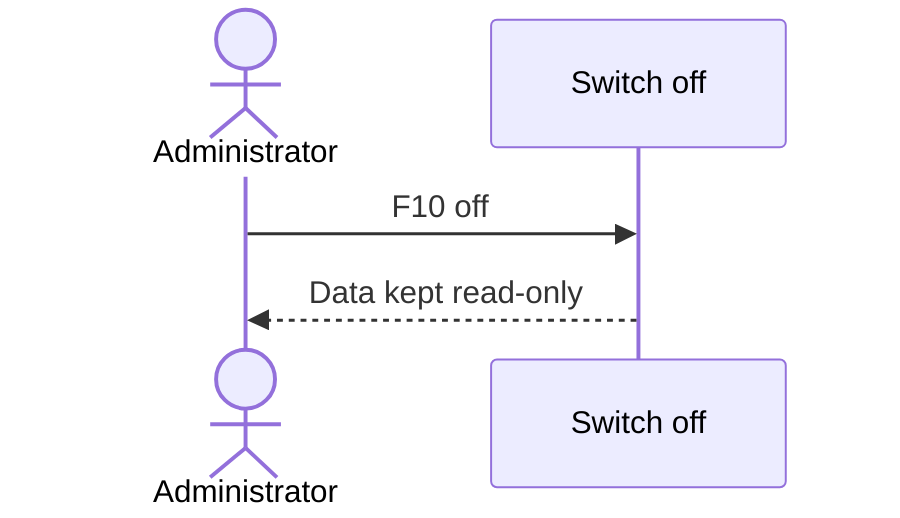

🏠 [Specs](../../../../README.md) › 🧩 [Functional capabilities](../../../README.md) ›
🧭 [F21 Onboarding and module activation](../../README.md) › 📝 [Use cases](../README.md) ›
📝 [Use cases: FL-F21-02 Modules](README.md) › 📝 UC-F21-06 Switch a module off and keep its data

# 📝 UC-F21-06 Switch a module off and keep its data

**Status:** ✅ specified

## Summary

The administrator switches a module off; its data stays read-only.

## Personas

- [U07 Administrator](../../../../01-users/personas/u07-administrator.md)

## Goal

Clean off.

## Trigger

Not needed.

## Frequency

Rare.

## Preconditions

- Module on.

## Postconditions

- Success: off, data kept.
- Failure: refused.

## Main flow

1. Switch off (S-F21-06).
2. Confirm.
3. Data read-only (BR-F21-04).
4. Menus hidden.

## Alternative flows

- 3a. Delete data explicitly.

## Error flows

- 1e. Needed by another: refused.
- Any step: a service does not answer; the call is retried first (BR-F3-32), then the message follows the error pattern
  (D122) and what was typed stays on the screen.

## Business rules

- [BR-F21-04 Data kept when a module is off](../../business-rules/br-f21-04-data-kept-when-off.md)
- [BR-F21-03 Dependencies explained, never hidden](../../business-rules/br-f21-03-dependencies-explained.md)

## Entities

- [E-F21-04 Module activation](../../data/e-f21-04-module-activation.md)

## Permissions

Administrator.

## Notifications

- Users.

## Audit events

Changes.

## AI involvement

None.

## API, MCP and A2A exposure

Through T5 and T6 with the caller's rights (BR-F3-34).

## Screens

- [S-F21-06 Switch off](../../screens/02-modules/s-f21-06-switch-off.md)

## Flowchart

See [FL-F21-02 Modules](../../flows/fl-f21-02-modules.md#flowchart).

## Sequence diagram

## Acceptance criteria

1. **Given** off **when** done **then** data read-only.
2. **Given** needed **when** off **then** refused.
3. **Given** delete **when** explicit **then** deleted.

## Non-functional notes

D408's targets ([Performance](../../../../05-non-functional/performance.md)): 95 % of screens within 1 second; lists
paged on the server, the first page within 1 second; reports within 5 seconds or in the background.

## Regulatory references

Set-up rules of the France country pack:
[CR-FR-001 Company identifiers](../../../../10-country-packs/france/company/cr-fr-001-company-identifiers.md),
[CR-FR-016 Electronic invoicing](../../../../10-country-packs/france/invoicing/cr-fr-016-electronic-invoicing.md),
[CR-FR-005 Accounting entries file (FEC)](../../../../10-country-packs/france/accounting/cr-fr-005-fec-export.md),
[CR-FR-038 Personnel register](../../../../10-country-packs/france/labour/cr-fr-038-personnel-register.md),
[CR-FR-048 Record of processing activities](../../../../10-country-packs/france/data-protection/cr-fr-048-record-of-processing.md),
[CR-FR-069 Website legal notices](../../../../10-country-packs/france/consumer/cr-fr-069-website-legal-notices.md).

## Related use cases

- [UC-F21-04 Switch modules on in one click](uc-f21-04-switch-modules-on-in-one-click.md)

## Open questions

None.

---

⬅️ [UC-F21-05 Understand a module's dependencies](uc-f21-05-understand-a-module-s-dependencies.md) ·
⬆️ [Up](README.md) · ➡️ [UC-F21-07](../01-first-run/uc-f21-07-set-the-company-identity-vat-and-bank.md)
