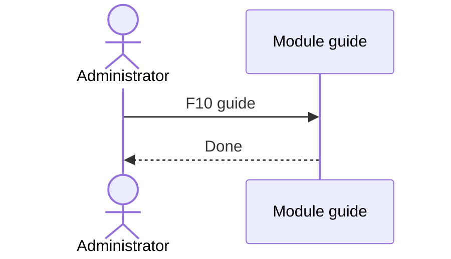

🏠 [Specs](../../../../README.md) › 🧩 [Functional capabilities](../../../README.md) ›
🧭 [F21 Onboarding and module activation](../../README.md) › 📝 [Use cases](../README.md) ›
📝 [Use cases: FL-F21-02 Modules](README.md) › 📝 UC-F21-11 Follow a module's short guide

# 📝 UC-F21-11 Follow a module's short guide

**Status:** ✅ specified

## Summary

The administrator follows a module's short guide.

## Personas

- [U07 Administrator](../../../../01-users/personas/u07-administrator.md)

## Goal

Module ready.

## Trigger

Module on.

## Frequency

Each module.

## Preconditions

- Module on.

## Postconditions

- Success: done.
- Failure: resumes.

## Main flow

1. Open (S-F21-11).
2. Answer.
3. Required steps first (BR-F21-07).
4. Done.

## Alternative flows

- 2a. Skip optional.

## Error flows

- 3e. Left: resumes.
- Any step: a service does not answer; the call is retried first (BR-F3-32), then the message follows the error pattern
  (D122) and what was typed stays on the screen.

## Business rules

- [BR-F21-05 Plain words with examples](../../business-rules/br-f21-05-plain-words-with-examples.md)
- [BR-F21-07 Required steps before the first legal document](../../business-rules/br-f21-07-required-steps-before-first-document.md)

## Entities

- [E-F21-01 Onboarding progress](../../data/e-f21-01-onboarding-progress.md)
- [E-F21-04 Module activation](../../data/e-f21-04-module-activation.md)
- [E-F21-18 Module guide](../../data/e-f21-18-module-guide.md)

## Permissions

Administrator.

## Notifications

- None.

## Audit events

Steps.

## AI involvement

Helps.

## API, MCP and A2A exposure

Through T5 and T6 with the caller's rights (BR-F3-34).

## Screens

- [S-F21-11 Module guide](../../screens/02-modules/s-f21-11-module-guide.md)

## Flowchart

See [FL-F21-02 Modules](../../flows/fl-f21-02-modules.md#flowchart).

## Sequence diagram

## Acceptance criteria

1. **Given** F10 **when** guide done **then** ready.
2. **Given** left **when** back **then** resumes.
3. **Given** required **when** skipped **then** refused.

## Non-functional notes

D408's targets ([Performance](../../../../05-non-functional/performance.md)): 95 % of screens within 1 second; lists
paged on the server, the first page within 1 second; reports within 5 seconds or in the background.

## Regulatory references

Set-up rules of the France country pack:
[CR-FR-001 Company identifiers](../../../../10-country-packs/france/company/cr-fr-001-company-identifiers.md),
[CR-FR-016 Electronic invoicing](../../../../10-country-packs/france/invoicing/cr-fr-016-electronic-invoicing.md),
[CR-FR-005 Accounting entries file (FEC)](../../../../10-country-packs/france/accounting/cr-fr-005-fec-export.md),
[CR-FR-038 Personnel register](../../../../10-country-packs/france/labour/cr-fr-038-personnel-register.md),
[CR-FR-048 Record of processing activities](../../../../10-country-packs/france/data-protection/cr-fr-048-record-of-processing.md),
[CR-FR-069 Website legal notices](../../../../10-country-packs/france/consumer/cr-fr-069-website-legal-notices.md).

## Related use cases

- [UC-F21-04 Switch modules on in one click](uc-f21-04-switch-modules-on-in-one-click.md)

## Open questions

None.

---

⬅️ [UC-F21-10 Connect email, calendar and bank](../03-team-and-data/uc-f21-10-connect-email-calendar-and-bank.md) ·
⬆️ [Up](README.md) ·
➡️ [UC-F21-12 Ask the AI assistant at any step](../01-first-run/uc-f21-12-ask-the-assistant-at-any-step.md)
