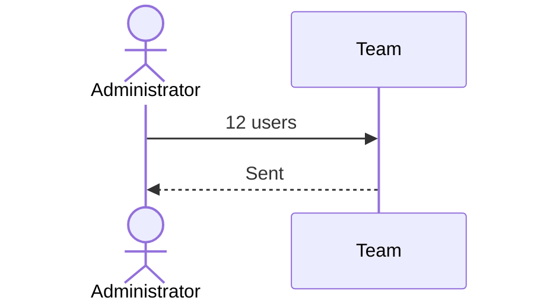

🏠 [Specs](../../../../README.md) › 🧩 [Functional capabilities](../../../README.md) ›
🧭 [F21 Onboarding and module activation](../../README.md) › 📝 [Use cases](../README.md) ›
📝 [Use cases: FL-F21-03 Team and data](README.md) › 📝 UC-F21-08 Invite users and give roles

# 📝 UC-F21-08 Invite users and give roles

**Status:** ✅ specified

## Summary

The administrator invites users and gives roles.

## Personas

- [U07 Administrator](../../../../01-users/personas/u07-administrator.md)

## Goal

Team in.

## Trigger

Guide.

## Frequency

Once then occasional.

## Preconditions

- None.

## Postconditions

- Success: invited.
- Failure: bounced.

## Main flow

1. Invite (S-F21-08).
2. Pick roles.
3. Send.
4. Accepted.

## Alternative flows

- 1a. The accountant (UC-F21-23).

## Error flows

- 3e. Bounce.
- Any step: a service does not answer; the call is retried first (BR-F3-32), then the message follows the error pattern
  (D122) and what was typed stays on the screen.

## Business rules

- [BR-F21-05 Plain words with examples](../../business-rules/br-f21-05-plain-words-with-examples.md)

## Entities

- [E-F1-04 Invitation](../../../f01-administration/data/e-f01-04-invitation.md)

## Permissions

Administrator.

## Notifications

- Invitees.

## Audit events

Invitations.

## AI involvement

From a list.

## API, MCP and A2A exposure

Through T5 and T6 with the caller's rights (BR-F3-34).

## Screens

- [S-F21-08 Team](../../screens/03-team-and-data/s-f21-08-team.md)

## Flowchart

See [FL-F21-03 Team and data](../../flows/fl-f21-03-team-and-data.md#flowchart).

## Sequence diagram

## Acceptance criteria

1. **Given** 12 **when** sent **then** 12 invited.
2. **Given** a bounce **when** sent **then** shown.
3. **Given** accepted **when** done **then** active.

## Non-functional notes

D408's targets ([Performance](../../../../05-non-functional/performance.md)): 95 % of screens within 1 second; lists
paged on the server, the first page within 1 second; reports within 5 seconds or in the background.

## Regulatory references

Set-up rules of the France country pack:
[CR-FR-001 Company identifiers](../../../../10-country-packs/france/company/cr-fr-001-company-identifiers.md),
[CR-FR-016 Electronic invoicing](../../../../10-country-packs/france/invoicing/cr-fr-016-electronic-invoicing.md),
[CR-FR-005 Accounting entries file (FEC)](../../../../10-country-packs/france/accounting/cr-fr-005-fec-export.md),
[CR-FR-038 Personnel register](../../../../10-country-packs/france/labour/cr-fr-038-personnel-register.md),
[CR-FR-048 Record of processing activities](../../../../10-country-packs/france/data-protection/cr-fr-048-record-of-processing.md),
[CR-FR-069 Website legal notices](../../../../10-country-packs/france/consumer/cr-fr-069-website-legal-notices.md).

## Related use cases

- [UC-F21-23 Invite the external accountant](uc-f21-23-invite-the-external-accountant.md)
- [UC-F21-25 Onboard on the phone as an employee](../04-learn-and-improve/uc-f21-25-onboard-on-the-phone-as-an-employee.md)

## Open questions

None.

---

⬅️ [UC-F21-07](../01-first-run/uc-f21-07-set-the-company-identity-vat-and-bank.md) · ⬆️ [Up](README.md) ·
➡️ [UC-F21-09 Import existing data](uc-f21-09-import-existing-data.md)
