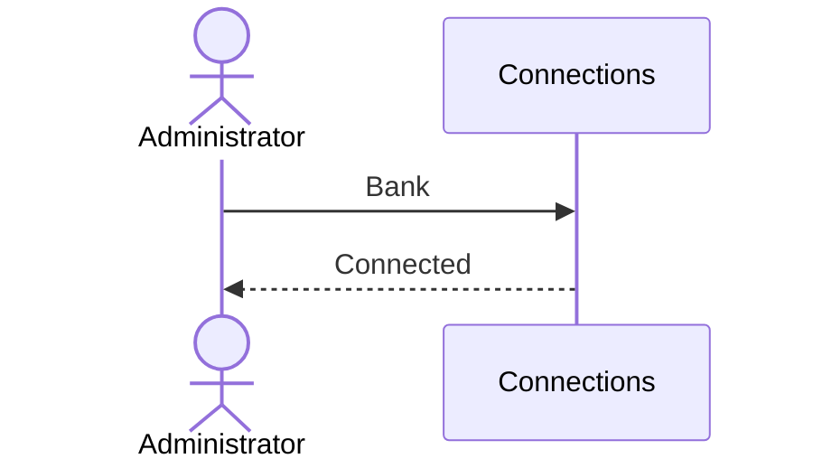

🏠 [Specs](../../../../README.md) › 🧩 [Functional capabilities](../../../README.md) ›
🧭 [F21 Onboarding and module activation](../../README.md) › 📝 [Use cases](../README.md) ›
📝 [Use cases: FL-F21-03 Team and data](README.md) › 📝 UC-F21-10 Connect email, calendar and bank

# 📝 UC-F21-10 Connect email, calendar and bank

**Status:** ✅ specified

## Summary

The administrator connects email, calendar and bank.

## Personas

- [U07 Administrator](../../../../01-users/personas/u07-administrator.md)

## Goal

Connected.

## Trigger

Guide.

## Frequency

Once.

## Preconditions

- None.

## Postconditions

- Success: connected.
- Failure: refused.

## Main flow

1. Choose (S-F21-10).
2. Sign in.
3. Test.
4. Connected.

## Alternative flows

- 1a. Later.

## Error flows

- 2e. Refused.
- Any step: a service does not answer; the call is retried first (BR-F3-32), then the message follows the error pattern
  (D122) and what was typed stays on the screen.

## Business rules

- [BR-F21-09 The AI assistant at every step](../../business-rules/br-f21-09-assistant-at-every-step.md)

## Entities

- [E-F24-02 Tool connection](../../../f24-integrations-hub/data/e-f24-02-tool-connection.md)

## Permissions

Administrator.

## Notifications

- Failures.

## Audit events

Connections.

## AI involvement

None.

## API, MCP and A2A exposure

Through T5 and T6 with the caller's rights (BR-F3-34).

## Screens

- [S-F21-10 Connections](../../screens/03-team-and-data/s-f21-10-connections.md)

## Flowchart

See [FL-F21-03 Team and data](../../flows/fl-f21-03-team-and-data.md#flowchart).

## Sequence diagram

## Acceptance criteria

1. **Given** bank **when** tested **then** ok.
2. **Given** refused **when** signing in **then** reason.
3. **Given** later **when** skipped **then** checklist.

## Non-functional notes

D408's targets ([Performance](../../../../05-non-functional/performance.md)): 95 % of screens within 1 second; lists
paged on the server, the first page within 1 second; reports within 5 seconds or in the background.

## Regulatory references

Set-up rules of the France country pack:
[CR-FR-001 Company identifiers](../../../../10-country-packs/france/company/cr-fr-001-company-identifiers.md),
[CR-FR-016 Electronic invoicing](../../../../10-country-packs/france/invoicing/cr-fr-016-electronic-invoicing.md),
[CR-FR-005 Accounting entries file (FEC)](../../../../10-country-packs/france/accounting/cr-fr-005-fec-export.md),
[CR-FR-038 Personnel register](../../../../10-country-packs/france/labour/cr-fr-038-personnel-register.md),
[CR-FR-048 Record of processing activities](../../../../10-country-packs/france/data-protection/cr-fr-048-record-of-processing.md),
[CR-FR-069 Website legal notices](../../../../10-country-packs/france/consumer/cr-fr-069-website-legal-notices.md).

## Related use cases

- [UC-F21-14 Follow the checklist and resume later](../04-learn-and-improve/uc-f21-14-follow-the-checklist-and-resume-later.md)

## Open questions

None.

---

⬅️ [UC-F21-09 Import existing data](uc-f21-09-import-existing-data.md) · ⬆️ [Up](README.md) ·
➡️ [UC-F21-11 Follow a module's short guide](../02-modules/uc-f21-11-follow-a-module-s-short-guide.md)
