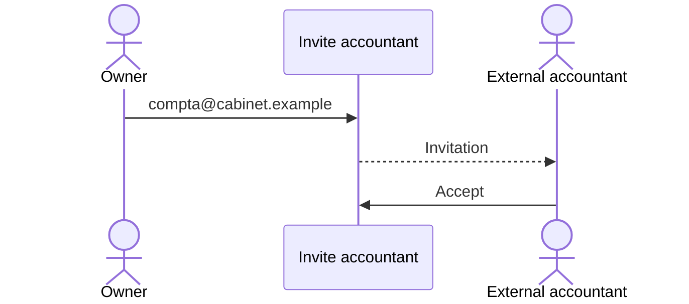

🏠 [Specs](../../../../README.md) › 🧩 [Functional capabilities](../../../README.md) ›
🧭 [F21 Onboarding and module activation](../../README.md) › 📝 [Use cases](../README.md) ›
📝 [Use cases: FL-F21-03 Team and data](README.md) › 📝 UC-F21-23 Invite the external accountant

# 📝 UC-F21-23 Invite the external accountant

**Status:** ✅ specified

## Summary

During onboarding the owner invites the external accountant, who joins with the accountant role for this company, linked
to their existing account if they have one.

## Personas

- [U13 Owner](../../../../01-users/personas/u13-owner.md)
- [U08 External accountant](../../../../01-users/personas/u08-external-accountant.md), who accepts

## Goal

The accountant helps from day one.

## Trigger

The team step of the guide.

## Frequency

Once per company.

## Preconditions

- The accountant's email.

## Postconditions

- Success: accountant joined.
- Failure: invitation expired.

## Main flow

1. The owner opens Invite your accountant (S-F21-23).
2. They type the email and firm.
3. simple-ERP sends the invitation with the accountant role (BR-F21-14).
4. The accountant accepts; the company appears in their list.

## Alternative flows

- 3a. Existing account: linked.

## Error flows

- 4e. Expired: resent.
- Any step: a service does not answer; the call is retried first (BR-F3-32), then the message follows the error pattern
  (D122) and what was typed stays on the screen.

## Business rules

- [BR-F21-14 The accountant joins with the accountant role](../../business-rules/br-f21-14-the-accountant-joins-with-the-accountant-role.md)

## Entities

- [E-F1-04 Invitation](../../../f01-administration/data/e-f01-04-invitation.md)

## Permissions

Owner and administrator.

## Notifications

- The owner when accepted.

## Audit events

Invitation.

## AI involvement

None.

## API, MCP and A2A exposure

Through the API (T5) and as AI assistant tools (T6), with the caller's rights (BR-F3-34).

## Screens

- [S-F21-23 Invite your accountant](../../screens/03-team-and-data/s-f21-23-invite-your-accountant.md)

## Flowchart

See [FL-F21-03 Team and data](../../flows/fl-f21-03-team-and-data.md#flowchart).

## Sequence diagram

## Acceptance criteria

1. **Given** a new email **when** invited **then** the accountant role only.
2. **Given** an accountant with 30 companies **when** invited **then** linked.
3. **Given** administrator asked **when** invited **then** refused.

## Non-functional notes

D408's targets ([Performance](../../../../05-non-functional/performance.md)): 95 % of screens within 1 second; lists
paged on the server, the first page within 1 second; reports within 5 seconds or in the background.

## Regulatory references

None.

## Related use cases

- [UC-F21-22 Check opening balances against last year's FEC](../05-migration-from-another-tool/uc-f21-22-check-opening-balances-against-last-years-fec.md)
- [UC-F21-08 Invite users and give roles](uc-f21-08-invite-users-and-give-roles.md)

## Open questions

None.

---

⬅️ [UC-F21-22](../05-migration-from-another-tool/uc-f21-22-check-opening-balances-against-last-years-fec.md) ·
⬆️ [Up](README.md) · ➡️ [UC-F21-24](../01-first-run/uc-f21-24-choose-the-companys-and-each-users-language.md)
