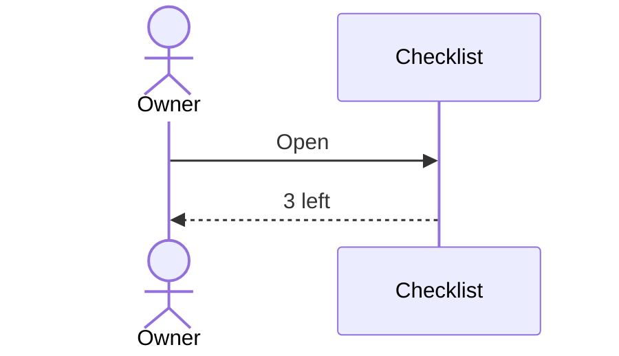

🏠 [Specs](../../../../README.md) › 🧩 [Functional capabilities](../../../README.md) ›
🧭 [F21 Onboarding and module activation](../../README.md) › 📝 [Use cases](../README.md) ›
📝 [Use cases: FL-F21-04 Learn and improve](README.md) › 📝 UC-F21-14 Follow the checklist and resume later

# 📝 UC-F21-14 Follow the checklist and resume later

**Status:** ✅ specified

## Summary

The owner follows the checklist and resumes.

## Personas

- [U13 Owner](../../../../01-users/personas/u13-owner.md)

## Goal

Finish set-up.

## Trigger

Any time.

## Frequency

Often.

## Preconditions

- None.

## Postconditions

- Success: done.
- Failure: none.

## Main flow

1. Open (S-F21-14).
2. Pick a step.
3. Finish.
4. See what is left.

## Alternative flows

- 2a. Required first.

## Error flows

- 3e. Left: resumes.
- Any step: a service does not answer; the call is retried first (BR-F3-32), then the message follows the error pattern
  (D122) and what was typed stays on the screen.

## Business rules

- [BR-F21-06 Resume anywhere](../../business-rules/br-f21-06-resume-anywhere.md)
- [BR-F21-07 Required steps before the first legal document](../../business-rules/br-f21-07-required-steps-before-first-document.md)

## Entities

- [E-F21-01 Onboarding progress](../../data/e-f21-01-onboarding-progress.md)

## Permissions

Owner.

## Notifications

- Reminders.

## Audit events

Steps.

## AI involvement

None.

## API, MCP and A2A exposure

Through T5 and T6 with the caller's rights (BR-F3-34).

## Screens

- [S-F21-14 Checklist](../../screens/04-learn-and-improve/s-f21-14-checklist.md)

## Flowchart

See [FL-F21-04 Learn and improve](../../flows/fl-f21-04-learn-and-improve.md#flowchart).

## Sequence diagram

## Acceptance criteria

1. **Given** 3 left **when** opened **then** shown.
2. **Given** done **when** finished **then** ticked.
3. **Given** required **when** left **then** first.

## Non-functional notes

D408's targets ([Performance](../../../../05-non-functional/performance.md)): 95 % of screens within 1 second; lists
paged on the server, the first page within 1 second; reports within 5 seconds or in the background.

## Regulatory references

Set-up rules of the France country pack:
[CR-FR-001 Company identifiers](../../../../10-country-packs/france/company/cr-fr-001-company-identifiers.md),
[CR-FR-016 Electronic invoicing](../../../../10-country-packs/france/invoicing/cr-fr-016-electronic-invoicing.md),
[CR-FR-005 Accounting entries file (FEC)](../../../../10-country-packs/france/accounting/cr-fr-005-fec-export.md),
[CR-FR-038 Personnel register](../../../../10-country-packs/france/labour/cr-fr-038-personnel-register.md),
[CR-FR-048 Record of processing activities](../../../../10-country-packs/france/data-protection/cr-fr-048-record-of-processing.md),
[CR-FR-069 Website legal notices](../../../../10-country-packs/france/consumer/cr-fr-069-website-legal-notices.md).

## Related use cases

- [UC-F21-01 Start the first-run guide](../01-first-run/uc-f21-01-start-the-first-run-guide.md)

## Open questions

None.

---

⬅️ [UC-F21-13 Try with demo data, then clear it](uc-f21-13-try-with-demo-data-then-clear-it.md) · ⬆️ [Up](README.md) ·
➡️ [UC-F21-15 Take an interactive tour of a screen](uc-f21-15-take-an-interactive-tour-of-a-screen.md)
