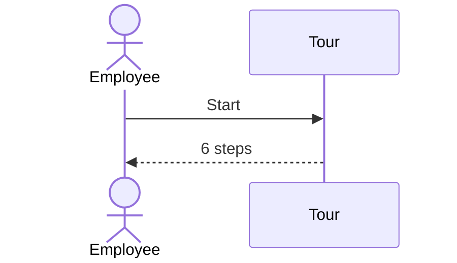

🏠 [Specs](../../../../README.md) › 🧩 [Functional capabilities](../../../README.md) ›
🧭 [F21 Onboarding and module activation](../../README.md) › 📝 [Use cases](../README.md) ›
📝 [Use cases: FL-F21-04 Learn and improve](README.md) › 📝 UC-F21-15 Take an interactive tour of a screen

# 📝 UC-F21-15 Take an interactive tour of a screen

**Status:** ✅ specified

## Summary

An employee takes an interactive tour of a screen.

## Personas

- [U01 Employee](../../../../01-users/personas/u01-employee.md)

## Goal

Learn a screen.

## Trigger

First visit.

## Frequency

Once per screen.

## Preconditions

- None.

## Postconditions

- Success: done.
- Failure: none.

## Main flow

1. Start (S-F21-15).
2. Follow.
3. Try.
4. Done.

## Alternative flows

- 1a. Skip.

## Error flows

- 2e. None.
- Any step: a service does not answer; the call is retried first (BR-F3-32), then the message follows the error pattern
  (D122) and what was typed stays on the screen.

## Business rules

- [BR-F21-05 Plain words with examples](../../business-rules/br-f21-05-plain-words-with-examples.md)

## Entities

- [E-F21-10 Tour](../../data/e-f21-10-tour.md)

## Permissions

Everyone.

## Notifications

- None.

## Audit events

None.

## AI involvement

None.

## API, MCP and A2A exposure

Through T5 and T6 with the caller's rights (BR-F3-34).

## Screens

- [S-F21-15 Tours](../../screens/04-learn-and-improve/s-f21-15-tours.md)

## Flowchart

See [FL-F21-04 Learn and improve](../../flows/fl-f21-04-learn-and-improve.md#flowchart).

## Sequence diagram

## Acceptance criteria

1. **Given** a tour **when** started **then** 6 steps.
2. **Given** skipped **when** skipped **then** not again.
3. **Given** tour **when** done **then** no data changed.

## Non-functional notes

D408's targets ([Performance](../../../../05-non-functional/performance.md)): 95 % of screens within 1 second; lists
paged on the server, the first page within 1 second; reports within 5 seconds or in the background.

## Regulatory references

Set-up rules of the France country pack:
[CR-FR-001 Company identifiers](../../../../10-country-packs/france/company/cr-fr-001-company-identifiers.md),
[CR-FR-016 Electronic invoicing](../../../../10-country-packs/france/invoicing/cr-fr-016-electronic-invoicing.md),
[CR-FR-005 Accounting entries file (FEC)](../../../../10-country-packs/france/accounting/cr-fr-005-fec-export.md),
[CR-FR-038 Personnel register](../../../../10-country-packs/france/labour/cr-fr-038-personnel-register.md),
[CR-FR-048 Record of processing activities](../../../../10-country-packs/france/data-protection/cr-fr-048-record-of-processing.md),
[CR-FR-069 Website legal notices](../../../../10-country-packs/france/consumer/cr-fr-069-website-legal-notices.md).

## Related use cases

- [UC-F21-17 Welcome an employee at first sign-in](uc-f21-17-welcome-an-employee-at-first-sign-in.md)

## Open questions

None.

---

⬅️ [UC-F21-14 Follow the checklist and resume later](uc-f21-14-follow-the-checklist-and-resume-later.md) ·
⬆️ [Up](README.md) · ➡️ [UC-F21-16 Check the legal set-up](../01-first-run/uc-f21-16-check-the-legal-set-up.md)
