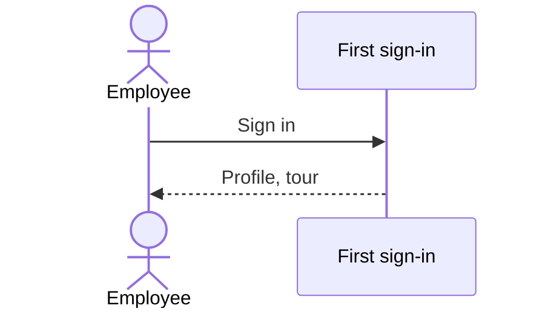

🏠 [Specs](../../../../README.md) › 🧩 [Functional capabilities](../../../README.md) ›
🧭 [F21 Onboarding and module activation](../../README.md) › 📝 [Use cases](../README.md) ›
📝 [Use cases: FL-F21-04 Learn and improve](README.md) › 📝 UC-F21-17 Welcome an employee at first sign-in

# 📝 UC-F21-17 Welcome an employee at first sign-in

**Status:** ✅ specified

## Summary

An employee is welcomed at first sign-in; on a phone the phone onboarding runs (UC-F21-25).

## Personas

- [U01 Employee](../../../../01-users/personas/u01-employee.md)

## Goal

Ready to work.

## Trigger

First sign-in.

## Frequency

Once.

## Preconditions

- Invited.

## Postconditions

- Success: ready.
- Failure: resumes.

## Main flow

1. Sign in (S-F21-17).
2. Set profile.
3. Short tour.
4. Done.

## Alternative flows

- 1a. On a phone: UC-F21-25.

## Error flows

- 2e. Left: resumes.
- Any step: a service does not answer; the call is retried first (BR-F3-32), then the message follows the error pattern
  (D122) and what was typed stays on the screen.

## Business rules

- [BR-F21-05 Plain words with examples](../../business-rules/br-f21-05-plain-words-with-examples.md)
- [BR-F21-16 Employees onboard on the phone](../../business-rules/br-f21-16-employees-onboard-on-the-phone.md)

## Entities

- [E-F1-04 Invitation](../../../f01-administration/data/e-f01-04-invitation.md)
- [E-F21-10 Tour](../../data/e-f21-10-tour.md)

## Permissions

Employee.

## Notifications

- Administrator.

## Audit events

Steps.

## AI involvement

Helps.

## API, MCP and A2A exposure

Through T5 and T6 with the caller's rights (BR-F3-34).

## Screens

- [S-F21-17 First sign-in](../../screens/04-learn-and-improve/s-f21-17-first-sign-in.md)

## Flowchart

See [FL-F21-04 Learn and improve](../../flows/fl-f21-04-learn-and-improve.md#flowchart).

## Sequence diagram

## Acceptance criteria

1. **Given** desktop **when** signing in **then** profile and tour.
2. **Given** phone **when** signing in **then** phone onboarding.
3. **Given** left **when** back **then** resumes.

## Non-functional notes

D408's targets ([Performance](../../../../05-non-functional/performance.md)): 95 % of screens within 1 second; lists
paged on the server, the first page within 1 second; reports within 5 seconds or in the background.

## Regulatory references

Set-up rules of the France country pack:
[CR-FR-001 Company identifiers](../../../../10-country-packs/france/company/cr-fr-001-company-identifiers.md),
[CR-FR-016 Electronic invoicing](../../../../10-country-packs/france/invoicing/cr-fr-016-electronic-invoicing.md),
[CR-FR-005 Accounting entries file (FEC)](../../../../10-country-packs/france/accounting/cr-fr-005-fec-export.md),
[CR-FR-038 Personnel register](../../../../10-country-packs/france/labour/cr-fr-038-personnel-register.md),
[CR-FR-048 Record of processing activities](../../../../10-country-packs/france/data-protection/cr-fr-048-record-of-processing.md),
[CR-FR-069 Website legal notices](../../../../10-country-packs/france/consumer/cr-fr-069-website-legal-notices.md).

## Related use cases

- [UC-F21-25 Onboard on the phone as an employee](uc-f21-25-onboard-on-the-phone-as-an-employee.md)

## Open questions

None.

---

⬅️ [UC-F21-16 Check the legal set-up](../01-first-run/uc-f21-16-check-the-legal-set-up.md) · ⬆️ [Up](README.md) ·
➡️ [UC-F21-18](../02-modules/uc-f21-18-see-what-each-module-costs-in-the-hosted-edition.md)
