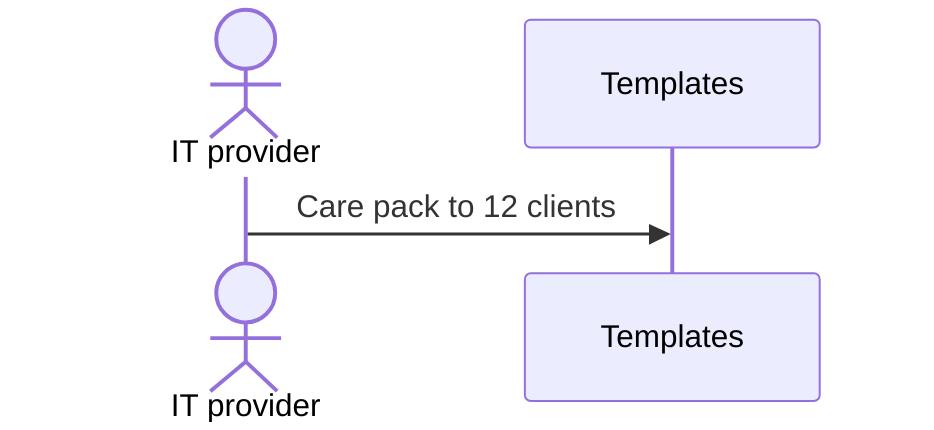

🏠 [Specs](../../../../README.md) › 🧩 [Functional capabilities](../../../README.md) ›
🧭 [F21 Onboarding and module activation](../../README.md) › 📝 [Use cases](../README.md) ›
📝 [Use cases: FL-F21-04 Learn and improve](README.md) › 📝 UC-F21-19 Reuse a set-up for several clients

# 📝 UC-F21-19 Reuse a set-up for several clients

**Status:** ✅ specified

## Summary

An IT provider reuses a set-up for several clients.

## Personas

- [U11 IT provider administrator](../../../../01-users/personas/u11-provider-admin.md)

## Goal

Fast client set-up.

## Trigger

New client.

## Frequency

Often.

## Preconditions

- Template.

## Postconditions

- Success: applied.
- Failure: none.

## Main flow

1. Save (S-F21-19).
2. Apply to a client.
3. Adjust.
4. Done.

## Alternative flows

- 2a. Several clients.

## Error flows

- 2e. Country differs: pack applies.
- Any step: a service does not answer; the call is retried first (BR-F3-32), then the message follows the error pattern
  (D122) and what was typed stays on the screen.

## Business rules

- [BR-F21-01 The legal set-up comes from the country pack](../../business-rules/br-f21-01-legal-set-up-from-the-country-pack.md)

## Entities

- [E-F21-03 Set-up template](../../data/e-f21-03-set-up-template.md)
- [E-F21-12 Provider set-up](../../data/e-f21-12-provider-set-up.md)

## Permissions

IT provider.

## Notifications

- None.

## Audit events

Applications.

## AI involvement

None.

## API, MCP and A2A exposure

Through T5 and T6 with the caller's rights (BR-F3-34).

## Screens

- [S-F21-19 Provider templates](../../screens/04-learn-and-improve/s-f21-19-provider-templates.md)

## Flowchart

See [FL-F21-04 Learn and improve](../../flows/fl-f21-04-learn-and-improve.md#flowchart).

## Sequence diagram

## Acceptance criteria

1. **Given** a template **when** applied **then** set up.
2. **Given** 12 clients **when** applied **then** 12.
3. **Given** another country **when** applied **then** its pack.

## Non-functional notes

D408's targets ([Performance](../../../../05-non-functional/performance.md)): 95 % of screens within 1 second; lists
paged on the server, the first page within 1 second; reports within 5 seconds or in the background.

## Regulatory references

Set-up rules of the France country pack:
[CR-FR-001 Company identifiers](../../../../10-country-packs/france/company/cr-fr-001-company-identifiers.md),
[CR-FR-016 Electronic invoicing](../../../../10-country-packs/france/invoicing/cr-fr-016-electronic-invoicing.md),
[CR-FR-005 Accounting entries file (FEC)](../../../../10-country-packs/france/accounting/cr-fr-005-fec-export.md),
[CR-FR-038 Personnel register](../../../../10-country-packs/france/labour/cr-fr-038-personnel-register.md),
[CR-FR-048 Record of processing activities](../../../../10-country-packs/france/data-protection/cr-fr-048-record-of-processing.md),
[CR-FR-069 Website legal notices](../../../../10-country-packs/france/consumer/cr-fr-069-website-legal-notices.md).

## Related use cases

- [UC-F21-03 Pick a sector template](../01-first-run/uc-f21-03-pick-a-sector-template.md)

## Open questions

None.

---

⬅️ [UC-F21-18](../02-modules/uc-f21-18-see-what-each-module-costs-in-the-hosted-edition.md) · ⬆️ [Up](README.md) ·
➡️ [UC-F21-20 Measure onboarding and drop-offs](uc-f21-20-measure-onboarding-and-drop-offs.md)
