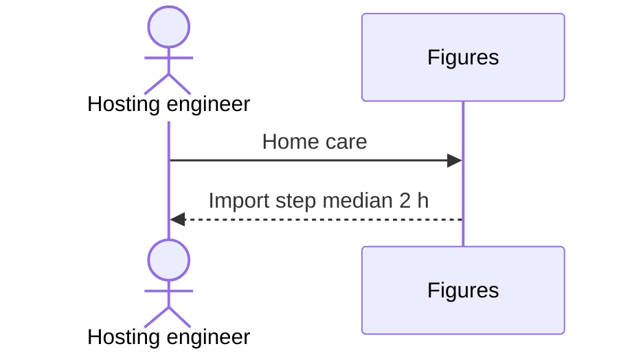

🏠 [Specs](../../../../README.md) › 🧩 [Functional capabilities](../../../README.md) ›
🧭 [F21 Onboarding and module activation](../../README.md) › 📝 [Use cases](../README.md) ›
📝 [Use cases: FL-F21-04 Learn and improve](README.md) › 📝 UC-F21-20 Measure onboarding and drop-offs

# 📝 UC-F21-20 Measure onboarding and drop-offs

**Status:** ✅ specified

## Summary

The hosting engineer and the owner measure onboarding and drop-offs, per company, never per person.

## Personas

- [U48 Hosting engineer](../../../../01-users/personas/u48-hosting-engineer.md)
- [U13 Owner](../../../../01-users/personas/u13-owner.md)

## Goal

Improve the guide.

## Trigger

Monthly.

## Frequency

Monthly.

## Preconditions

- Data.

## Postconditions

- Success: read.
- Failure: none.

## Main flow

1. Open (S-F21-20).
2. Read (BR-F21-11).
3. Find drop-offs.
4. Improve.

## Alternative flows

- 2a. Per sector.

## Error flows

- 1e. No data.
- Any step: a service does not answer; the call is retried first (BR-F3-32), then the message follows the error pattern
  (D122) and what was typed stays on the screen.

## Business rules

- [BR-F21-11 Onboarding measured without people](../../business-rules/br-f21-11-onboarding-measured-anonymously.md)

## Entities

- [E-F21-13 Onboarding figure](../../data/e-f21-13-onboarding-figure.md)

## Permissions

Hosting engineer; owner own.

## Notifications

- None.

## Audit events

None.

## AI involvement

None.

## API, MCP and A2A exposure

Through T5 and T6 with the caller's rights (BR-F3-34).

## Screens

- [S-F21-20 Onboarding figures](../../screens/04-learn-and-improve/s-f21-20-onboarding-figures.md)

## Flowchart

See [FL-F21-04 Learn and improve](../../flows/fl-f21-04-learn-and-improve.md#flowchart).

## Sequence diagram

## Acceptance criteria

1. **Given** 40 companies **when** read **then** median 2 h at import.
2. **Given** per person **when** asked **then** refused.
3. **Given** migrations **when** counted **then** per tool.

## Non-functional notes

D408's targets ([Performance](../../../../05-non-functional/performance.md)): 95 % of screens within 1 second; lists
paged on the server, the first page within 1 second; reports within 5 seconds or in the background.

## Regulatory references

Set-up rules of the France country pack:
[CR-FR-001 Company identifiers](../../../../10-country-packs/france/company/cr-fr-001-company-identifiers.md),
[CR-FR-016 Electronic invoicing](../../../../10-country-packs/france/invoicing/cr-fr-016-electronic-invoicing.md),
[CR-FR-005 Accounting entries file (FEC)](../../../../10-country-packs/france/accounting/cr-fr-005-fec-export.md),
[CR-FR-038 Personnel register](../../../../10-country-packs/france/labour/cr-fr-038-personnel-register.md),
[CR-FR-048 Record of processing activities](../../../../10-country-packs/france/data-protection/cr-fr-048-record-of-processing.md),
[CR-FR-069 Website legal notices](../../../../10-country-packs/france/consumer/cr-fr-069-website-legal-notices.md).

## Related use cases

- [UC-F21-21 Migrate from a named tool](../05-migration-from-another-tool/uc-f21-21-migrate-from-a-named-tool.md)

## Open questions

None.

---

⬅️ [UC-F21-19 Reuse a set-up for several clients](uc-f21-19-reuse-a-set-up-for-several-clients.md) ·
⬆️ [Up](README.md) ·
➡️ [UC-F21-21 Migrate from a named tool](../05-migration-from-another-tool/uc-f21-21-migrate-from-a-named-tool.md)
