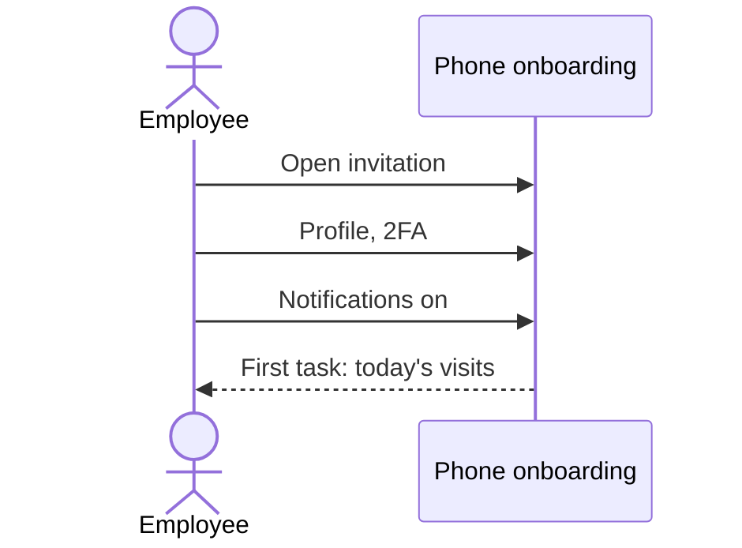

🏠 [Specs](../../../../README.md) › 🧩 [Functional capabilities](../../../README.md) ›
🧭 [F21 Onboarding and module activation](../../README.md) › 📝 [Use cases](../README.md) ›
📝 [Use cases: FL-F21-04 Learn and improve](README.md) › 📝 UC-F21-25 Onboard on the phone as an employee

# 📝 UC-F21-25 Onboard on the phone as an employee

**Status:** ✅ specified

## Summary

An employee opens the invitation on the phone and completes profile, password and two-factor, notifications and a first
task of their role, resuming where they stopped.

## Personas

- [U01 Employee](../../../../01-users/personas/u01-employee.md)

## Goal

Ready to work from the phone in minutes.

## Trigger

An invitation opened on a phone.

## Frequency

Each new employee.

## Preconditions

- Invited (UC-F21-08).

## Postconditions

- Success: account active, first task done.
- Failure: resumes later.

## Main flow

1. The employee opens the invitation on the phone (S-F21-25).
2. They set the profile and the language.
3. They set password and two-factor.
4. They allow notifications.
5. They do the first task of their role (BR-F21-16).

## Alternative flows

- 5a. A carer: today's visits.

## Error flows

- 3e. Link expired: asks again.
- Any step: a service does not answer; the call is retried first (BR-F3-32), then the message follows the error pattern
  (D122) and what was typed stays on the screen.

## Business rules

- [BR-F21-16 Employees onboard on the phone](../../business-rules/br-f21-16-employees-onboard-on-the-phone.md)

## Entities

- [E-F21-01 Onboarding progress](../../data/e-f21-01-onboarding-progress.md)

## Permissions

The employee.

## Notifications

- The administrator when done.

## Audit events

Steps.

## AI involvement

The AI assistant helps on each step.

## API, MCP and A2A exposure

Through the API (T5) and as AI assistant tools (T6), with the caller's rights (BR-F3-34).

## Screens

- [S-F21-25 Phone onboarding](../../screens/04-learn-and-improve/s-f21-25-phone-onboarding.md)

## Flowchart

See [FL-F21-04 Learn and improve](../../flows/fl-f21-04-learn-and-improve.md#flowchart).

## Sequence diagram

## Acceptance criteria

1. **Given** a carer of the home-care example company **when** onboarding on the phone **then** 4 steps then today's
   visits.
2. **Given** stopped after step 2 **when** back **then** resumes at step 3.
3. **Given** an expired link **when** opened **then** asks again.

## Non-functional notes

D408's targets ([Performance](../../../../05-non-functional/performance.md)): 95 % of screens within 1 second; lists
paged on the server, the first page within 1 second; reports within 5 seconds or in the background.

## Regulatory references

None.

## Related use cases

- [UC-F21-17 Welcome an employee at first sign-in](uc-f21-17-welcome-an-employee-at-first-sign-in.md)
- [UC-F21-24 Choose the company's and each user's language](../01-first-run/uc-f21-24-choose-the-companys-and-each-users-language.md)

## Open questions

None.

---

⬅️ [UC-F21-24](../01-first-run/uc-f21-24-choose-the-companys-and-each-users-language.md) · ⬆️ [Up](README.md) ·
➡️ [UC-F21-26](../06-experts-cutover-and-parallel-run/uc-f21-26-book-an-implementation-expert.md)
