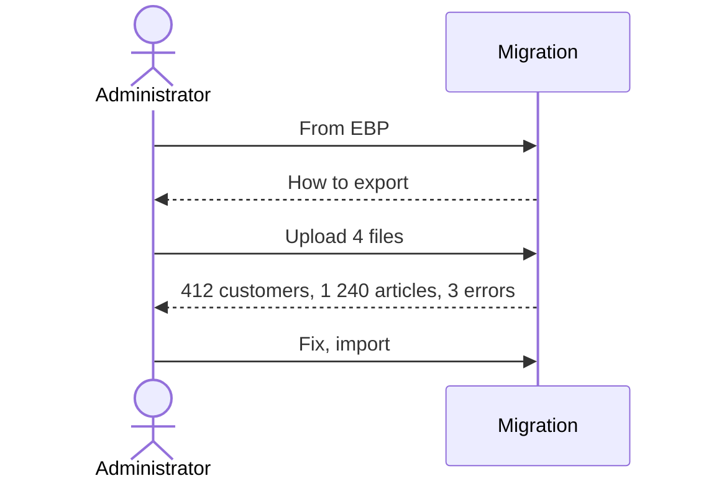

🏠 [Specs](../../../../README.md) › 🧩 [Functional capabilities](../../../README.md) ›
🧭 [F21 Onboarding and module activation](../../README.md) › 📝 [Use cases](../README.md) ›
📝 [Use cases: FL-F21-05 Migration from another tool](README.md) › 📝 UC-F21-21 Migrate from a named tool

# 📝 UC-F21-21 Migrate from a named tool

**Status:** ✅ specified

## Summary

The administrator, helped by the external accountant, picks the tool the company used before; the guide shows how to
export from it, reads its files with a ready mapping and imports partners, products, open items and balances.

## Personas

- [U07 Administrator](../../../../01-users/personas/u07-administrator.md)
- [U08 External accountant](../../../../01-users/personas/u08-external-accountant.md), who provides the FEC and checks
  the result

## Goal

Start with the company's real data in an afternoon.

## Trigger

Onboarding of a company that used another tool.

## Frequency

Once per company.

## Preconditions

- Modules for the data are on (UC-F21-04).

## Postconditions

- Success: data imported, rows in error listed.
- Failure: nothing imported; the files kept for a new try.

## Main flow

1. The administrator opens Migration (S-F21-21) and picks "EBP".
2. The guide shows how to export each file from EBP.
3. The administrator uploads them; simple-ERP recognises the format and applies the ready mapping (BR-F21-12).
4. A preview shows counts and rows in error.
5. The administrator imports; balances go to the check (UC-F21-22).

## Alternative flows

- 1a. Excel: the generic import opens (UC-F21-09).
- 3a. The AI assistant reads an unusual column and proposes its mapping.

## Error flows

- 3e. Unsupported version: generic import offered.
- 4e. Rows in error: listed with the reason, fixed and uploaded again.
- Any step: a service does not answer; the call is retried first (BR-F3-32), then the message follows the error pattern
  (D122) and what was typed stays on the screen.

## Business rules

- [BR-F21-12 Migrations read the old tool's known formats](../../business-rules/br-f21-12-migrations-read-the-old-tools-known-formats.md)

## Entities

- [E-F21-14 Migration source](../../data/e-f21-14-migration-source.md)
- [E-F21-07 Import job](../../data/e-f21-07-import-job.md)
- [E-F21-17 Migration guide](../../data/e-f21-17-migration-guide.md)

## Permissions

Administrator and owner; the external accountant uploads accounting files.

## Notifications

- The administrator when an import ends.

## Audit events

Files, mapping, counts and errors.

## AI involvement

The AI assistant maps unusual columns; the administrator confirms.

## API, MCP and A2A exposure

Through the API (T5) and as AI assistant tools (T6), with the caller's rights (BR-F3-34).

## Screens

- [S-F21-21 Migration](../../screens/05-migration-from-another-tool/s-f21-21-migration.md)

## Flowchart

See [FL-F21-05 Migration from another tool](../../flows/fl-f21-05-migration-from-another-tool.md#flowchart).

## Sequence diagram

## Acceptance criteria

1. **Given** the retail example company's EBP exports with 412 customers **when** uploaded **then** the ready mapping
   shows 412 customers to import.
2. **Given** 3 customers with an invalid SIRET **when** previewed **then** they are listed, not imported.
3. **Given** an Excel sheet **when** chosen **then** the generic import opens.
4. **Given** the import done **when** finished **then** the old tool is unchanged and the counts are logged.

## Non-functional notes

D408's targets ([Performance](../../../../05-non-functional/performance.md)): 95 % of screens within 1 second; lists
paged on the server, the first page within 1 second; reports within 5 seconds or in the background.

## Regulatory references

[CR-FR-001 Company identifiers](../../../../10-country-packs/france/company/cr-fr-001-company-identifiers.md).

## Related use cases

- [UC-F21-22 Check opening balances against last year's FEC](uc-f21-22-check-opening-balances-against-last-years-fec.md)
- [UC-F21-09 Import existing data](../03-team-and-data/uc-f21-09-import-existing-data.md)

## Open questions

None.

---

⬅️ [UC-F21-20 Measure onboarding and drop-offs](../04-learn-and-improve/uc-f21-20-measure-onboarding-and-drop-offs.md) ·
⬆️ [Up](README.md) · ➡️ [UC-F21-22](uc-f21-22-check-opening-balances-against-last-years-fec.md)
