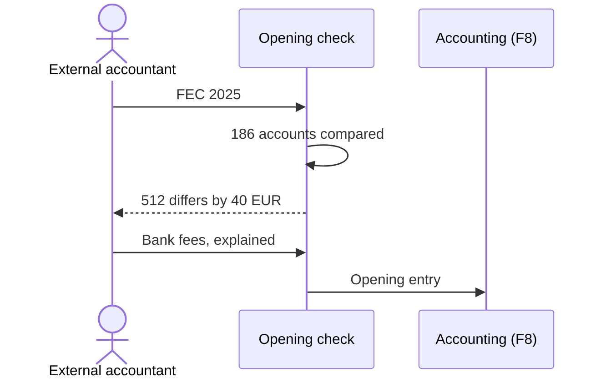

🏠 [Specs](../../../../README.md) › 🧩 [Functional capabilities](../../../README.md) ›
🧭 [F21 Onboarding and module activation](../../README.md) › 📝 [Use cases](../README.md) ›
📝 [Use cases: FL-F21-05 Migration from another tool](README.md) ›
📝 UC-F21-22 Check opening balances against last year's FEC

# 📝 UC-F21-22 Check opening balances against last year's FEC

**Status:** ✅ specified

## Summary

The external accountant uploads last year's FEC; simple-ERP compares its closing balances with the opening balances per
account and posts the opening entry only when they match or each difference is explained.

## Personas

- [U08 External accountant](../../../../01-users/personas/u08-external-accountant.md)
- [U05 Accounting](../../../../01-users/personas/u05-accounting.md)

## Goal

The books continue exactly from the last closing.

## Trigger

Balances imported (UC-F21-21) or entered.

## Frequency

Once per company.

## Preconditions

- F8 is on; last year's FEC is available.

## Postconditions

- Success: opening entry posted.
- Failure: differences listed, entry not posted.

## Main flow

1. The accountant opens Opening balance check (S-F21-22) and uploads the FEC.
2. simple-ERP checks the FEC's format and reads its closing balances.
3. It compares them with the opening balances per account (BR-F21-13).
4. The accountant corrects or explains each difference.
5. The opening entry is posted in F8.

## Alternative flows

- 1a. First year: no FEC, check skipped.

## Error flows

- 2e. Invalid FEC: refused with the line.
- 3e. Differences: not posted until handled.
- Any step: a service does not answer; the call is retried first (BR-F3-32), then the message follows the error pattern
  (D122) and what was typed stays on the screen.

## Business rules

- [BR-F21-13 Opening balances match last year's FEC](../../business-rules/br-f21-13-opening-balances-match-last-years-fec.md)

## Entities

- [E-F21-15 Opening balance check](../../data/e-f21-15-opening-balance-check.md)
- [E-F8-27 FEC file](../../../f08-accounting/data/e-f08-27-fec-file.md)

## Permissions

External accountant and accounting.

## Notifications

- The owner when the opening entry is posted.

## Audit events

Check and explanations.

## AI involvement

The AI assistant suggests causes of differences.

## API, MCP and A2A exposure

Through the API (T5) and as AI assistant tools (T6), with the caller's rights (BR-F3-34).

## Screens

- [S-F21-22 Opening balance check](../../screens/05-migration-from-another-tool/s-f21-22-opening-balance-check.md)

## Flowchart

See [FL-F21-05 Migration from another tool](../../flows/fl-f21-05-migration-from-another-tool.md#flowchart).

## Sequence diagram

## Acceptance criteria

1. **Given** account 411 at 48 210.00 in both **when** compared **then** it passes.
2. **Given** 512 differing by 40.00 **when** compared **then** it is listed and the entry not posted.
3. **Given** the difference explained **when** saved **then** the entry is posted with the note.
4. **Given** an invalid FEC **when** uploaded **then** refused with the line.

## Non-functional notes

D408's targets ([Performance](../../../../05-non-functional/performance.md)): 95 % of screens within 1 second; lists
paged on the server, the first page within 1 second; reports within 5 seconds or in the background.

## Regulatory references

[CR-FR-005 FEC export](../../../../10-country-packs/france/accounting/cr-fr-005-fec-export.md).

## Related use cases

- [UC-F21-21 Migrate from a named tool](uc-f21-21-migrate-from-a-named-tool.md)
- [UC-F21-23 Invite the external accountant](../03-team-and-data/uc-f21-23-invite-the-external-accountant.md)

## Open questions

None.

---

⬅️ [UC-F21-21 Migrate from a named tool](uc-f21-21-migrate-from-a-named-tool.md) · ⬆️ [Up](README.md) ·
➡️ [UC-F21-23 Invite the external accountant](../03-team-and-data/uc-f21-23-invite-the-external-accountant.md)
