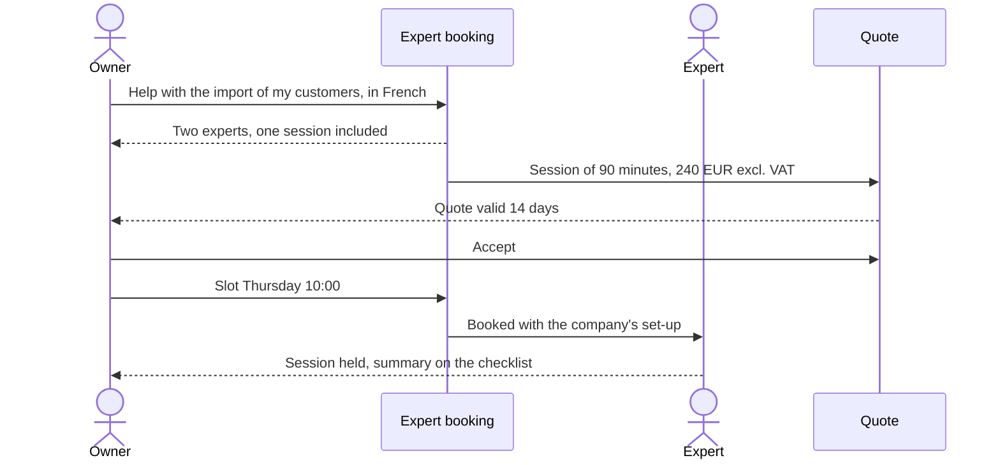

🏠 [Specs](../../../../README.md) › 🧩 [Functional capabilities](../../../README.md) ›
🧭 [F21 Onboarding and module activation](../../README.md) › 📝 [Use cases](../README.md) ›
📝 [Use cases: FL-F21-06 Experts, cutover, parallel run and set-up from documents](README.md) ›
📝 UC-F21-26 Book an implementation expert

# 📝 UC-F21-26 Book an implementation expert

**Status:** ✅ specified

## Summary

The owner who does not want to set up alone books a session with an implementation expert: a person of the SimpleERP
team or of an implementation partner who helps with the set-up, an import, a migration or the go-live. Any session that
is paid is quoted first with its scope, duration and price, and is booked only after the owner accepts the quote.

## Personas

- [U13 Owner](../../../../01-users/personas/u13-owner.md)

## Goal

The owner gets human help at the hard steps of the set-up, at a price known before it is booked.

## Trigger

The owner asks for help at a step of the first-run guide
([UC-F21-01](../01-first-run/uc-f21-01-start-the-first-run-guide.md)), or opens the expert booking screen.

## Frequency

One to five sessions during the first months of a company.

## Preconditions

- The company has an onboarding in progress
  ([E-F21-01 Onboarding progress](../../data/e-f21-01-onboarding-progress.md)).
- Experts and their topics are listed, with the partners of the store
  ([E-F14-24 Partner listing](../../../f14-plugin-store/data/e-f14-24-partner-listing.md)).

## Postconditions

- **Succeeded:** the session is saved ([E-F21-19 Expert session](../../data/e-f21-19-expert-session.md)) with its topic,
  its expert, its slot, its language and, when paid, the accepted quote; after the session the expert records what was
  done and what remains.
- **Failed:** no session is booked and nothing is charged; the screen says whether the quote was not accepted or no slot
  fits.

## Main flow

1. The owner opens the expert booking screen
   ([S-F21-26](../../screens/06-experts-cutover-and-parallel-run/s-f21-26-expert-booking.md)) and picks a topic (set-up,
   import, migration, training, go-live) and the language.
2. SimpleERP shows the experts who cover the topic and the language, each with their kind (SimpleERP team or partner),
   their rating and whether the session is included in the plan.
3. For a paid session the owner receives a quote with the scope, the length, the price excluding VAT and the validity
   (14 days); the owner reads it and accepts or declines
   ([BR-F21-17](../../business-rules/br-f21-17-paid-sessions-are-quoted-before-booking.md)).
4. After acceptance the owner picks a slot among the expert's free times and the session is Booked; both sides get the
   invitation.
5. At the time the expert and the owner work together, by video, on the company's own set-up; the owner may grant a
   time-limited view of the screen
   [UC-F20-30](../../../f20-hosted-support-assistant/use-cases/08-engineers-sharing-and-reports/uc-f20-30-share-the-screen-or-a-time-limited-view.md).
6. The expert records what was done and what is left in the onboarding checklist
   ([UC-F21-14](../04-learn-and-improve/uc-f21-14-follow-the-checklist-and-resume-later.md)); the session becomes Held
   and the invoice is issued.

## Alternative flows

- 3a. The session is included in the plan: no quote is needed and the screen shows that it is included.
- 4a. The owner moves the session at least 2 working days before: it moves with no charge.
- 6a. The work needs a second session: the expert proposes one and a new quote follows.

## Error flows

- 3e. The quote is not accepted within 14 days: it expires and no slot is held.
- 4e. No expert covers the language: the owner is offered English with the expert's name, or a wait.
- 6e. The expert does not come: the session is rebooked at no charge and the owner is told.
- Any step: a service does not answer; the call is retried first
  ([BR-F3-32](../../../f03-assistant/business-rules/br-f03-32-retry-before-an-error.md)), then the message follows the
  error pattern ([D122](../../../../06-decisions/ux/d122-error-message-standard.md)) and what the user typed stays on
  the screen.

## Business rules

- [BR-F21-17](../../business-rules/br-f21-17-paid-sessions-are-quoted-before-booking.md)
- [BR-F21-09](../../business-rules/br-f21-09-assistant-at-every-step.md)
- [BR-F21-10](../../business-rules/br-f21-10-hosted-prices-shown-first.md)

## Entities

- [E-F21-19 Expert session](../../data/e-f21-19-expert-session.md): created, changed
- [E-F21-01 Onboarding progress](../../data/e-f21-01-onboarding-progress.md): read and changed, the checklist
- [E-F14-24 Partner listing](../../../f14-plugin-store/data/e-f14-24-partner-listing.md): read, the partner listings
- [E-F21-02 Company profile](../../data/e-f21-02-company-profile.md): read, the company profile
- [E-F19-09 Hosted invoice](../../../f19-feature-factory/data/e-f19-09-hosted-invoice.md): read, the way hosted invoices
  are issued

## Permissions

The owner books, accepts quotes and cancels. An administrator may book on the owner's behalf; the owner
accepts quotes only.

## Notifications

The owner, by email and in the app: the quote, the confirmation, a reminder the day before, the report of the session.

## Audit events

Each quote, acceptance, refusal, booking, move, cancellation and session held, with the price shown, who and when.

## AI involvement

No AI step of its own. The AI assistant may open the screen and prefill it from the user's words; the user checks and
confirms ([BR-F3-07](../../../f03-assistant/business-rules/br-f03-07-no-deletes-no-irreversible-acts.md)).

## API, MCP and A2A exposure

T5 operations of the capability for the personas above: create, read, update and list. The MCP tool of the
capability may read and propose, never confirm alone. No A2A skill.

## Screens

- [S-F21-26](../../screens/06-experts-cutover-and-parallel-run/s-f21-26-expert-booking.md)

## Flowchart

See
[FL-F21-06 Experts, cutover, parallel run and set-up from documents](../../flows/fl-f21-06-experts-cutover-and-parallel-run.md#flowchart).

## Sequence diagram

## Acceptance criteria

1. **Given** a paid session **when** the owner wants to book **then** a quote with scope, length and price is shown
   first and no slot is held until it is accepted.
2. **Given** a session included in the plan **when** the owner books **then** no quote is needed and the price shown is
   zero.
3. **Given** a quote older than 14 days **when** the owner tries to accept it **then** it has expired and a new one is
   offered.
4. **Given** a session held **when** the expert records the summary **then** the checklist shows what was done and what
   remains.

## Non-functional notes

The screen answers within 2 seconds for 10,000 records; every change is audited.

## Regulatory references

A paid session is a service sold with its price shown before the order and the VAT of the customer's country
added on the invoice
([CR-FR-015](../../../../10-country-packs/france/invoicing/cr-fr-015-invoice-mandatory-mentions.md),
[CR-FR-100](../../../../10-country-packs/france/tax-and-vat/cr-fr-100-vat-on-services-abroad.md)); an expert who sees
personal data does so under the processor terms
([CR-FR-049](../../../../10-country-packs/france/data-protection/cr-fr-049-processors-and-transfers.md)) and only on the
owner's own set-up.

## Related use cases

- [UC-F21-27 Run the go-live cutover](uc-f21-27-run-the-go-live-cutover.md)
- [UC-F21-01 Start the first-run guide](../01-first-run/uc-f21-01-start-the-first-run-guide.md)
- [UC-F21-14](../04-learn-and-improve/uc-f21-14-follow-the-checklist-and-resume-later.md)
- [UC-F21-27 Run the go-live cutover](uc-f21-27-run-the-go-live-cutover.md)
- [UC-F21-21](../05-migration-from-another-tool/uc-f21-21-migrate-from-a-named-tool.md)
- [UC-F14-31](../../../f14-plugin-store/use-cases/08-trials-instances-and-partners/uc-f14-31-find-an-implementation-partner.md)
- [UC-F20-29](../../../f20-hosted-support-assistant/use-cases/08-engineers-sharing-and-reports/uc-f20-29-book-a-call-with-an-engineer.md)

## Open questions

None.

---

⬅️ [UC-F21-25](../04-learn-and-improve/uc-f21-25-onboard-on-the-phone-as-an-employee.md) · ⬆️ [Up](README.md) ·
➡️ [UC-F21-27 Run the go-live cutover](uc-f21-27-run-the-go-live-cutover.md)
