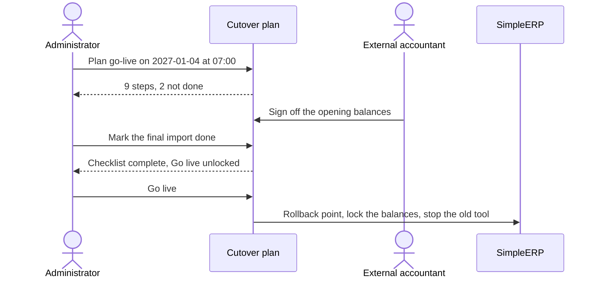

🏠 [Specs](../../../../README.md) › 🧩 [Functional capabilities](../../../README.md) ›
🧭 [F21 Onboarding and module activation](../../README.md) › 📝 [Use cases](../README.md) ›
📝 [Use cases: FL-F21-06 Experts, cutover, parallel run and set-up from documents](README.md) ›
📝 UC-F21-27 Run the go-live cutover

# 📝 UC-F21-27 Run the go-live cutover

**Status:** ✅ specified

## Summary

The administrator plans and runs the day the company stops using its old tools and works only in SimpleERP: a dated
plan with a checklist (last export of the old tool, final import, opening balances checked, users invited, backup taken,
legal check passed), an owner for each step, a rollback point, and a go-live button that stays locked until the
checklist is complete. The external accountant signs off the accounting steps.

## Personas

- [U07 Administrator](../../../../01-users/personas/u07-administrator.md)
- [U08 External accountant](../../../../01-users/personas/u08-external-accountant.md)

## Goal

The company goes live on a day it chose, with nothing forgotten, and can go back to where it was if the first hours go
wrong.

## Trigger

The administrator decides on a go-live date after the imports and the checks, or opens a plan already started by the
first-run guide.

## Frequency

Once per company, with the rollback used rarely.

## Preconditions

- The imports are done ([E-F21-07 Import job](../../data/e-f21-07-import-job.md)) and the legal check has run
  ([UC-F21-16](../01-first-run/uc-f21-16-check-the-legal-set-up.md)).
- The users are invited ([UC-F21-08](../03-team-and-data/uc-f21-08-invite-users-and-give-roles.md)) and the external
  accountant has the accountant role
  ([BR-F21-14](../../business-rules/br-f21-14-the-accountant-joins-with-the-accountant-role.md)).

## Postconditions

- **Succeeded:** the company is live: the old tool is marked stopped, the opening balances are locked, a rollback point
  exists, and the plan is saved ([E-F21-20 Cutover plan](../../data/e-f21-20-cutover-plan.md)) with who did each step
  and when.
- **Failed:** the company stays in preparation; the go-live button names the steps that are missing, and nothing of the
  old tool is switched off.

## Main flow

1. The administrator opens the cutover screen
   ([S-F21-27 Cutover](../../screens/06-experts-cutover-and-parallel-run/s-f21-27-cutover.md)) and creates the plan: the
   go-live date and time, the modules, and the steps with an owner and a due date for each.
2. SimpleERP fills the steps it knows: the last export of the old tool, the final import, the opening balances check
   against the FEC
   ([UC-F21-22](../05-migration-from-another-tool/uc-f21-22-check-opening-balances-against-last-years-fec.md)), the
   invitations, the legal check, the backup and the announcement to the team.
3. Each owner marks their steps done; the external accountant signs off the opening balances and the accounting steps in
   their own workspace, read-only elsewhere.
4. When every required step is done the go-live button unlocks
   ([BR-F21-18](../../business-rules/br-f21-18-go-live-waits-for-a-complete-checklist.md)); until then it names what is
   missing.
5. At the chosen time the administrator presses Go live: SimpleERP takes a rollback point, locks the opening balances,
   marks the old tool as stopped and tells the team.
6. During the first 48 hours the screen offers Roll back to the rollback point; after that the plan closes and the
   cutover is kept as the company's record.

## Alternative flows

- 1a. A parallel run is planned: its differences must be explained before the step counts as done
  ([UC-F21-28](uc-f21-28-run-old-and-new-tools-in-parallel.md)).
- 5a. The go-live is moved: the date changes and the owners are told; a step done stays done.
- 6a. A problem appears in the first hours: the administrator rolls back; the company returns to the rollback point and
  the plan reopens.

## Error flows

- 4e. A required step is not done: Go live stays locked and names the step and its owner.
- 5e. The backup before go-live fails: the go-live is refused until a backup exists.
- 6e. The rollback point is older than the data entered since: the screen shows what would be lost and asks the
  administrator to confirm.
- Any step: a service does not answer; the call is retried first
  ([BR-F3-32](../../../f03-assistant/business-rules/br-f03-32-retry-before-an-error.md)), then the message follows the
  error pattern ([D122](../../../../06-decisions/ux/d122-error-message-standard.md)) and what the user typed stays on
  the screen.

## Business rules

- [BR-F21-18](../../business-rules/br-f21-18-go-live-waits-for-a-complete-checklist.md)
- [BR-F21-07](../../business-rules/br-f21-07-required-steps-before-first-document.md)
- [BR-F21-13](../../business-rules/br-f21-13-opening-balances-match-last-years-fec.md)
- [BR-F21-14](../../business-rules/br-f21-14-the-accountant-joins-with-the-accountant-role.md)

## Entities

- [E-F21-20 Cutover plan](../../data/e-f21-20-cutover-plan.md): created, changed
- [E-F21-01 Onboarding progress](../../data/e-f21-01-onboarding-progress.md): read and changed, the onboarding progress
- [E-F21-15 Opening balance check](../../data/e-f21-15-opening-balance-check.md): read, the opening balance checks
- [E-F21-07 Import job](../../data/e-f21-07-import-job.md): read, the imports
- [E-F21-11 Legal check item](../../data/e-f21-11-legal-check-item.md): read, the legal check items

## Permissions

The administrator creates the plan and presses Go live. The external accountant signs off the accounting steps.
The owner approves the go-live date and reads the plan.

## Notifications

Each step owner, by email and in the app: their step is due. The team: the go-live announcement. The administrator: a
step overdue the day before the date.

## Audit events

Each plan created, each step marked done or undone, each sign-off, the go-live, the rollback point and any rollback,
with who and when.

## AI involvement

No AI step of its own. The AI assistant may open the screen and prefill it from the user's words; the user checks and
confirms ([BR-F3-07](../../../f03-assistant/business-rules/br-f03-07-no-deletes-no-irreversible-acts.md)).

## API, MCP and A2A exposure

T5 operations of the capability for the personas above: create, read, update and list. The MCP tool of the
capability may read and propose, never confirm alone. No A2A skill.

## Screens

- [S-F21-27 Cutover](../../screens/06-experts-cutover-and-parallel-run/s-f21-27-cutover.md)

## Flowchart

See
[FL-F21-06 Experts, cutover, parallel run and set-up from documents](../../flows/fl-f21-06-experts-cutover-and-parallel-run.md#flowchart).

## Sequence diagram

## Acceptance criteria

1. **Given** a checklist with one required step open **when** the administrator presses Go live **then** it is refused
   and names the step and its owner.
2. **Given** a complete checklist **when** the administrator presses Go live **then** a rollback point is taken, the
   opening balances are locked and the old tool is marked stopped.
3. **Given** the first 48 hours after go-live **when** the administrator rolls back **then** the company returns to the
   rollback point and the plan reopens.
4. **Given** a missing backup **when** the go-live is asked **then** it is refused until a backup exists.

## Non-functional notes

The screen answers within 2 seconds for 10,000 records; every change is audited.

## Regulatory references

The accounting records of the old tool are kept as the law requires and the opening balances match the last
closed year ([CR-FR-002](../../../../10-country-packs/france/accounting/cr-fr-002-accounting-records-kept-ten-years.md),
[CR-FR-005](../../../../10-country-packs/france/accounting/cr-fr-005-fec-export.md)); the old tool is not switched off
by SimpleERP and the company keeps its export. Switching between services follows the cloud-switching rules
([CR-FR-170](../../../../10-country-packs/france/digital/cr-fr-170-data-act-switching.md)).

## Related use cases

- [UC-F21-26 Book an implementation expert](uc-f21-26-book-an-implementation-expert.md)
- [UC-F21-28 Run old and new tools in parallel](uc-f21-28-run-old-and-new-tools-in-parallel.md)
- [UC-F21-26 Book an implementation expert](uc-f21-26-book-an-implementation-expert.md)
- [UC-F21-28 Run old and new tools in parallel](uc-f21-28-run-old-and-new-tools-in-parallel.md)
- [UC-F21-21](../05-migration-from-another-tool/uc-f21-21-migrate-from-a-named-tool.md)
- [UC-F21-22](../05-migration-from-another-tool/uc-f21-22-check-opening-balances-against-last-years-fec.md)
- [UC-F21-14](../04-learn-and-improve/uc-f21-14-follow-the-checklist-and-resume-later.md)
- [UC-F21-23](../03-team-and-data/uc-f21-23-invite-the-external-accountant.md)

## Open questions

None.

---

⬅️ [UC-F21-26 Book an implementation expert](uc-f21-26-book-an-implementation-expert.md) · ⬆️ [Up](README.md) ·
➡️ [UC-F21-28 Run old and new tools in parallel](uc-f21-28-run-old-and-new-tools-in-parallel.md)
