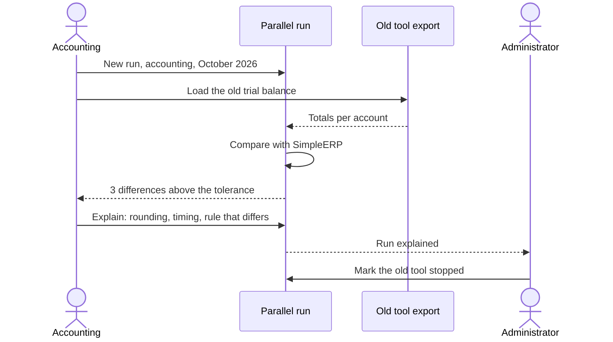

🏠 [Specs](../../../../README.md) › 🧩 [Functional capabilities](../../../README.md) ›
🧭 [F21 Onboarding and module activation](../../README.md) › 📝 [Use cases](../README.md) ›
📝 [Use cases: FL-F21-06 Experts, cutover, parallel run and set-up from documents](README.md) ›
📝 UC-F21-28 Run old and new tools in parallel

# 📝 UC-F21-28 Run old and new tools in parallel

**Status:** ✅ specified

## Summary

For one accounting period or one pay run, the company works in both the old tool and SimpleERP on the same
transactions. SimpleERP compares the results (totals of the trial balance, the VAT, the amounts invoiced, the net pay
of each employee) and lists each difference. The old tool is stopped only when every difference has an explanation.

## Personas

- [U05 Accounting](../../../../01-users/personas/u05-accounting.md)
- [U45 Payroll officer](../../../../01-users/personas/u45-payroll-officer.md)

## Goal

The company trusts the new figures before it relies on them, because every gap with the old tool is understood.

## Trigger

The administrator or the person in charge plans a parallel run before the cutover, or the cutover plan asks for one.

## Frequency

One to three periods per area during a migration (accounting, payroll, sales).

## Preconditions

- The old tool is a known migration source ([E-F21-14 Migration source](../../data/e-f21-14-migration-source.md)) and
  its results for the period can be exported.
- The area's data is imported in SimpleERP ([E-F21-07 Import job](../../data/e-f21-07-import-job.md)) and its opening
  balances are checked ([E-F21-15 Opening balance check](../../data/e-f21-15-opening-balance-check.md)).

## Postconditions

- **Succeeded:** the run is saved ([E-F21-21 Parallel run](../../data/e-f21-21-parallel-run.md)) with its period, its
  measures, its differences and their explanations; when all are explained the old tool can be marked stopped.
- **Failed:** the run stays open; the differences without explanation are listed and the old tool is not marked stopped.

## Main flow

1. The accounting or payroll person opens the parallel run screen
   ([S-F21-28](../../screens/06-experts-cutover-and-parallel-run/s-f21-28-parallel-run.md)) and creates a run for an
   area and a period, naming the old tool.
2. During the period both tools are used on the same transactions; at its end the person loads the old tool's results
   (an export of the trial balance, the VAT return, the payslips' net).
3. SimpleERP compares the old tool's figures with its own for each measure (account totals, VAT by rate, invoices, net
   pay per employee) and lists every difference above the tolerance.
4. For each difference the person chooses an explanation (rounding, a rule that differs, a timing difference, an error
   in the old tool, an error in SimpleERP, data not migrated) and adds a note; an error in SimpleERP opens a
   correction.
5. When every difference is explained or accepted, the run becomes Explained
   ([BR-F21-19](../../business-rules/br-f21-19-differences-are-explained-before-the-old-tool-stops.md)) and the person
   asks the administrator to mark the old tool as stopped.
6. The administrator confirms; the run closes and its report is kept for the accountant and for the cutover plan
   ([UC-F21-27](uc-f21-27-run-the-go-live-cutover.md)).

## Alternative flows

- 2a. The payroll officer runs the comparison on one pay run: the net of each employee is compared and a difference of
  more than the tolerance is listed with the line that causes it
  ([UC-F13-07](../../../f13-payroll/use-cases/02-monthly-pay-run/uc-f13-07-check-and-approve-the-pay-run.md)).
- 5a. A difference is accepted with a note and the approval of the accountant: it counts as explained.
- 6a. The run is not enough: another period is added before the old tool stops.

## Error flows

- 3e. The old tool's export is in an unknown format: the file is kept and the person is shown the lines that cannot be
  read ([BR-F21-12](../../business-rules/br-f21-12-migrations-read-the-old-tools-known-formats.md)).
- 4e. A difference has no explanation: the run cannot be Explained and the old tool stays open.
- 5e. A correction of SimpleERP changes the figures: the comparison is run again for the measure.
- Any step: a service does not answer; the call is retried first
  ([BR-F3-32](../../../f03-assistant/business-rules/br-f03-32-retry-before-an-error.md)), then the message follows the
  error pattern ([D122](../../../../06-decisions/ux/d122-error-message-standard.md)) and what the user typed stays on
  the screen.

## Business rules

- [BR-F21-19](../../business-rules/br-f21-19-differences-are-explained-before-the-old-tool-stops.md)
- [BR-F21-12](../../business-rules/br-f21-12-migrations-read-the-old-tools-known-formats.md)
- [BR-F21-13](../../business-rules/br-f21-13-opening-balances-match-last-years-fec.md)
- [BR-F21-14](../../business-rules/br-f21-14-the-accountant-joins-with-the-accountant-role.md)

## Entities

- [E-F21-21 Parallel run](../../data/e-f21-21-parallel-run.md): created, changed
- [E-F21-14 Migration source](../../data/e-f21-14-migration-source.md): read, the old tool
- [E-F21-15 Opening balance check](../../data/e-f21-15-opening-balance-check.md): read, the opening balance check
- [E-F21-07 Import job](../../data/e-f21-07-import-job.md): read, the imports
- [E-F21-01 Onboarding progress](../../data/e-f21-01-onboarding-progress.md): read, the onboarding progress

## Permissions

Accounting and the payroll officer run and explain the comparisons of their area. The administrator marks the old tool
stopped. The external accountant reads and approves accepted differences.

## Notifications

The person in charge, in the app: the run's period ended and the comparison is ready, or differences remain unexplained.
The administrator: a run is Explained.

## Audit events

Each run, each export loaded, each difference found, explained or accepted, each correction and each stopping of the old
tool, with who and when.

## AI involvement

No AI step of its own. The AI assistant may open the screen and prefill it from the user's words; the user checks and
confirms ([BR-F3-07](../../../f03-assistant/business-rules/br-f03-07-no-deletes-no-irreversible-acts.md)).

## API, MCP and A2A exposure

T5 operations of the capability for the personas above: create, read, update and list. The MCP tool of the
capability may read and propose, never confirm alone. No A2A skill.

## Screens

- [S-F21-28](../../screens/06-experts-cutover-and-parallel-run/s-f21-28-parallel-run.md)

## Flowchart

See
[FL-F21-06 Experts, cutover, parallel run and set-up from documents](../../flows/fl-f21-06-experts-cutover-and-parallel-run.md#flowchart).

## Sequence diagram

## Acceptance criteria

1. **Given** a run with 3 differences and 2 explained **when** someone asks to mark the old tool stopped **then** it is
   refused and the unexplained difference is named.
2. **Given** a difference below the tolerance **when** the comparison runs **then** it is not listed.
3. **Given** an error found in SimpleERP **when** it is marked as such **then** a correction is opened and the measure
   is compared again.
4. **Given** a run whose differences are all explained **when** the administrator confirms **then** the old tool is
   marked stopped and the run closes.

## Non-functional notes

The screen answers within 2 seconds for 10,000 records; every change is audited.

## Regulatory references

The accounting and payroll results of the parallel period are kept with the records of the year
([CR-FR-002](../../../../10-country-packs/france/accounting/cr-fr-002-accounting-records-kept-ten-years.md),
[CR-FR-047](../../../../10-country-packs/france/labour/cr-fr-047-hr-records-retention.md)); payslip amounts compared are
personal data and visible only to the payroll officer
([CR-FR-052](../../../../10-country-packs/france/data-protection/cr-fr-052-storage-limitation.md)).

## Related use cases

- [UC-F21-27 Run the go-live cutover](uc-f21-27-run-the-go-live-cutover.md)
- [UC-F21-29 Set up from last year's documents](uc-f21-29-set-up-from-last-years-documents.md)
- [UC-F21-27 Run the go-live cutover](uc-f21-27-run-the-go-live-cutover.md)
- [UC-F21-21](../05-migration-from-another-tool/uc-f21-21-migrate-from-a-named-tool.md)
- [UC-F21-22](../05-migration-from-another-tool/uc-f21-22-check-opening-balances-against-last-years-fec.md)
- [UC-F13-07](../../../f13-payroll/use-cases/02-monthly-pay-run/uc-f13-07-check-and-approve-the-pay-run.md)
- [UC-F8-01](../../../f08-accounting/use-cases/01-set-up-and-post/uc-f08-01-set-up-the-books.md)

## Open questions

None.

---

⬅️ [UC-F21-27 Run the go-live cutover](uc-f21-27-run-the-go-live-cutover.md) · ⬆️ [Up](README.md) ·
➡️ [UC-F21-29 Set up from last year's documents](uc-f21-29-set-up-from-last-years-documents.md)
