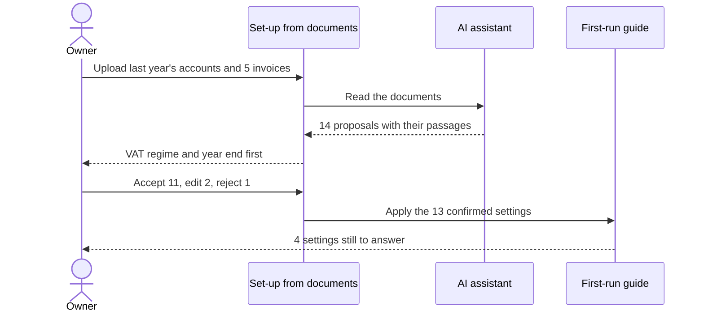

🏠 [Specs](../../../../README.md) › 🧩 [Functional capabilities](../../../README.md) ›
🧭 [F21 Onboarding and module activation](../../README.md) › 📝 [Use cases](../README.md) ›
📝 [Use cases: FL-F21-06 Experts, cutover, parallel run and set-up from documents](README.md) ›
📝 UC-F21-29 Set up from last year's documents

# 📝 UC-F21-29 Set up from last year's documents

**Status:** ✅ specified

## Summary

The owner uploads last year's documents (the annual accounts, a few invoices, a payslip summary, the price list, the
contracts) and the AI assistant proposes the company's settings from them: identity, financial year, VAT regime,
products and prices, payment terms, main customers and suppliers and the modules to switch on. Every proposal shows the
passage it came from, and nothing is applied until a person confirms it.

## Personas

- [U13 Owner](../../../../01-users/personas/u13-owner.md)

## Goal

The owner starts from what the company already has on paper, instead of answering a hundred questions, and stays in
control of every setting.

## Trigger

The owner chooses Set up from my documents in the first-run guide
([UC-F21-01](../01-first-run/uc-f21-01-start-the-first-run-guide.md)), or at any later time.

## Frequency

Once at the start, sometimes again when a year's documents are added.

## Preconditions

- The onboarding of the company is open ([E-F21-01 Onboarding progress](../../data/e-f21-01-onboarding-progress.md)) and
  the owner accepted that an AI reads the documents.
- The documents are files the owner can upload (PDF, images of paper, spreadsheets).

## Postconditions

- **Succeeded:** the settings the owner confirmed are applied through the usual steps
  ([UC-F21-02](../01-first-run/uc-f21-02-describe-the-company.md),
  [UC-F21-07](../01-first-run/uc-f21-07-set-the-company-identity-vat-and-bank.md)); the documents are deleted after the
  set-up unless the owner keeps them; the audit trail keeps who confirmed what.
- **Failed:** no setting is applied; the proposals stay as a list the owner can come back to.

## Main flow

1. The owner opens the set-up from documents screen
   ([S-F21-29](../../screens/06-experts-cutover-and-parallel-run/s-f21-29-setup-from-documents.md)) and uploads the
   documents, saying what each is.
2. The AI assistant reads each document and proposes settings: each is a line with the setting, the proposed value, the
   document and the passage it came from, and how sure the AI is.
3. The owner goes through the lines and accepts, edits or rejects each one; settings that carry a risk (the VAT regime,
   the financial year) are shown first and need an explicit confirmation
   ([BR-F21-20](../../business-rules/br-f21-20-settings-proposed-from-documents-are-confirmed-by-a-person.md)).
4. simple-ERP applies only the confirmed lines, through the same steps as the manual guide, and shows what was applied.
5. The owner sees the settings that the documents did not give, and the guide asks for them in plain words
   ([UC-F21-03](../01-first-run/uc-f21-03-pick-a-sector-template.md),
   [UC-F21-16](../01-first-run/uc-f21-16-check-the-legal-set-up.md)).
6. The owner chooses to delete the documents or to keep them in the company's documents
   [UC-F2-13](../../../f02-no-code-configuration/use-cases/07-benchmark-additions/uc-f02-13-manage-documents-in-a-workspace.md).

## Alternative flows

- 2a. A document is a scan: simple-ERP reads it by character recognition and marks lower confidence on the lines it read
  badly.
- 3a. Two documents disagree (two different financial year ends): both are shown and the owner picks.
- 6a. The owner uploads more documents later: only the new proposals are shown.

## Error flows

- 2e. A document cannot be read (locked, blurred): it is listed as not read and no line is invented from it.
- 2e. A document contains data of other people (payslips, contracts): only the totals and the contract terms needed are
  proposed and the rest is not kept.
- 4e. A confirmed line conflicts with what the company already set: the screen asks which value wins.
- Any step: a service does not answer; the call is retried first
  ([BR-F3-32](../../../f03-assistant/business-rules/br-f03-32-retry-before-an-error.md)), then the message follows the
  error pattern ([D122](../../../../06-decisions/ux/d122-error-message-standard.md)) and what the user typed stays on
  the screen.

## Business rules

- [BR-F21-20](../../business-rules/br-f21-20-settings-proposed-from-documents-are-confirmed-by-a-person.md)
- [BR-F21-01](../../business-rules/br-f21-01-legal-set-up-from-the-country-pack.md)
- [BR-F21-05](../../business-rules/br-f21-05-plain-words-with-examples.md)
- [BR-F21-09](../../business-rules/br-f21-09-assistant-at-every-step.md)

## Entities

- [E-F21-01 Onboarding progress](../../data/e-f21-01-onboarding-progress.md): changed, the progress of each step applied
- [E-F21-02 Company profile](../../data/e-f21-02-company-profile.md): changed, the company profile
- [E-F21-03 Set-up template](../../data/e-f21-03-set-up-template.md): read, the set-up template the proposals may start
  from
- [E-F21-04 Module activation](../../data/e-f21-04-module-activation.md): changed, the modules switched on

## Permissions

The owner uploads and confirms. An administrator confirms settings of their own area; the external accountant
may be invited to read the financial proposals.

## Notifications

The owner, in the app: the proposals are ready, with the number of lines to check.

## Audit events

Each document uploaded and deleted, each proposal shown, each line accepted, edited or rejected, and each setting
applied, with who and when.

## AI involvement

The AI assistant reads the documents and proposes; it never applies a setting on its own, never reads a document the
owner did not upload, and says which AI provider reads them
([BR-F3-07](../../../f03-assistant/business-rules/br-f03-07-no-deletes-no-irreversible-acts.md),
[CR-FR-056](../../../../10-country-packs/france/ai-and-recording/cr-fr-056-people-know-they-deal-with-an-ai.md)).

## API, MCP and A2A exposure

T5 operations of the capability for the personas above: create, read, update and list. The MCP tool of the
capability may read and propose, never confirm alone. No A2A skill.

## Screens

- [S-F21-29](../../screens/06-experts-cutover-and-parallel-run/s-f21-29-setup-from-documents.md)

## Flowchart

See
[FL-F21-06 Experts, cutover, parallel run and set-up from documents](../../flows/fl-f21-06-experts-cutover-and-parallel-run.md#flowchart).

## Sequence diagram

## Acceptance criteria

1. **Given** an uploaded balance sheet showing a year end of 30 June **when** the proposals are made **then** the
   financial year line shows 30 June with the page it came from.
2. **Given** a proposed setting the owner does not confirm **when** the owner finishes **then** it is not applied.
3. **Given** a scanned document read badly **when** the proposals are made **then** the lines from it carry a low
   confidence.
4. **Given** documents uploaded **when** the set-up ends **then** they are deleted unless the owner chose to keep them.

## Non-functional notes

The screen answers within 2 seconds for 10,000 records; every change is audited.

## Regulatory references

The documents may hold personal data of employees, customers or suppliers: only what a setting needs is read
and kept, and the AI that reads them is named to the owner
([CR-FR-050](../../../../10-country-packs/france/data-protection/cr-fr-050-privacy-by-design.md),
[CR-FR-056](../../../../10-country-packs/france/ai-and-recording/cr-fr-056-people-know-they-deal-with-an-ai.md)). The
VAT regime and the financial year follow the country pack's rules, not the documents' habit
([BR-F21-01](../../business-rules/br-f21-01-legal-set-up-from-the-country-pack.md)).

## Related use cases

- [UC-F21-28 Run old and new tools in parallel](uc-f21-28-run-old-and-new-tools-in-parallel.md)
- [UC-F21-02 Describe the company](../01-first-run/uc-f21-02-describe-the-company.md)
- [UC-F21-03 Pick a sector template](../01-first-run/uc-f21-03-pick-a-sector-template.md)
- [UC-F21-07](../01-first-run/uc-f21-07-set-the-company-identity-vat-and-bank.md)
- [UC-F21-09 Import existing data](../03-team-and-data/uc-f21-09-import-existing-data.md)
- [UC-F21-16 Check the legal set-up](../01-first-run/uc-f21-16-check-the-legal-set-up.md)
- [UC-F21-21](../05-migration-from-another-tool/uc-f21-21-migrate-from-a-named-tool.md)

## Open questions

None.

---

⬅️ [UC-F21-28 Run old and new tools in parallel](uc-f21-28-run-old-and-new-tools-in-parallel.md) · ⬆️ [Up](README.md)
