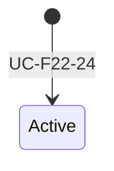

🏠 [Specs](../../../README.md) › 🧩 [Functional capabilities](../../README.md) ›
💸 [F22 Unified platform cost management](../README.md) › 🗃️ [Data](README.md) › 🗃️ E-F22-01 Cost period

# 🗃️ E-F22-01 Cost period

**Status:** ✅ specified

## Purpose

A company's costs for a month.

## Fields

| Name | Type | Required | Validation | Default | Example | Personal data | Custom fields |
|---|---|---|---|---|---|---|---|
| company, month, total, currency | records | yes | - | - | Acme, 2026-11, 312.40, EUR | no | no |

## Relations

As its use cases.

## Lifecycle

## Indexes and search

By number, date, partner.

## Retention

As an accounting record:
[CR-FR-002 Accounting records kept 10 years](../../../10-country-packs/france/accounting/cr-fr-002-accounting-records-kept-ten-years.md).

## Audit

Every change.

## Import and export

CSV, FEC where relevant.

## Used by

- [UC-F22-01](../use-cases/01-see-and-set-up/uc-f22-01-see-all-platform-costs-in-one-place.md)
- [UC-F22-24 Read the cost KPIs](../use-cases/06-savings-and-kpis/uc-f22-24-read-the-cost-kpis.md)

## Open questions

None.

---

⬆️ [Up](README.md) · ➡️ [E-F22-02 Metered call record](e-f22-02-metered-call-record.md)
