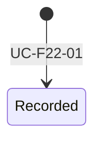

🏠 [Specs](../../../README.md) › 🧩 [Functional capabilities](../../README.md) ›
💸 [F22 Unified platform cost management](../README.md) › 🗃️ [Data](README.md) › 🗃️ E-F22-02 Metered call record

# 🗃️ E-F22-02 Metered call record

**Status:** ✅ specified

## Purpose

One metered paid call.

## Fields

| Name | Type | Required | Validation | Default | Example | Personal data | Custom fields |
|---|---|---|---|---|---|---|---|
| company, user, module, feature, provider, units, cost, at | records | yes | BR-F22-02 | - | Acme, PM, F3, answer, provider A, 1 840 tokens, 0.011 | yes | no |

## Relations

As its use cases.

## Lifecycle

## Indexes and search

By number, date, partner.

## Retention

Kept for the period of its kind of record in the country pack (D293), or else its kind's default in the
[retention schedule](../../../05-non-functional/data-retention.md).

## Audit

Every change.

## Import and export

CSV, FEC where relevant.

## Used by

- [UC-F22-01](../use-cases/01-see-and-set-up/uc-f22-01-see-all-platform-costs-in-one-place.md)
- [UC-F22-02](../use-cases/01-see-and-set-up/uc-f22-02-see-costs-per-module-feature-and-provider.md)
- [UC-F22-03](../use-cases/04-accounting/uc-f22-03-see-costs-per-department-project-and-client.md)
- [UC-F22-11](../use-cases/03-runs/uc-f22-11-follow-a-run-s-cost-live-and-stop-it.md)
- [UC-F22-13](../use-cases/04-accounting/uc-f22-13-match-suppliers-invoices-in-accounting.md)
- [UC-F22-14](../use-cases/04-accounting/uc-f22-14-allocate-costs-to-accounts-and-projects.md)
- [UC-F22-17](../use-cases/05-billing/uc-f22-17-follow-the-hosting-s-own-platform-costs.md)
- [UC-F22-18](../use-cases/03-runs/uc-f22-18-spot-anomalies-and-runaway-agents.md)
- [UC-F22-19](../use-cases/04-accounting/uc-f22-19-export-and-report-costs.md)
- [UC-F22-20](../use-cases/01-see-and-set-up/uc-f22-20-ask-the-assistant-about-costs.md)
- [UC-F22-22 Count the cost of self-hosted compute](../use-cases/01-see-and-set-up/uc-f22-22-count-the-cost-of-self-hosted-compute.md)

## Open questions

None.

---

⬅️ [E-F22-01 Cost period](e-f22-01-cost-period.md) · ⬆️ [Up](README.md) ·
➡️ [E-F22-03 Provider price list](e-f22-03-provider-price-list.md)
