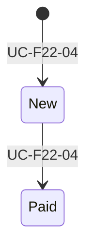

🏠 [Specs](../../../README.md) › 🧩 [Functional capabilities](../../README.md) ›
💸 [F22 Unified platform cost management](../README.md) › 🗃️ [Data](README.md) › 🗃️ E-F22-04 Paid provider

# 🗃️ E-F22-04 Paid provider

**Status:** ✅ specified

## Purpose

A provider and how it is paid.

## Fields

| Name | Type | Required | Validation | Default | Example | Personal data | Custom fields |
|---|---|---|---|---|---|---|---|
| name, kind, vault key name, mode | records | yes | BR-F22-10 | quota | provider A, AI, provider_a_key, own key | no | no |

## Relations

As its use cases.

## Lifecycle

## Indexes and search

By number, date, partner.

## Retention

Kept for the period of its kind of record in the country pack (D293), or else its kind's default in the
[retention schedule](../../../05-non-functional/data-retention.md).

## Audit

Every change.

## Import and export

CSV, FEC where relevant.

## Used by

- [UC-F22-04](../use-cases/01-see-and-set-up/uc-f22-04-register-a-paid-provider-and-its-prices.md)
- [UC-F22-05](../use-cases/01-see-and-set-up/uc-f22-05-bring-own-keys-or-use-the-hosted-quota.md)

## Open questions

None.

---

⬅️ [E-F22-03 Provider price list](e-f22-03-provider-price-list.md) · ⬆️ [Up](README.md) ·
➡️ [E-F22-05 Hosted quota](e-f22-05-hosted-quota.md)
