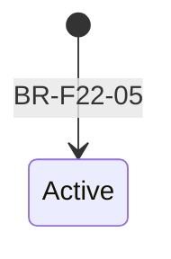

🏠 [Specs](../../../README.md) › 🧩 [Functional capabilities](../../README.md) ›
💸 [F22 Unified platform cost management](../README.md) › 🗃️ [Data](README.md) › 🗃️ E-F22-07 Cost alert

# 🗃️ E-F22-07 Cost alert

**Status:** ✅ specified

## Purpose

A warning, stop or anomaly.

## Fields

| Name | Type | Required | Validation | Default | Example | Personal data | Custom fields |
|---|---|---|---|---|---|---|---|
| kind, budget, value, sent | records | yes | BR-F22-05, BR-F22-13 | - | warning, F17, 82 %, yes | no | no |

## Relations

As its use cases.

## Lifecycle

## Indexes and search

By number, date, partner.

## Retention

Kept for the period of its kind of record in the country pack (D293), or else its kind's default in the
[retention schedule](../../../05-non-functional/data-retention.md).

## Audit

Every change.

## Import and export

CSV, FEC where relevant.

## Used by

- [UC-F22-07](../use-cases/02-budgets-and-stops/uc-f22-07-receive-warnings-at-thresholds.md)
- [UC-F22-18](../use-cases/03-runs/uc-f22-18-spot-anomalies-and-runaway-agents.md)

## Open questions

None.

---

⬅️ [E-F22-06 Cost budget](e-f22-06-cost-budget.md) · ⬆️ [Up](README.md) ·
➡️ [E-F22-08 Budget approval](e-f22-08-budget-approval.md)
