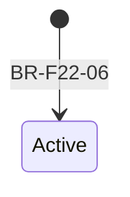

🏠 [Specs](../../../README.md) › 🧩 [Functional capabilities](../../README.md) ›
💸 [F22 Unified platform cost management](../README.md) › 🗃️ [Data](README.md) › 🗃️ E-F22-08 Budget approval

# 🗃️ E-F22-08 Budget approval

**Status:** ✅ specified

## Purpose

An owner's raise or one-off approval.

## Fields

| Name | Type | Required | Validation | Default | Example | Personal data | Custom fields |
|---|---|---|---|---|---|---|---|
| budget, by, amount, reason | records | yes | BR-F22-06 | - | F17, owner, +50, tender season | no | no |

## Relations

As its use cases.

## Lifecycle

## Indexes and search

By number, date, partner.

## Retention

Kept for the period of its kind of record in the country pack (D293), or else its kind's default in the
[retention schedule](../../../05-non-functional/data-retention.md).

## Audit

Every change.

## Import and export

CSV, FEC where relevant.

## Used by

- [UC-F22-08](../use-cases/02-budgets-and-stops/uc-f22-08-stop-paid-calls-at-100-legal-duties-kept.md)
- [UC-F22-09](../use-cases/02-budgets-and-stops/uc-f22-09-raise-a-budget-or-approve-a-run.md)

## Open questions

None.

---

⬅️ [E-F22-07 Cost alert](e-f22-07-cost-alert.md) · ⬆️ [Up](README.md) ·
➡️ [E-F22-09 Allocation rule](e-f22-09-allocation-rule.md)
