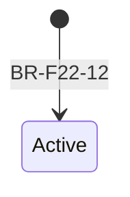

🏠 [Specs](../../../README.md) › 🧩 [Functional capabilities](../../README.md) ›
💸 [F22 Unified platform cost management](../README.md) › 🗃️ [Data](README.md) › 🗃️ E-F22-09 Allocation rule

# 🗃️ E-F22-09 Allocation rule

**Status:** ✅ specified

## Purpose

How costs are charged.

## Fields

| Name | Type | Required | Validation | Default | Example | Personal data | Custom fields |
|---|---|---|---|---|---|---|---|
| condition, target | records | yes | BR-F22-12 | - | project tag Durand, project Durand | no | no |

## Relations

As its use cases.

## Lifecycle

## Indexes and search

By number, date, partner.

## Retention

Kept for the period of its kind of record in the country pack (D293), or else its kind's default in the
[retention schedule](../../../05-non-functional/data-retention.md).

## Audit

Every change.

## Import and export

CSV, FEC where relevant.

## Used by

- [UC-F22-03](../use-cases/04-accounting/uc-f22-03-see-costs-per-department-project-and-client.md)
- [UC-F22-14](../use-cases/04-accounting/uc-f22-14-allocate-costs-to-accounts-and-projects.md)
- [UC-F22-16](../use-cases/05-billing/uc-f22-16-re-bill-clients-as-an-it-provider.md)

## Open questions

None.

---

⬅️ [E-F22-08 Budget approval](e-f22-08-budget-approval.md) · ⬆️ [Up](README.md) ·
➡️ [E-F22-10 Run estimate](e-f22-10-run-estimate.md)
