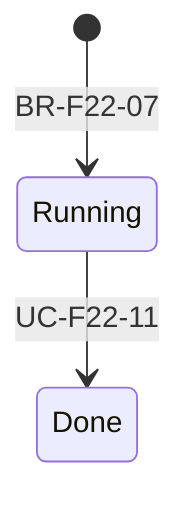

🏠 [Specs](../../../README.md) › 🧩 [Functional capabilities](../../README.md) ›
💸 [F22 Unified platform cost management](../README.md) › 🗃️ [Data](README.md) › 🗃️ E-F22-10 Run estimate

# 🗃️ E-F22-10 Run estimate

**Status:** ✅ specified

## Purpose

The estimate and live cost of a run.

## Fields

| Name | Type | Required | Validation | Default | Example | Personal data | Custom fields |
|---|---|---|---|---|---|---|---|
| run, estimate, spent, state | records | yes | BR-F22-07, BR-F22-08 | - | enrichment, 38, 12.40, running | no | no |

## Relations

As its use cases.

## Lifecycle

## Indexes and search

By number, date, partner.

## Retention

Kept for the period of its kind of record in the country pack (D293), or else its kind's default in the
[retention schedule](../../../05-non-functional/data-retention.md).

## Audit

Every change.

## Import and export

CSV, FEC where relevant.

## Used by

- [UC-F22-10](../use-cases/03-runs/uc-f22-10-estimate-a-run-before-it-starts.md)
- [UC-F22-11](../use-cases/03-runs/uc-f22-11-follow-a-run-s-cost-live-and-stop-it.md)

## Open questions

None.

---

⬅️ [E-F22-09 Allocation rule](e-f22-09-allocation-rule.md) · ⬆️ [Up](README.md) ·
➡️ [E-F22-11 Forecast](e-f22-11-forecast.md)
