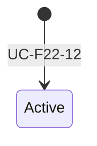

🏠 [Specs](../../../README.md) › 🧩 [Functional capabilities](../../README.md) ›
💸 [F22 Unified platform cost management](../README.md) › 🗃️ [Data](README.md) › 🗃️ E-F22-11 Forecast

# 🗃️ E-F22-11 Forecast

**Status:** ✅ specified

## Purpose

The expected total of a period.

## Fields

| Name | Type | Required | Validation | Default | Example | Personal data | Custom fields |
|---|---|---|---|---|---|---|---|
| period, expected, range | records | yes | - | - | 2026-11, 340, 310 to 380 | no | no |

## Relations

As its use cases.

## Lifecycle

## Indexes and search

By number, date, partner.

## Retention

Kept for the period of its kind of record in the country pack (D293), or else its kind's default in the
[retention schedule](../../../05-non-functional/data-retention.md).

## Audit

Every change.

## Import and export

CSV, FEC where relevant.

## Used by

- [UC-F22-12](../use-cases/04-accounting/uc-f22-12-forecast-the-month-s-costs.md)
- [UC-F22-19](../use-cases/04-accounting/uc-f22-19-export-and-report-costs.md)

## Open questions

None.

---

⬅️ [E-F22-10 Run estimate](e-f22-10-run-estimate.md) · ⬆️ [Up](README.md) ·
➡️ [E-F22-12 Invoice match](e-f22-12-invoice-match.md)
