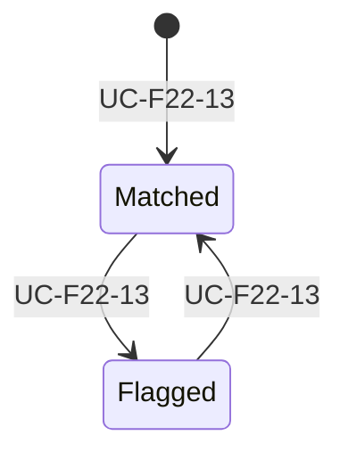

🏠 [Specs](../../../README.md) › 🧩 [Functional capabilities](../../README.md) ›
💸 [F22 Unified platform cost management](../README.md) › 🗃️ [Data](README.md) › 🗃️ E-F22-12 Invoice match

# 🗃️ E-F22-12 Invoice match

**Status:** ✅ specified

## Purpose

A provider invoice against metered costs.

## Fields

| Name | Type | Required | Validation | Default | Example | Personal data | Custom fields |
|---|---|---|---|---|---|---|---|
| invoice, metered, gap, state | records | yes | BR-F22-11 | - | INV-212, 205, 3.4 %, flagged | no | no |

## Relations

As its use cases.

## Lifecycle

## Indexes and search

By number, date, partner.

## Retention

As an accounting record:
[CR-FR-002 Accounting records kept 10 years](../../../10-country-packs/france/accounting/cr-fr-002-accounting-records-kept-ten-years.md).

## Audit

Every change.

## Import and export

CSV, FEC where relevant.

## Used by

- [UC-F22-13](../use-cases/04-accounting/uc-f22-13-match-suppliers-invoices-in-accounting.md)
- [UC-F22-17](../use-cases/05-billing/uc-f22-17-follow-the-hosting-s-own-platform-costs.md)

## Open questions

None.

---

⬅️ [E-F22-11 Forecast](e-f22-11-forecast.md) · ⬆️ [Up](README.md) ·
➡️ [E-F22-13 Usage invoice](e-f22-13-usage-invoice.md)
