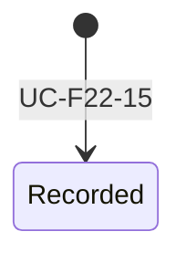

🏠 [Specs](../../../README.md) › 🧩 [Functional capabilities](../../README.md) ›
💸 [F22 Unified platform cost management](../README.md) › 🗃️ [Data](README.md) › 🗃️ E-F22-13 Usage invoice

# 🗃️ E-F22-13 Usage invoice

**Status:** ✅ specified

## Purpose

A hosted or re-billing invoice of usage.

## Fields

| Name | Type | Required | Validation | Default | Example | Personal data | Custom fields |
|---|---|---|---|---|---|---|---|
| customer, period, units, amount excl. VAT | records | yes | BR-F22-09 | - | Acme, Nov, 0.4 M tokens, 2.40 | no | no |

## Relations

As its use cases.

## Lifecycle

## Indexes and search

By number, date, partner.

## Retention

As an accounting record:
[CR-FR-002 Accounting records kept 10 years](../../../10-country-packs/france/accounting/cr-fr-002-accounting-records-kept-ten-years.md).

## Audit

Every change.

## Import and export

CSV, FEC where relevant.

## Used by

- [UC-F22-15](../use-cases/05-billing/uc-f22-15-see-the-hosted-quota-and-units-billed.md)
- [UC-F22-16](../use-cases/05-billing/uc-f22-16-re-bill-clients-as-an-it-provider.md)

## Open questions

None.

---

⬅️ [E-F22-12 Invoice match](e-f22-12-invoice-match.md) · ⬆️ [Up](README.md) ·
➡️ [E-F22-14 Exchange rate](e-f22-14-exchange-rate.md)
