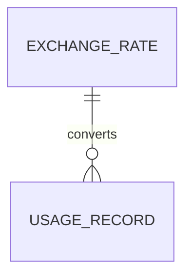
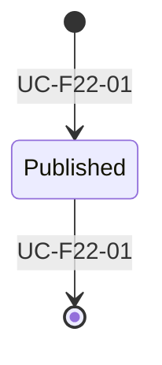

🏠 [Specs](../../../README.md) › 🧩 [Functional capabilities](../../README.md) ›
💸 [F22 Unified platform cost management](../README.md) › 🗃️ [Data](README.md) › 🗃️ E-F22-14 Exchange rate

# 🗃️ E-F22-14 Exchange rate

**Status:** ✅ specified

## Purpose

The rate used to convert foreign-currency costs on a day.

## Fields

| Name | Type | Required | Validation | Default | Example | Personal data | Custom fields |
|---|---|---|---|---|---|---|---|
| currency | text | yes | ISO code | - | USD | no | no |
| date | date | yes | - | - | 2026-11-12 | no | no |
| rate | number | yes | above 0 | from the source | 0.9200 | no | no |
| source | text | yes | - | ECB | ECB | no | no |

## Relations

## Lifecycle

## Indexes and search

By currency and date.

## Retention

As the costs: CR-FR-002.

## Audit

Every creation and change, with who, when, the old and the new value.

## Import and export

CSV and JSON export through the API (T5); no bulk import.

## Used by

- [UC-F22-21 Record a provider's prices in a foreign currency](../use-cases/01-see-and-set-up/uc-f22-21-record-a-providers-prices-in-a-foreign-currency.md)
- [UC-F22-01 See all platform costs in one place](../use-cases/01-see-and-set-up/uc-f22-01-see-all-platform-costs-in-one-place.md)
- [UC-F22-04 Register a paid provider and its prices](../use-cases/01-see-and-set-up/uc-f22-04-register-a-paid-provider-and-its-prices.md)
- [UC-F22-13 Match suppliers' invoices in accounting](../use-cases/04-accounting/uc-f22-13-match-suppliers-invoices-in-accounting.md)

## Open questions

None.

---

⬅️ [E-F22-13 Usage invoice](e-f22-13-usage-invoice.md) · ⬆️ [Up](README.md) ·
➡️ [E-F22-15 Compute machine](e-f22-15-compute-machine.md)
