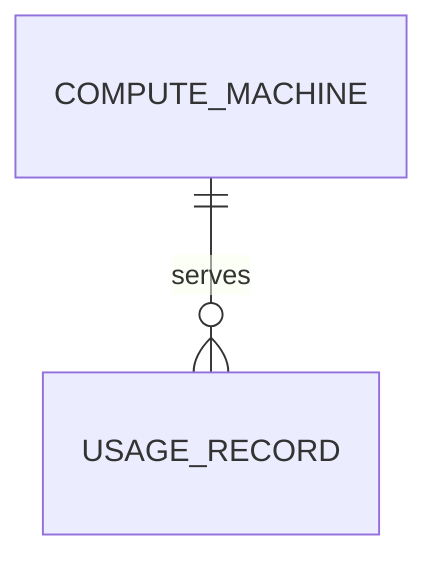
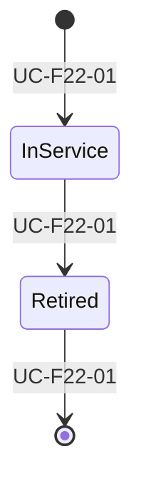

🏠 [Specs](../../../README.md) › 🧩 [Functional capabilities](../../README.md) ›
💸 [F22 Unified platform cost management](../README.md) › 🗃️ [Data](README.md) › 🗃️ E-F22-15 Compute machine

# 🗃️ E-F22-15 Compute machine

**Status:** 🔄 waiting for the owner

## Purpose

A machine running local models, with what it costs per hour.

## Fields

| Name | Type | Required | Validation | Default | Example | Personal data | Custom fields |
|---|---|---|---|---|---|---|---|
| name | text | yes | - | - | gpu-server-1 | no | no |
| purchase price, life | amount, months | yes | - | - | 6 000.00 EUR, 36 | no | no |
| power, electricity price | watts, EUR per kWh | yes | - | - | 400 W, 0.25 | no | no |
| cost per hour | amount | yes | computed | computed | 0.33 EUR | no | no |

## Relations

## Lifecycle

## Indexes and search

By name.

## Retention

For its life, then (Proposed) 10 years with the costs.

## Audit

Every creation and change, with who, when, the old and the new value.

## Import and export

CSV and JSON export through the API (T5); no bulk import.

## Used by

- [UC-F22-22 Count the cost of self-hosted compute](../use-cases/01-see-and-set-up/uc-f22-22-count-the-cost-of-self-hosted-compute.md)
- [UC-F22-01 See all platform costs in one place](../use-cases/01-see-and-set-up/uc-f22-01-see-all-platform-costs-in-one-place.md)
- [UC-F22-14 Allocate costs to accounts and projects](../use-cases/04-accounting/uc-f22-14-allocate-costs-to-accounts-and-projects.md)
- [UC-F22-17 Follow the hosting's own platform costs](../use-cases/05-billing/uc-f22-17-follow-the-hosting-s-own-platform-costs.md)

## Open questions

None.

---

⬅️ [E-F22-14 Exchange rate](e-f22-14-exchange-rate.md) · ⬆️ [Up](README.md) ·
➡️ [E-F22-16 Savings recommendation](e-f22-16-savings-recommendation.md)
