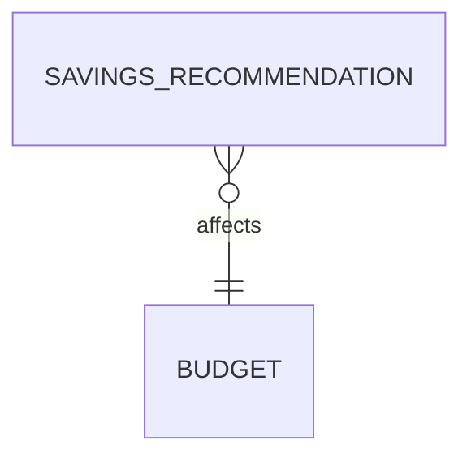
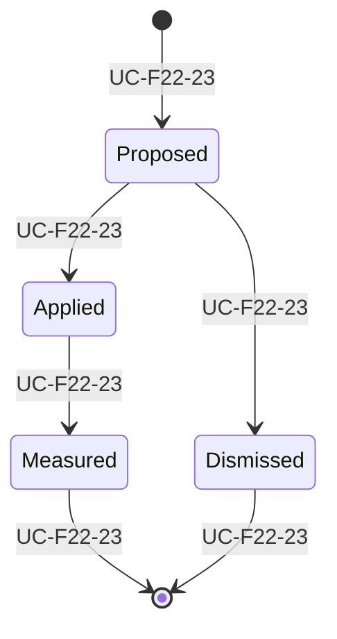

🏠 [Specs](../../../README.md) › 🧩 [Functional capabilities](../../README.md) ›
💸 [F22 Unified platform cost management](../README.md) › 🗃️ [Data](README.md) › 🗃️ E-F22-16 Savings recommendation

# 🗃️ E-F22-16 Savings recommendation

**Status:** 🔄 waiting for the owner

## Purpose

A proposed change that would lower costs, with its expected and measured saving.

## Fields

| Name | Type | Required | Validation | Default | Example | Personal data | Custom fields |
|---|---|---|---|---|---|---|---|
| feature | link | yes | - | - | AI assistant summaries | no | no |
| change | text | yes | - | - | use the local model | no | no |
| expected saving | amount per month | yes | - | computed | 42.00 EUR | no | no |
| quality effect | text | yes | from the F3 evaluation | - | within the bar | no | no |
| measured saving | amount | after applying | - | - | 39.10 EUR | no | no |
| status | choice | yes | proposed, applied, dismissed | proposed | applied | no | no |

## Relations

## Lifecycle

## Indexes and search

By feature and status.

## Retention

(Proposed) 2 years.

## Audit

Every creation and change, with who, when, the old and the new value.

## Import and export

CSV and JSON export through the API (T5); no bulk import.

## Used by

- [UC-F22-23 Act on savings recommendations](../use-cases/06-savings-and-kpis/uc-f22-23-act-on-savings-recommendations.md)
- [UC-F22-24 Read the cost KPIs](../use-cases/06-savings-and-kpis/uc-f22-24-read-the-cost-kpis.md)

## Open questions

None.

---

⬅️ [E-F22-15 Compute machine](e-f22-15-compute-machine.md) · ⬆️ [Up](README.md) ·
➡️ [E-F22-17 Re-billing rule](e-f22-17-re-billing-rule.md)
