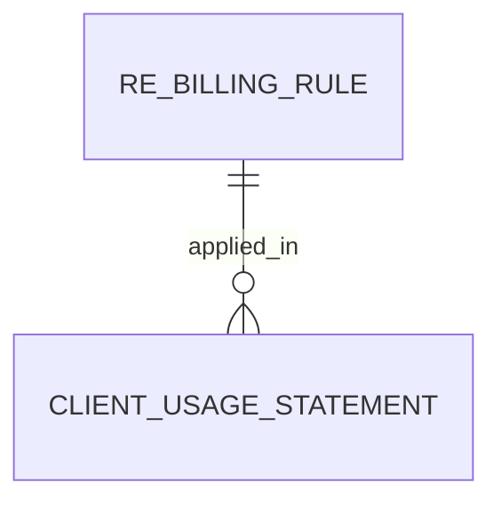
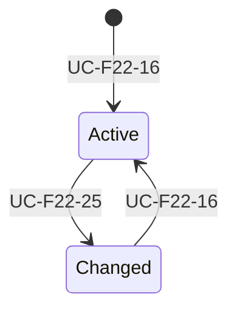

🏠 [Specs](../../../README.md) › 🧩 [Functional capabilities](../../README.md) ›
💸 [F22 Unified platform cost management](../README.md) › 🗃️ [Data](README.md) › 🗃️ E-F22-17 Re-billing rule

# 🗃️ E-F22-17 Re-billing rule

**Status:** ✅ specified

## Purpose

How an IT provider re-bills one client's platform costs.

## Fields

| Name | Type | Required | Validation | Default | Example | Personal data | Custom fields |
|---|---|---|---|---|---|---|---|
| client | link | yes | a client company | - | the transport example company | no | no |
| margin | percent | yes | 0 or more | 0 | 15 % | no | no |
| included | amount per month | no | - | 0 | 50.00 EUR | no | no |
| rounding | choice | yes | none, 1 EUR, 5 EUR | none | 1 EUR | no | no |

## Relations

## Lifecycle

## Indexes and search

By client.

## Retention

Every version kept with the statements.

## Audit

Every creation and change, with who, when, the old and the new value.

## Import and export

CSV and JSON export through the API (T5); no bulk import.

## Used by

- [UC-F22-25 Set re-billing rules per client](../use-cases/07-it-provider-re-billing/uc-f22-25-set-re-billing-rules-per-client.md)
- [UC-F22-16 Re-bill clients as an IT provider](../use-cases/05-billing/uc-f22-16-re-bill-clients-as-an-it-provider.md)

## Open questions

None.

---

⬅️ [E-F22-16 Savings recommendation](e-f22-16-savings-recommendation.md) · ⬆️ [Up](README.md) ·
➡️ [E-F22-18 Client usage statement](e-f22-18-client-usage-statement.md)
