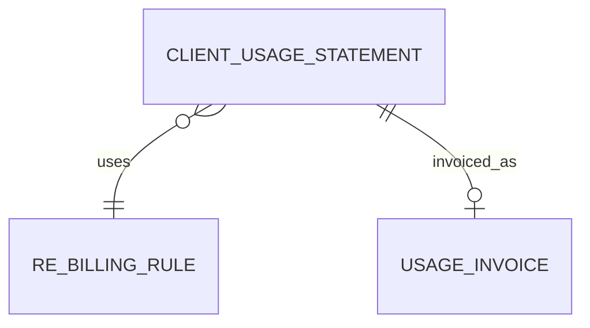
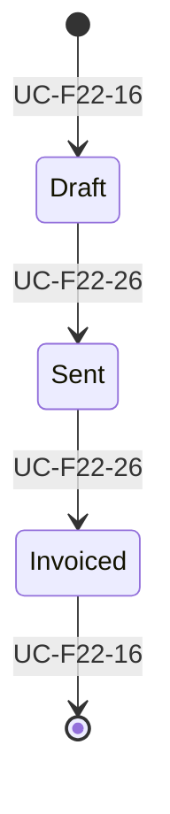

🏠 [Specs](../../../README.md) › 🧩 [Functional capabilities](../../README.md) ›
💸 [F22 Unified platform cost management](../README.md) › 🗃️ [Data](README.md) › 🗃️ E-F22-18 Client usage statement

# 🗃️ E-F22-18 Client usage statement

**Status:** ✅ specified

## Purpose

A client's monthly platform usage and the amount re-billed by its IT provider.

## Fields

| Name | Type | Required | Validation | Default | Example | Personal data | Custom fields |
|---|---|---|---|---|---|---|---|
| client | link | yes | - | - | the transport example company | no | no |
| month | month | yes | - | - | 2026-11 | no | no |
| usage | list | yes | per feature | - | AI assistant 42.00, connectors 38.00 | no | no |
| billed | amount | yes | by the rule | computed | 34.50 EUR | no | no |
| corrections | list | no | - | - | -5.00 disputed line | no | no |

## Relations

## Lifecycle

## Indexes and search

By client and month.

## Retention

As accounting records: CR-FR-002.

## Audit

Every creation and change, with who, when, the old and the new value.

## Import and export

CSV and JSON export through the API (T5); no bulk import.

## Used by

- [UC-F22-26 Send each client its usage statement](../use-cases/07-it-provider-re-billing/uc-f22-26-send-each-client-its-usage-statement.md)
- [UC-F22-16 Re-bill clients as an IT provider](../use-cases/05-billing/uc-f22-16-re-bill-clients-as-an-it-provider.md)

## Open questions

None.

---

⬅️ [E-F22-17 Re-billing rule](e-f22-17-re-billing-rule.md) · ⬆️ [Up](README.md) ·
➡️ [E-F22-19 Credit pack](e-f22-19-credit-pack.md)
