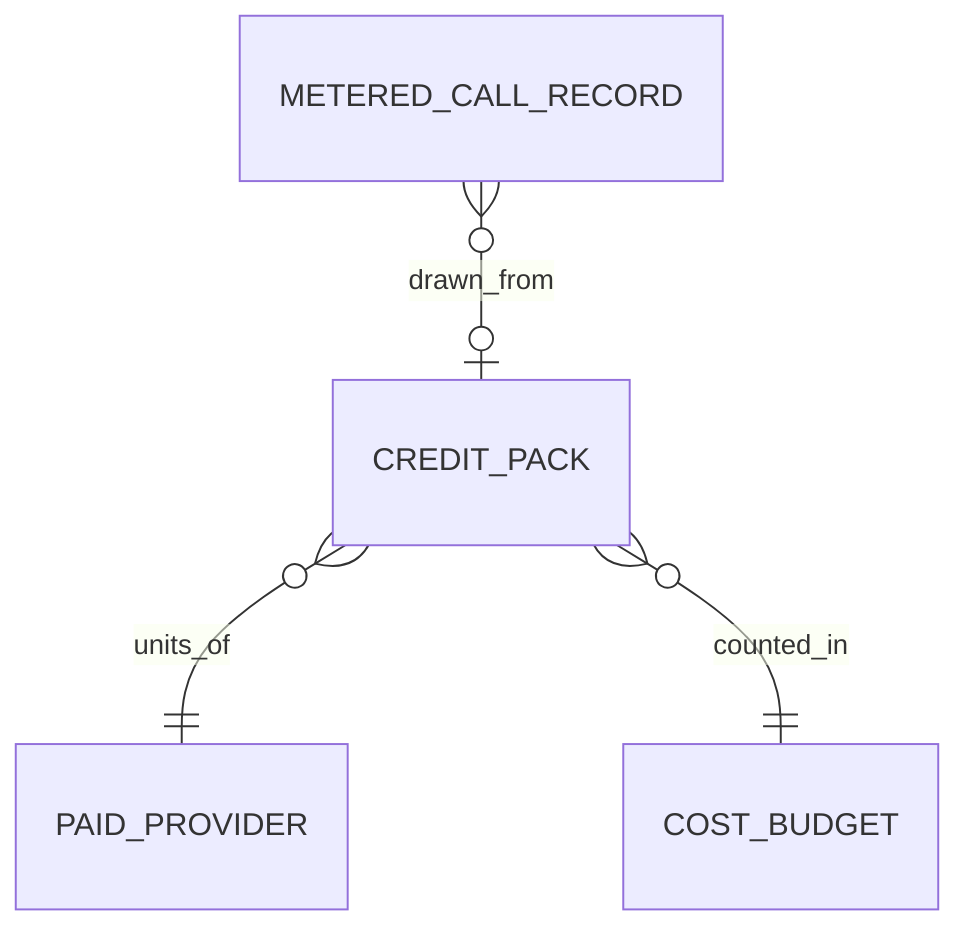
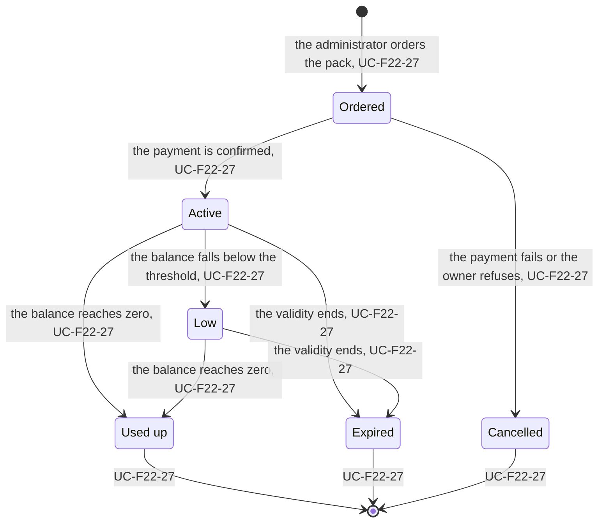

🏠 [Specs](../../../README.md) › 🧩 [Functional capabilities](../../README.md) ›
💸 [F22 Unified platform cost management](../README.md) › 🗃️ [Data](README.md) › 🗃️ E-F22-19 Credit pack

# 🗃️ E-F22-19 Credit pack

**Status:** ✅ specified

## Purpose

A prepaid pack of units of one kind of paid usage, with its balance, its expiry and its automatic top-up rule
([D541](../../../06-decisions/f22-unified-cost-management/d541-benchmark-gaps-f22-unified-cost-management.md)). It
differs from the hosted quota ([E-F22-05 Hosted quota](e-f22-05-hosted-quota.md)): the quota is the plan's monthly
allowance and is never bought, while a pack is bought, drawn down and expires.

## Fields

| Name | Type | Required | Validation | Default | Example | Personal data | Custom fields |
|---|---|---|---|---|---|---|---|
| kind | AI, scraping, connector, data | yes | a kind of paid usage | - | AI | no | no |
| provider | paid provider (E-F22-04) | yes | a provider of the same kind | - | provider A | no | no |
| units bought | number | yes | above 0, a size of the price list | - | 5,000,000 | no | no |
| units left | number | yes | 0 to the units bought | units bought | 4,100,000 | no | no |
| price | amount with currency | yes | from the price list ([BR-F22-03](../business-rules/br-f22-03-prices-versioned-per-provider.md)) | - | 40 EUR | no | no |
| valid until | date | yes | after the purchase | 12 months | 2027-11-14 | no | no |
| top-up threshold | percent | no | 1 to 50 | 10 | 10 | no | no |
| top-up monthly maximum | number | no | 0 to 5 | 0 (off) | 2 | no | no |
| budget | cost budget (E-F22-06) | yes | the level the pack is charged to | - | module F17, November | no | no |
| state | Ordered, Active, Cancelled, Low, Used up, Expired | yes | the lifecycle below | Ordered | Active | no | no |
| owner | user | yes | a user of the company | the creator | Claire P. | yes | no |

## Relations

- [E-F22-02 Metered call record](e-f22-02-metered-call-record.md)
- [E-F22-04 Paid provider](e-f22-04-paid-provider.md)
- [E-F22-05 Hosted quota](e-f22-05-hosted-quota.md)
- [E-F22-06 Cost budget](e-f22-06-cost-budget.md)

## Lifecycle

## Indexes and search

By kind, provider, state, valid-until date and budget.

## Retention

Kept 10 years like the invoices of the purchases
([CR-FR-002](../../../10-country-packs/france/accounting/cr-fr-002-accounting-records-kept-ten-years.md)).

## Audit

Every order, approval, payment, top-up decision, daily draw-down total and expiry, with who and when.

## Import and export

No import. Export with the cost reports ([UC-F22-19](../use-cases/04-accounting/uc-f22-19-export-and-report-costs.md)).

## Used by

- [UC-F22-27](../use-cases/08-credits-saas-and-carbon/uc-f22-27-buy-prepaid-credit-packs.md)

## Open questions

None.

---

⬅️ [E-F22-18 Client usage statement](e-f22-18-client-usage-statement.md) · ⬆️ [Up](README.md) ·
➡️ [E-F22-20 SaaS subscription](e-f22-20-saas-subscription.md)
