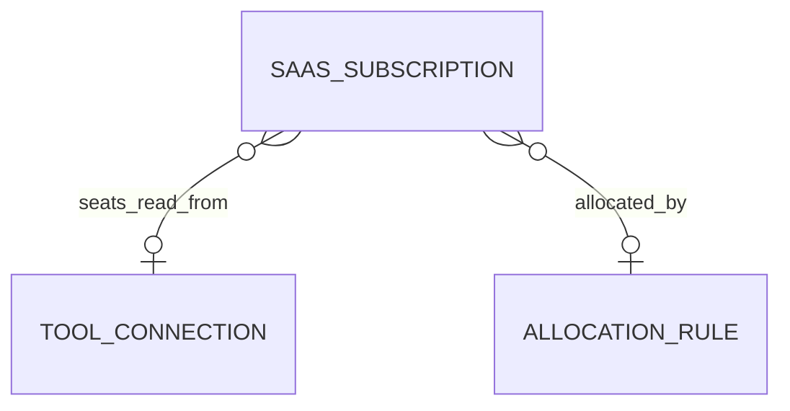
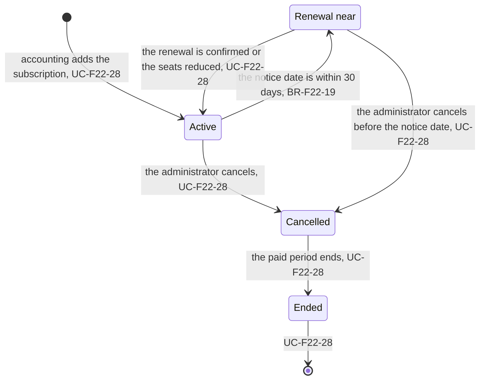

🏠 [Specs](../../../README.md) › 🧩 [Functional capabilities](../../README.md) ›
💸 [F22 Unified platform cost management](../README.md) › 🗃️ [Data](README.md) › 🗃️ E-F22-20 SaaS subscription

# 🗃️ E-F22-20 SaaS subscription

**Status:** ✅ specified

## Purpose

A software subscription of the company outside SimpleERP, with its seats, its price and its renewal
([D541](../../../06-decisions/f22-unified-cost-management/d541-benchmark-gaps-f22-unified-cost-management.md)). It
differs from the paid provider ([E-F22-04 Paid provider](e-f22-04-paid-provider.md)): a provider is a service SimpleERP
calls and meters, a subscription is a tool the company's people use.

## Fields

| Name | Type | Required | Validation | Default | Example | Personal data | Custom fields |
|---|---|---|---|---|---|---|---|
| tool | text | yes | 1 to 80 characters | - | Design tool | no | no |
| seats paid | number | yes | 0 or more | - | 20 | no | no |
| seats used | number | no | 0 or more, at most the seats paid plus overuse | unknown | 14 | no | no |
| price per seat | amount with currency | yes | 0 or more | - | 12 EUR | no | no |
| billing period | month, year | yes | a value of the list | year | year | no | no |
| renewal date | date | yes | in the future when created | - | 2027-01-31 | no | no |
| notice date | date | yes | on or before the renewal date | - | 2026-12-31 | no | no |
| allocation | department or project | no | an allocation rule target | none | Marketing | no | no |
| connection | tool connection (E-F24-02) | no | a connection of the tool | none | design tool | no | no |
| state | Active, Renewal near, Cancelled, Ended | yes | the lifecycle below | Active | Renewal near | no | no |
| owner | user | yes | a user of the company | the creator | Claire P. | yes | no |

## Relations

- [E-F22-06 Cost budget](e-f22-06-cost-budget.md)
- [E-F22-09 Allocation rule](e-f22-09-allocation-rule.md)
- [E-F22-12 Invoice match](e-f22-12-invoice-match.md)
- [E-F24-02 Tool connection](../../f24-integrations-hub/data/e-f24-02-tool-connection.md)

## Lifecycle

## Indexes and search

By tool, state, renewal date, notice date and allocation.

## Retention

Kept 10 years with the invoices it relates to
([CR-FR-002](../../../10-country-packs/france/accounting/cr-fr-002-accounting-records-kept-ten-years.md)).

## Audit

Every addition, seat change, flag, decision, renewal and cancellation, with who and when.

## Import and export

Import from a CSV of subscriptions; export with the cost reports
([UC-F22-19](../use-cases/04-accounting/uc-f22-19-export-and-report-costs.md)).

## Used by

- [UC-F22-28](../use-cases/08-credits-saas-and-carbon/uc-f22-28-manage-saas-subscriptions.md)

## Open questions

None.

---

⬅️ [E-F22-19 Credit pack](e-f22-19-credit-pack.md) · ⬆️ [Up](README.md) ·
➡️ [E-F22-21 Routing rule](e-f22-21-routing-rule.md)
