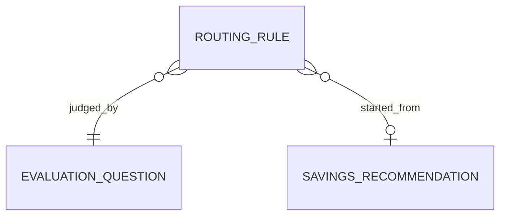
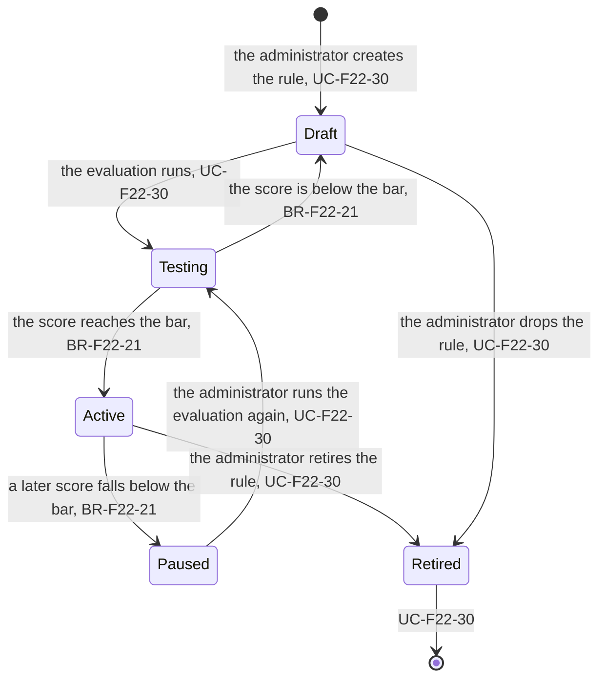

🏠 [Specs](../../../README.md) › 🧩 [Functional capabilities](../../README.md) ›
💸 [F22 Unified platform cost management](../README.md) › 🗃️ [Data](README.md) › 🗃️ E-F22-21 Routing rule

# 🗃️ E-F22-21 Routing rule

**Status:** ✅ specified

## Purpose

A routing rule: for one kind of AI task, the models in order, the quality bar and the saving
([D541](../../../06-decisions/f22-unified-cost-management/d541-benchmark-gaps-f22-unified-cost-management.md)). It
differs from the savings recommendation ([E-F22-16 Savings recommendation](e-f22-16-savings-recommendation.md)): a
recommendation is advice the owner may dismiss, a rule is the setting the router follows.

## Fields

| Name | Type | Required | Validation | Default | Example | Personal data | Custom fields |
|---|---|---|---|---|---|---|---|
| task kind | text | yes | a kind of AI task of the company | - | Summaries | no | no |
| models | list of models | yes | 2 to 5 models of the AI providers | - | small, large | no | no |
| quality bar | number | yes | 0 to 1 | 0.85 | 0.85 | no | no |
| score | number | no | from the last evaluation run | none | 0.88 | no | no |
| cost cap per call | amount with currency | no | 0 or more | none | 0.05 EUR | no | no |
| saving | amount with currency | no | computed from the metered calls | 0 | 120 EUR | no | no |
| evaluation set | evaluation question set (E-F3-17) | yes | a set of the task kind | - | summaries set | no | no |
| state | Draft, Testing, Active, Paused, Retired | yes | the lifecycle below | Draft | Testing | no | no |
| owner | user | yes | a user of the company | the creator | Claire P. | yes | no |

## Relations

- [E-F22-04 Paid provider](e-f22-04-paid-provider.md)
- [E-F22-16 Savings recommendation](e-f22-16-savings-recommendation.md)
- [E-F3-17 Evaluation question](../../f03-assistant/data/e-f03-17-evaluation-question.md)
- [E-F3-18 Evaluation run](../../f03-assistant/data/e-f03-18-evaluation-run.md)

## Lifecycle

## Indexes and search

By task kind, state, score and saving.

## Retention

Kept 3 years after retirement, with the scores that justified each change.

## Audit

Every rule created, tested, activated, paused and retired, with the scores, the models and who.

## Import and export

No import. Export with the cost reports ([UC-F22-19](../use-cases/04-accounting/uc-f22-19-export-and-report-costs.md)).

## Used by

- [UC-F22-30](../use-cases/08-credits-saas-and-carbon/uc-f22-30-route-ai-tasks-to-save-costs.md)

## Open questions

None.

---

⬅️ [E-F22-20 SaaS subscription](e-f22-20-saas-subscription.md) · ⬆️ [Up](README.md)
