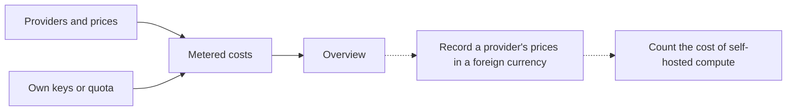

🏠 [Specs](../../../README.md) › 🧩 [Functional capabilities](../../README.md) ›
💸 [F22 Unified platform cost management](../README.md) › 🔀 [Flows](README.md) › 🔀 FL-F22-01 See and set up

# 🔀 FL-F22-01 See and set up

**Status:** ✅ specified

## Summary

Covers UC-F22-01, UC-F22-02, UC-F22-04, UC-F22-05, UC-F22-20.

## Personas

- [U02 Manager](../../../01-users/personas/u02-manager.md)
- [U05 Accounting](../../../01-users/personas/u05-accounting.md)
- [U07 Administrator](../../../01-users/personas/u07-administrator.md)
- [U13 Owner](../../../01-users/personas/u13-owner.md)
- [U48 Hosting engineer](../../../01-users/personas/u48-hosting-engineer.md)

## Flowchart

## Sequence diagram

See each use case.

## Steps

| Step | Persona | Screen | Use case | What happens |
|---|---|---|---|---|
| 1 | U13, U05 | [S-F22-01](../screens/01-see-and-set-up/s-f22-01-costs-overview.md) | [UC-F22-01](../use-cases/01-see-and-set-up/uc-f22-01-see-all-platform-costs-in-one-place.md) | See all platform costs in one place |
| 2 | U13 | [S-F22-02](../screens/01-see-and-set-up/s-f22-02-cost-breakdown.md) | [UC-F22-02](../use-cases/01-see-and-set-up/uc-f22-02-see-costs-per-module-feature-and-provider.md) | See costs per module, feature and provider |
| 3 | U07 | [S-F22-04](../screens/01-see-and-set-up/s-f22-04-providers.md) | [UC-F22-04](../use-cases/01-see-and-set-up/uc-f22-04-register-a-paid-provider-and-its-prices.md) | Register a paid provider and its prices |
| 4 | U07, U13 | [S-F22-05](../screens/01-see-and-set-up/s-f22-05-payment-mode.md) | [UC-F22-05](../use-cases/01-see-and-set-up/uc-f22-05-bring-own-keys-or-use-the-hosted-quota.md) | Bring own keys or use the hosted quota |
| 5 | U13, U02 | [S-F22-20](../screens/01-see-and-set-up/s-f22-20-cost-assistant.md) | [UC-F22-20](../use-cases/01-see-and-set-up/uc-f22-20-ask-the-assistant-about-costs.md) | Ask the AI assistant about costs |
| 6 | U07, U05 | [S-F22-21](../screens/01-see-and-set-up/s-f22-21-currencies.md) | [UC-F22-21](../use-cases/01-see-and-set-up/uc-f22-21-record-a-providers-prices-in-a-foreign-currency.md) | Record a provider's prices in a foreign currency |
| 7 | U07, U48 | [S-F22-22](../screens/01-see-and-set-up/s-f22-22-self-hosted-compute.md) | [UC-F22-22](../use-cases/01-see-and-set-up/uc-f22-22-count-the-cost-of-self-hosted-compute.md) | Count the cost of self-hosted compute |

### Entities and screens

| Entity | States in this flow | Shown at step and screen | Aggregated view |
|---|---|---|---|
| [E-F22-04 Paid provider](../data/e-f22-04-paid-provider.md) | New, Paid | 3 [S-F22-04](../screens/01-see-and-set-up/s-f22-04-providers.md); 4 [S-F22-05](../screens/01-see-and-set-up/s-f22-05-payment-mode.md); 6 [S-F22-21](../screens/01-see-and-set-up/s-f22-21-currencies.md) | Paid providers |
| [E-F22-03 Provider price list](../data/e-f22-03-provider-price-list.md) | Active | 2 [S-F22-02](../screens/01-see-and-set-up/s-f22-02-cost-breakdown.md); 3 [S-F22-04](../screens/01-see-and-set-up/s-f22-04-providers.md); 6 [S-F22-21](../screens/01-see-and-set-up/s-f22-21-currencies.md) | Provider price lists |
| [E-F22-02 Metered call record](../data/e-f22-02-metered-call-record.md) | Recorded | 1 [S-F22-01](../screens/01-see-and-set-up/s-f22-01-costs-overview.md); 2 [S-F22-02](../screens/01-see-and-set-up/s-f22-02-cost-breakdown.md); 5 [S-F22-20](../screens/01-see-and-set-up/s-f22-20-cost-assistant.md); 7 [S-F22-22](../screens/01-see-and-set-up/s-f22-22-self-hosted-compute.md) | Metered call records |
| [E-T12-02 Credential](../../../03-technical/t12-connectors-and-scrapers/data/e-t12-02-credential.md) | Active | Shown elsewhere: [S-T12-02 Credential](../../../03-technical/t12-connectors-and-scrapers/screens/s-t12-02-credential.md), from the admin list [S-T12-L02](../../../03-technical/t12-connectors-and-scrapers/screens/00-lists/s-t12-l02-credentials.md) | Credentials |
| [E-F22-05 Hosted quota](../data/e-f22-05-hosted-quota.md) | Active | 4 [S-F22-05](../screens/01-see-and-set-up/s-f22-05-payment-mode.md) | Hosted quotas |
| [E-F22-01 Cost period](../data/e-f22-01-cost-period.md) | Active | 1 [S-F22-01](../screens/01-see-and-set-up/s-f22-01-costs-overview.md) | Cost periods |
| [E-F22-14 Exchange rate](../data/e-f22-14-exchange-rate.md) | Published | 1 [S-F22-01](../screens/01-see-and-set-up/s-f22-01-costs-overview.md); 3 [S-F22-04](../screens/01-see-and-set-up/s-f22-04-providers.md); 6 [S-F22-21](../screens/01-see-and-set-up/s-f22-21-currencies.md) | Exchange rates |
| [E-F22-15 Compute machine](../data/e-f22-15-compute-machine.md) | In service, Retired | 1 [S-F22-01](../screens/01-see-and-set-up/s-f22-01-costs-overview.md); 7 [S-F22-22](../screens/01-see-and-set-up/s-f22-22-self-hosted-compute.md) | Compute machines |

## Errors

As each use case.

## Images

Every step and error, for each persona taking part, in light and dark mode (D120). Steps are numbered as in the Steps
table; E rows are the error cases.

| Step | Persona | Device | Light | Dark |
|---|---|---|---|---|
| 1 | U13 | desktop | [light](../images/01-see-and-set-up/u13-owner/1-overview-desktop-light.png) | [dark](../images/01-see-and-set-up/u13-owner/1-overview-desktop-dark.png) |
| 1 | U13 | phone | [light](../images/01-see-and-set-up/u13-owner/1-overview-phone-light.png) | [dark](../images/01-see-and-set-up/u13-owner/1-overview-phone-dark.png) |
| 1 | U05 | desktop | [light](../images/01-see-and-set-up/u05-accounting/1-overview-desktop-light.png) | [dark](../images/01-see-and-set-up/u05-accounting/1-overview-desktop-dark.png) |
| 2 | U13 | desktop | [light](../images/01-see-and-set-up/u13-owner/2-breakdown-desktop-light.png) | [dark](../images/01-see-and-set-up/u13-owner/2-breakdown-desktop-dark.png) |
| 2 | U13 | phone | [light](../images/01-see-and-set-up/u13-owner/2-breakdown-phone-light.png) | [dark](../images/01-see-and-set-up/u13-owner/2-breakdown-phone-dark.png) |
| 3 | U07 | desktop | [light](../images/01-see-and-set-up/u07-administrator/3-providers-desktop-light.png) | [dark](../images/01-see-and-set-up/u07-administrator/3-providers-desktop-dark.png) |
| 4 | U07 | desktop | [light](../images/01-see-and-set-up/u07-administrator/4-keys-desktop-light.png) | [dark](../images/01-see-and-set-up/u07-administrator/4-keys-desktop-dark.png) |
| 4 | U13 | desktop | [light](../images/01-see-and-set-up/u13-owner/4-keys-desktop-light.png) | [dark](../images/01-see-and-set-up/u13-owner/4-keys-desktop-dark.png) |
| 4 | U13 | phone | [light](../images/01-see-and-set-up/u13-owner/4-keys-phone-light.png) | [dark](../images/01-see-and-set-up/u13-owner/4-keys-phone-dark.png) |
| 5 | U02 | desktop | [light](../images/01-see-and-set-up/u02-manager/5-assistant-desktop-light.png) | [dark](../images/01-see-and-set-up/u02-manager/5-assistant-desktop-dark.png) |
| 5 | U02 | phone | [light](../images/01-see-and-set-up/u02-manager/5-assistant-phone-light.png) | [dark](../images/01-see-and-set-up/u02-manager/5-assistant-phone-dark.png) |
| 5 | U13 | desktop | [light](../images/01-see-and-set-up/u13-owner/5-assistant-desktop-light.png) | [dark](../images/01-see-and-set-up/u13-owner/5-assistant-desktop-dark.png) |
| 5 | U13 | phone | [light](../images/01-see-and-set-up/u13-owner/5-assistant-phone-light.png) | [dark](../images/01-see-and-set-up/u13-owner/5-assistant-phone-dark.png) |
| E1 | U07 | desktop | [light](../images/01-see-and-set-up/u07-administrator/e1-overlap-desktop-light.png) | [dark](../images/01-see-and-set-up/u07-administrator/e1-overlap-desktop-dark.png) |
| 6 | U07 | desktop | [light](../images/01-see-and-set-up/u07-administrator/6-currencies-desktop-light.png) | [dark](../images/01-see-and-set-up/u07-administrator/6-currencies-desktop-dark.png) |
| 6 | U05 | desktop | [light](../images/01-see-and-set-up/u05-accounting/6-currencies-desktop-light.png) | [dark](../images/01-see-and-set-up/u05-accounting/6-currencies-desktop-dark.png) |
| 7 | U07 | desktop | [light](../images/01-see-and-set-up/u07-administrator/7-self-hosted-compute-desktop-light.png) | [dark](../images/01-see-and-set-up/u07-administrator/7-self-hosted-compute-desktop-dark.png) |
| 7 | U48 | desktop | [light](../images/01-see-and-set-up/u48-hosting-engineer/7-self-hosted-compute-desktop-light.png) | [dark](../images/01-see-and-set-up/u48-hosting-engineer/7-self-hosted-compute-desktop-dark.png) |
| 7 | U48 | phone | [light](../images/01-see-and-set-up/u48-hosting-engineer/7-self-hosted-compute-phone-light.png) | [dark](../images/01-see-and-set-up/u48-hosting-engineer/7-self-hosted-compute-phone-dark.png) |

## Open questions

None.

---

⬆️ [Up](README.md) · ➡️ [FL-F22-02 Budgets and stops](fl-f22-02-budgets-and-stops.md)
