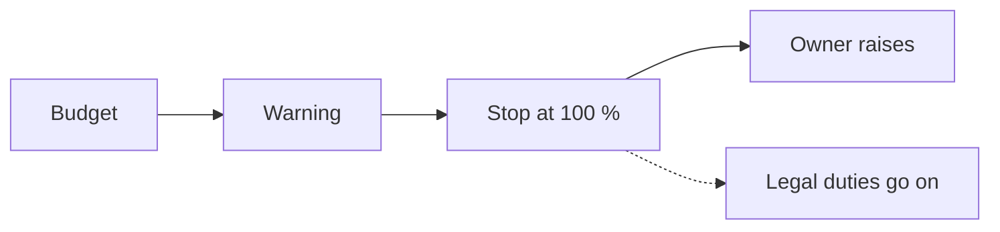

🏠 [Specs](../../../README.md) › 🧩 [Functional capabilities](../../README.md) ›
💸 [F22 Unified platform cost management](../README.md) › 🔀 [Flows](README.md) › 🔀 FL-F22-02 Budgets and stops

# 🔀 FL-F22-02 Budgets and stops

**Status:** ✅ specified

## Summary

Covers UC-F22-06, UC-F22-07, UC-F22-08, UC-F22-09.

## Personas

- [U02 Manager](../../../01-users/personas/u02-manager.md)
- [U07 Administrator](../../../01-users/personas/u07-administrator.md)
- [U13 Owner](../../../01-users/personas/u13-owner.md)

## Flowchart

## Sequence diagram

See each use case.

## Steps

| Step | Persona | Screen | Use case | What happens |
|---|---|---|---|---|
| 1 | U13, U02 | [S-F22-06](../screens/02-budgets-and-stops/s-f22-06-budgets.md) | [UC-F22-06](../use-cases/02-budgets-and-stops/uc-f22-06-set-budgets-at-every-level.md) | Set budgets at every level |
| 2 | U13, U07 | [S-F22-07](../screens/02-budgets-and-stops/s-f22-07-budget-warnings.md) | [UC-F22-07](../use-cases/02-budgets-and-stops/uc-f22-07-receive-warnings-at-thresholds.md) | Receive warnings at thresholds |
| 3 | U07 | [S-F22-08](../screens/02-budgets-and-stops/s-f22-08-budget-stop.md) | [UC-F22-08](../use-cases/02-budgets-and-stops/uc-f22-08-stop-paid-calls-at-100-legal-duties-kept.md) | Stop paid calls at 100 %, legal duties kept |
| 4 | U13 | [S-F22-09](../screens/02-budgets-and-stops/s-f22-09-approvals.md) | [UC-F22-09](../use-cases/02-budgets-and-stops/uc-f22-09-raise-a-budget-or-approve-a-run.md) | Raise a budget or approve a run |

### Entities and screens

| Entity | States in this flow | Shown at step and screen | Aggregated view |
|---|---|---|---|
| [E-F22-06 Cost budget](../data/e-f22-06-cost-budget.md) | Active | 1 [S-F22-06](../screens/02-budgets-and-stops/s-f22-06-budgets.md); 2 [S-F22-07](../screens/02-budgets-and-stops/s-f22-07-budget-warnings.md); 3 [S-F22-08](../screens/02-budgets-and-stops/s-f22-08-budget-stop.md); 4 [S-F22-09](../screens/02-budgets-and-stops/s-f22-09-approvals.md) | Cost budgets |
| [E-F22-07 Cost alert](../data/e-f22-07-cost-alert.md) | Active | 2 [S-F22-07](../screens/02-budgets-and-stops/s-f22-07-budget-warnings.md) | Cost alerts |
| [E-F15-05 Compliance duty](../../f15-legal-assistant/data/e-f15-05-compliance-duty.md) | Planned, Done, Overdue | Shown elsewhere: [S-F15-07 Compliance calendar](../../f15-legal-assistant/screens/05-duties-and-records/s-f15-07-compliance-calendar.md) | Compliance duties |

## Errors

As each use case.

## Images

Every step and error, for each persona taking part, in light and dark mode (D120). Steps are numbered as in the Steps
table; E rows are the error cases.

| Step | Persona | Device | Light | Dark |
|---|---|---|---|---|
| 1 | U13 | desktop | [light](../images/02-budgets-and-stops/u13-owner/1-budgets-desktop-light.png) | [dark](../images/02-budgets-and-stops/u13-owner/1-budgets-desktop-dark.png) |
| 1 | U13 | phone | [light](../images/02-budgets-and-stops/u13-owner/1-budgets-phone-light.png) | [dark](../images/02-budgets-and-stops/u13-owner/1-budgets-phone-dark.png) |
| 1 | U02 | desktop | [light](../images/02-budgets-and-stops/u02-manager/1-budgets-desktop-light.png) | [dark](../images/02-budgets-and-stops/u02-manager/1-budgets-desktop-dark.png) |
| 1 | U02 | phone | [light](../images/02-budgets-and-stops/u02-manager/1-budgets-phone-light.png) | [dark](../images/02-budgets-and-stops/u02-manager/1-budgets-phone-dark.png) |
| 2 | U07 | desktop | [light](../images/02-budgets-and-stops/u07-administrator/2-warning-desktop-light.png) | [dark](../images/02-budgets-and-stops/u07-administrator/2-warning-desktop-dark.png) |
| 2 | U13 | desktop | [light](../images/02-budgets-and-stops/u13-owner/2-warning-desktop-light.png) | [dark](../images/02-budgets-and-stops/u13-owner/2-warning-desktop-dark.png) |
| 2 | U13 | phone | [light](../images/02-budgets-and-stops/u13-owner/2-warning-phone-light.png) | [dark](../images/02-budgets-and-stops/u13-owner/2-warning-phone-dark.png) |
| 3 | U07 | desktop | [light](../images/02-budgets-and-stops/u07-administrator/3-stop-desktop-light.png) | [dark](../images/02-budgets-and-stops/u07-administrator/3-stop-desktop-dark.png) |
| 4 | U13 | desktop | [light](../images/02-budgets-and-stops/u13-owner/4-approve-desktop-light.png) | [dark](../images/02-budgets-and-stops/u13-owner/4-approve-desktop-dark.png) |
| 4 | U13 | phone | [light](../images/02-budgets-and-stops/u13-owner/4-approve-phone-light.png) | [dark](../images/02-budgets-and-stops/u13-owner/4-approve-phone-dark.png) |
| E1 | U02 | desktop | [light](../images/02-budgets-and-stops/u02-manager/e1-not-owner-desktop-light.png) | [dark](../images/02-budgets-and-stops/u02-manager/e1-not-owner-desktop-dark.png) |
| E1 | U02 | phone | [light](../images/02-budgets-and-stops/u02-manager/e1-not-owner-phone-light.png) | [dark](../images/02-budgets-and-stops/u02-manager/e1-not-owner-phone-dark.png) |

## Open questions

None.

---

⬅️ [FL-F22-01 See and set up](fl-f22-01-see-and-set-up.md) · ⬆️ [Up](README.md) ·
➡️ [FL-F22-03 Runs](fl-f22-03-runs.md)
