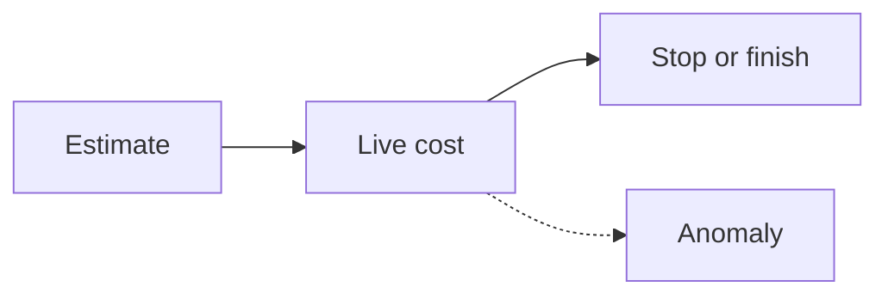

🏠 [Specs](../../../README.md) › 🧩 [Functional capabilities](../../README.md) ›
💸 [F22 Unified platform cost management](../README.md) › 🔀 [Flows](README.md) › 🔀 FL-F22-03 Runs

# 🔀 FL-F22-03 Runs

**Status:** ✅ specified

## Summary

Covers UC-F22-10, UC-F22-11, UC-F22-18.

## Personas

- [U02 Manager](../../../01-users/personas/u02-manager.md)
- [U07 Administrator](../../../01-users/personas/u07-administrator.md)
- [U48 Hosting engineer](../../../01-users/personas/u48-hosting-engineer.md)

## Flowchart

## Sequence diagram

See each use case.

## Steps

| Step | Persona | Screen | Use case | What happens |
|---|---|---|---|---|
| 1 | U07, U02 | [S-F22-10](../screens/03-runs/s-f22-10-estimate.md) | [UC-F22-10](../use-cases/03-runs/uc-f22-10-estimate-a-run-before-it-starts.md) | Estimate a run before it starts |
| 2 | U07 | [S-F22-11](../screens/03-runs/s-f22-11-live-run.md) | [UC-F22-11](../use-cases/03-runs/uc-f22-11-follow-a-run-s-cost-live-and-stop-it.md) | Follow a run's cost live and stop it |
| 3 | U07, U48 | [S-F22-18](../screens/03-runs/s-f22-18-anomalies.md) | [UC-F22-18](../use-cases/03-runs/uc-f22-18-spot-anomalies-and-runaway-agents.md) | Spot anomalies and runaway agents |

### Entities and screens

| Entity | States in this flow | Shown at step and screen | Aggregated view |
|---|---|---|---|
| [E-F22-10 Run estimate](../data/e-f22-10-run-estimate.md) | Running, Done | 1 [S-F22-10](../screens/03-runs/s-f22-10-estimate.md); 2 [S-F22-11](../screens/03-runs/s-f22-11-live-run.md) | Run estimates |
| [E-F22-07 Cost alert](../data/e-f22-07-cost-alert.md) | Active | 3 [S-F22-18](../screens/03-runs/s-f22-18-anomalies.md) | Cost alerts |

## Errors

As each use case.

## Images

Every step and error, for each persona taking part, in light and dark mode (D120). Steps are numbered as in the Steps
table; E rows are the error cases.

| Step | Persona | Device | Light | Dark |
|---|---|---|---|---|
| 1 | U07 | desktop | [light](../images/03-runs/u07-administrator/1-estimate-desktop-light.png) | [dark](../images/03-runs/u07-administrator/1-estimate-desktop-dark.png) |
| 1 | U02 | desktop | [light](../images/03-runs/u02-manager/1-estimate-desktop-light.png) | [dark](../images/03-runs/u02-manager/1-estimate-desktop-dark.png) |
| 1 | U02 | phone | [light](../images/03-runs/u02-manager/1-estimate-phone-light.png) | [dark](../images/03-runs/u02-manager/1-estimate-phone-dark.png) |
| 2 | U07 | desktop | [light](../images/03-runs/u07-administrator/2-live-desktop-light.png) | [dark](../images/03-runs/u07-administrator/2-live-desktop-dark.png) |
| 3 | U48 | desktop | [light](../images/03-runs/u48-hosting-engineer/3-anomaly-desktop-light.png) | [dark](../images/03-runs/u48-hosting-engineer/3-anomaly-desktop-dark.png) |
| 3 | U48 | phone | [light](../images/03-runs/u48-hosting-engineer/3-anomaly-phone-light.png) | [dark](../images/03-runs/u48-hosting-engineer/3-anomaly-phone-dark.png) |
| 3 | U07 | desktop | [light](../images/03-runs/u07-administrator/3-anomaly-desktop-light.png) | [dark](../images/03-runs/u07-administrator/3-anomaly-desktop-dark.png) |
| E1 | U07 | desktop | [light](../images/03-runs/u07-administrator/e1-stopped-desktop-light.png) | [dark](../images/03-runs/u07-administrator/e1-stopped-desktop-dark.png) |

## Open questions

None.

---

⬅️ [FL-F22-02 Budgets and stops](fl-f22-02-budgets-and-stops.md) · ⬆️ [Up](README.md) ·
➡️ [FL-F22-04 Accounting](fl-f22-04-accounting.md)
