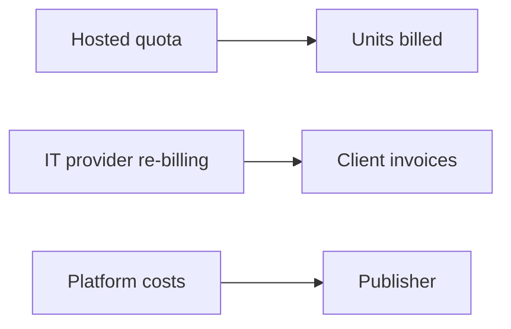

🏠 [Specs](../../../README.md) › 🧩 [Functional capabilities](../../README.md) ›
💸 [F22 Unified platform cost management](../README.md) › 🔀 [Flows](README.md) › 🔀 FL-F22-05 Billing

# 🔀 FL-F22-05 Billing

**Status:** ✅ specified

## Summary

Covers UC-F22-15, UC-F22-16, UC-F22-17.

## Personas

- [U05 Accounting](../../../01-users/personas/u05-accounting.md)
- [U11 IT provider administrator](../../../01-users/personas/u11-provider-admin.md)
- [U13 Owner](../../../01-users/personas/u13-owner.md)
- [U48 Hosting engineer](../../../01-users/personas/u48-hosting-engineer.md)

## Flowchart

## Sequence diagram

See each use case.

## Steps

| Step | Persona | Screen | Use case | What happens |
|---|---|---|---|---|
| 1 | U13, U05 | [S-F22-15](../screens/05-billing/s-f22-15-hosted-usage.md) | [UC-F22-15](../use-cases/05-billing/uc-f22-15-see-the-hosted-quota-and-units-billed.md) | See the hosted quota and units billed |
| 2 | U11 | [S-F22-16](../screens/05-billing/s-f22-16-client-re-billing.md) | [UC-F22-16](../use-cases/05-billing/uc-f22-16-re-bill-clients-as-an-it-provider.md) | Re-bill clients as an IT provider |
| 3 | U48 | [S-F22-17](../screens/05-billing/s-f22-17-platform-costs.md) | [UC-F22-17](../use-cases/05-billing/uc-f22-17-follow-the-hosting-s-own-platform-costs.md) | Follow the hosting's own platform costs |

### Entities and screens

| Entity | States in this flow | Shown at step and screen | Aggregated view |
|---|---|---|---|
| [E-F22-05 Hosted quota](../data/e-f22-05-hosted-quota.md) | Active | 1 [S-F22-15](../screens/05-billing/s-f22-15-hosted-usage.md) | Hosted quotas |
| [E-F22-13 Usage invoice](../data/e-f22-13-usage-invoice.md) | Recorded | 1 [S-F22-15](../screens/05-billing/s-f22-15-hosted-usage.md); 2 [S-F22-16](../screens/05-billing/s-f22-16-client-re-billing.md) | Usage invoices |
| [E-F22-17 Re-billing rule](../data/e-f22-17-re-billing-rule.md) | Active, Changed | 2 [S-F22-16](../screens/05-billing/s-f22-16-client-re-billing.md) | Re-billing rules |
| [E-F22-01 Cost period](../data/e-f22-01-cost-period.md) | Active | Shown elsewhere: [S-F22-01 Costs overview](../screens/01-see-and-set-up/s-f22-01-costs-overview.md) | Cost periods |

## Errors

As each use case.

## Images

Every step and error, for each persona taking part, in light and dark mode (D120). Steps are numbered as in the Steps
table; E rows are the error cases.

| Step | Persona | Device | Light | Dark |
|---|---|---|---|---|
| 1 | U13 | desktop | [light](../images/05-billing/u13-owner/1-quota-desktop-light.png) | [dark](../images/05-billing/u13-owner/1-quota-desktop-dark.png) |
| 1 | U13 | phone | [light](../images/05-billing/u13-owner/1-quota-phone-light.png) | [dark](../images/05-billing/u13-owner/1-quota-phone-dark.png) |
| 1 | U05 | desktop | [light](../images/05-billing/u05-accounting/1-quota-desktop-light.png) | [dark](../images/05-billing/u05-accounting/1-quota-desktop-dark.png) |
| 2 | U11 | desktop | [light](../images/05-billing/u11-provider-admin/2-re-billing-desktop-light.png) | [dark](../images/05-billing/u11-provider-admin/2-re-billing-desktop-dark.png) |
| 3 | U48 | desktop | [light](../images/05-billing/u48-hosting-engineer/3-platform-desktop-light.png) | [dark](../images/05-billing/u48-hosting-engineer/3-platform-desktop-dark.png) |
| 3 | U48 | phone | [light](../images/05-billing/u48-hosting-engineer/3-platform-phone-light.png) | [dark](../images/05-billing/u48-hosting-engineer/3-platform-phone-dark.png) |
| E1 | U11 | desktop | [light](../images/05-billing/u11-provider-admin/e1-no-contract-desktop-light.png) | [dark](../images/05-billing/u11-provider-admin/e1-no-contract-desktop-dark.png) |

## Open questions

None.

---

⬅️ [FL-F22-04 Accounting](fl-f22-04-accounting.md) · ⬆️ [Up](README.md) ·
➡️ [FL-F22-06 Savings and KPIs](fl-f22-06-savings-and-kpis.md)
