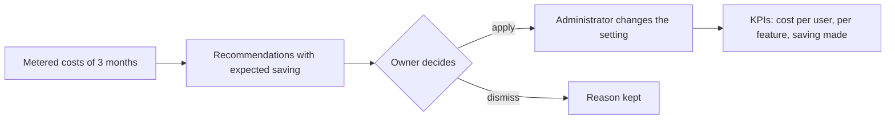
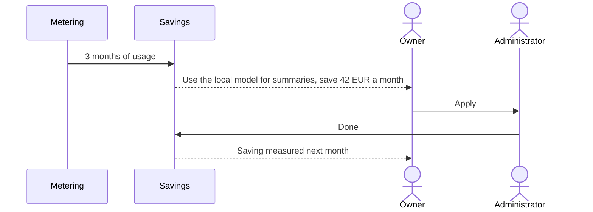

🏠 [Specs](../../../README.md) › 🧩 [Functional capabilities](../../README.md) ›
💸 [F22 Unified platform cost management](../README.md) › 🔀 [Flows](README.md) › 🔀 FL-F22-06 Savings and KPIs

# 🔀 FL-F22-06 Savings and KPIs

**Status:** ✅ specified

## Summary

simple-ERP reads the metered costs and proposes savings (a local model, caching, a cheaper model per feature), each with
its expected saving; the owner applies the ones they want, and the cost KPIs show the effect month after month (D479).

## Personas

- [U13 Owner](../../../01-users/personas/u13-owner.md)
- [U07 Administrator](../../../01-users/personas/u07-administrator.md)
- [U05 Accounting](../../../01-users/personas/u05-accounting.md)

## Flowchart

## Sequence diagram

## Steps

| Step | Persona | Screen | Use case | What happens |
|---|---|---|---|---|
| 1 | U13, U07 | [S-F22-23](../screens/06-savings-and-kpis/s-f22-23-savings.md) | [UC-F22-23](../use-cases/06-savings-and-kpis/uc-f22-23-act-on-savings-recommendations.md) | Act on savings recommendations |
| 2 | U13, U05 | [S-F22-24](../screens/06-savings-and-kpis/s-f22-24-cost-kpis.md) | [UC-F22-24](../use-cases/06-savings-and-kpis/uc-f22-24-read-the-cost-kpis.md) | Read the cost KPIs |

### Entities and screens

| Entity | States in this flow | Shown at step and screen | Aggregated view |
|---|---|---|---|
| [E-F22-02 Metered call record](../data/e-f22-02-metered-call-record.md) | Recorded | Shown elsewhere: [S-F22-01 Costs overview](../screens/01-see-and-set-up/s-f22-01-costs-overview.md) | Metered call records |
| [E-F22-16 Savings recommendation](../data/e-f22-16-savings-recommendation.md) | Proposed, Applied, Measured | 1 [S-F22-23](../screens/06-savings-and-kpis/s-f22-23-savings.md); 2 [S-F22-24](../screens/06-savings-and-kpis/s-f22-24-cost-kpis.md) | Savings recommendations |

## Errors

E1: a recommendation would lower quality below the feature's bar (F3 evaluation): it is not shown (step 1). E2: the
saving measured is below half the expected: the recommendation is marked "less than expected" (step 2).

## Images

Every step and error, for each persona taking part, in light and dark mode (D120). Steps are numbered as in the Steps
table; E rows are the error cases.

| Step | Persona | Device | Light | Dark |
|---|---|---|---|---|
| 1 | U13 | desktop | [light](../images/06-savings-and-kpis/u13-owner/1-savings-desktop-light.png) | [dark](../images/06-savings-and-kpis/u13-owner/1-savings-desktop-dark.png) |
| 1 | U13 | phone | [light](../images/06-savings-and-kpis/u13-owner/1-savings-phone-light.png) | [dark](../images/06-savings-and-kpis/u13-owner/1-savings-phone-dark.png) |
| 1 | U07 | desktop | [light](../images/06-savings-and-kpis/u07-administrator/1-savings-desktop-light.png) | [dark](../images/06-savings-and-kpis/u07-administrator/1-savings-desktop-dark.png) |
| 2 | U13 | desktop | [light](../images/06-savings-and-kpis/u13-owner/2-cost-kpis-desktop-light.png) | [dark](../images/06-savings-and-kpis/u13-owner/2-cost-kpis-desktop-dark.png) |
| 2 | U13 | phone | [light](../images/06-savings-and-kpis/u13-owner/2-cost-kpis-phone-light.png) | [dark](../images/06-savings-and-kpis/u13-owner/2-cost-kpis-phone-dark.png) |
| 2 | U05 | desktop | [light](../images/06-savings-and-kpis/u05-accounting/2-cost-kpis-desktop-light.png) | [dark](../images/06-savings-and-kpis/u05-accounting/2-cost-kpis-desktop-dark.png) |
| E1 | U13 | desktop | [light](../images/06-savings-and-kpis/u13-owner/e1-savings-refused-desktop-light.png) | [dark](../images/06-savings-and-kpis/u13-owner/e1-savings-refused-desktop-dark.png) |
| E1 | U13 | phone | [light](../images/06-savings-and-kpis/u13-owner/e1-savings-refused-phone-light.png) | [dark](../images/06-savings-and-kpis/u13-owner/e1-savings-refused-phone-dark.png) |

## Open questions

None.

---

⬅️ [FL-F22-05 Billing](fl-f22-05-billing.md) · ⬆️ [Up](README.md) ·
➡️ [FL-F22-07 IT provider re-billing](fl-f22-07-it-provider-re-billing.md)
