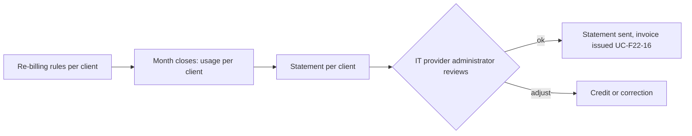
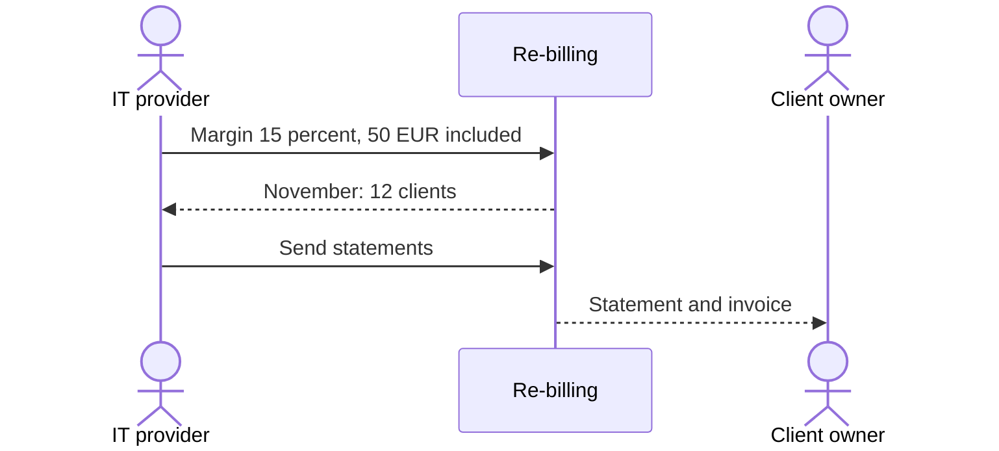

🏠 [Specs](../../../README.md) › 🧩 [Functional capabilities](../../README.md) ›
💸 [F22 Unified platform cost management](../README.md) › 🔀 [Flows](README.md) › 🔀 FL-F22-07 IT provider re-billing

# 🔀 FL-F22-07 IT provider re-billing

**Status:** ✅ specified

## Summary

An IT provider sets, per client, how the platform costs are re-billed (margin, rounding, what is included), reviews each
client's usage at the month's end, sends the statement and invoices it (D479).

## Personas

- [U11 IT provider administrator](../../../01-users/personas/u11-provider-admin.md)
- [U13 Owner](../../../01-users/personas/u13-owner.md)

## Flowchart

## Sequence diagram

## Steps

| Step | Persona | Screen | Use case | What happens |
|---|---|---|---|---|
| 1 | U11 | [S-F22-25](../screens/07-it-provider-re-billing/s-f22-25-re-billing-rules.md) | [UC-F22-25](../use-cases/07-it-provider-re-billing/uc-f22-25-set-re-billing-rules-per-client.md) | Set re-billing rules per client |
| 2 | U11, U13 | [S-F22-26](../screens/07-it-provider-re-billing/s-f22-26-client-statements.md) | [UC-F22-26](../use-cases/07-it-provider-re-billing/uc-f22-26-send-each-client-its-usage-statement.md) | Send each client its usage statement |
| 3 | U11 | [S-F22-16](../screens/05-billing/s-f22-16-client-re-billing.md) | [UC-F22-16](../use-cases/05-billing/uc-f22-16-re-bill-clients-as-an-it-provider.md) | Re-bill clients as an IT provider |

### Entities and screens

| Entity | States in this flow | Shown at step and screen | Aggregated view |
|---|---|---|---|
| [E-F22-17 Re-billing rule](../data/e-f22-17-re-billing-rule.md) | Active, Changed | 1 [S-F22-25](../screens/07-it-provider-re-billing/s-f22-25-re-billing-rules.md); 3 [S-F22-16](../screens/05-billing/s-f22-16-client-re-billing.md) | Re-billing rules |
| [E-F1-01 Company](../../f01-administration/data/e-f01-01-company.md) | In setup, Active | Shown elsewhere: [S-F1-10 Client companies](../../f01-administration/screens/08-provider-and-client-companies/s-f01-10-client-companies.md) | Companies |
| [E-F22-02 Metered call record](../data/e-f22-02-metered-call-record.md) | Recorded | Shown elsewhere: [S-F22-01 Costs overview](../screens/01-see-and-set-up/s-f22-01-costs-overview.md) | Metered call records |
| [E-F22-18 Client usage statement](../data/e-f22-18-client-usage-statement.md) | Draft, Sent | 2 [S-F22-26](../screens/07-it-provider-re-billing/s-f22-26-client-statements.md); 3 [S-F22-16](../screens/05-billing/s-f22-16-client-re-billing.md) | Client usage statements |
| [E-F22-13 Usage invoice](../data/e-f22-13-usage-invoice.md) | Recorded | 3 [S-F22-16](../screens/05-billing/s-f22-16-client-re-billing.md) | Usage invoices |

## Errors

E1: a client with no rule: the default rule applies and the provider is told (step 1). E2: a client disputes a line: the
provider adds a correction before invoicing (step 2).

## Images

Every step and error, for each persona taking part, in light and dark mode (D120). Steps are numbered as in the Steps
table; E rows are the error cases.

| Step | Persona | Device | Light | Dark |
|---|---|---|---|---|
| 1 | U11 | desktop | [light](../images/07-it-provider-re-billing/u11-provider-admin/1-re-billing-rules-desktop-light.png) | [dark](../images/07-it-provider-re-billing/u11-provider-admin/1-re-billing-rules-desktop-dark.png) |
| 2 | U11 | desktop | [light](../images/07-it-provider-re-billing/u11-provider-admin/2-client-statements-desktop-light.png) | [dark](../images/07-it-provider-re-billing/u11-provider-admin/2-client-statements-desktop-dark.png) |
| 2 | U13 | desktop | [light](../images/07-it-provider-re-billing/u13-owner/2-client-statements-desktop-light.png) | [dark](../images/07-it-provider-re-billing/u13-owner/2-client-statements-desktop-dark.png) |
| 2 | U13 | phone | [light](../images/07-it-provider-re-billing/u13-owner/2-client-statements-phone-light.png) | [dark](../images/07-it-provider-re-billing/u13-owner/2-client-statements-phone-dark.png) |
| 3 | U11 | desktop | [light](../images/07-it-provider-re-billing/u11-provider-admin/3-client-re-billing-desktop-light.png) | [dark](../images/07-it-provider-re-billing/u11-provider-admin/3-client-re-billing-desktop-dark.png) |
| E1 | U11 | desktop | [light](../images/07-it-provider-re-billing/u11-provider-admin/e1-re-billing-rules-refused-desktop-light.png) | [dark](../images/07-it-provider-re-billing/u11-provider-admin/e1-re-billing-rules-refused-desktop-dark.png) |

## Open questions

None.

---

⬅️ [FL-F22-06 Savings and KPIs](fl-f22-06-savings-and-kpis.md) · ⬆️ [Up](README.md) ·
➡️ [FL-F22-08 Credits, SaaS subscriptions, carbon and routing](fl-f22-08-credits-saas-and-carbon.md)
