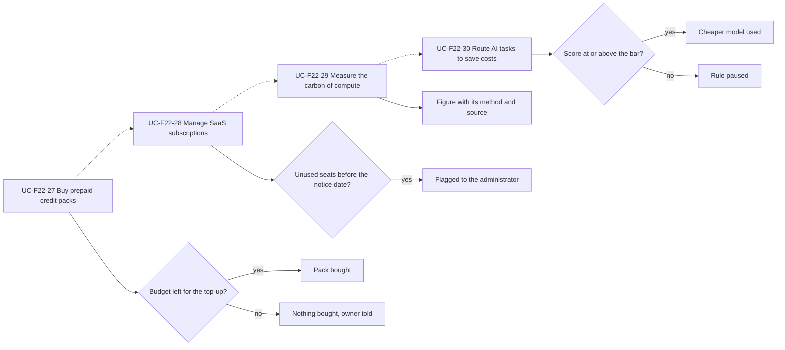
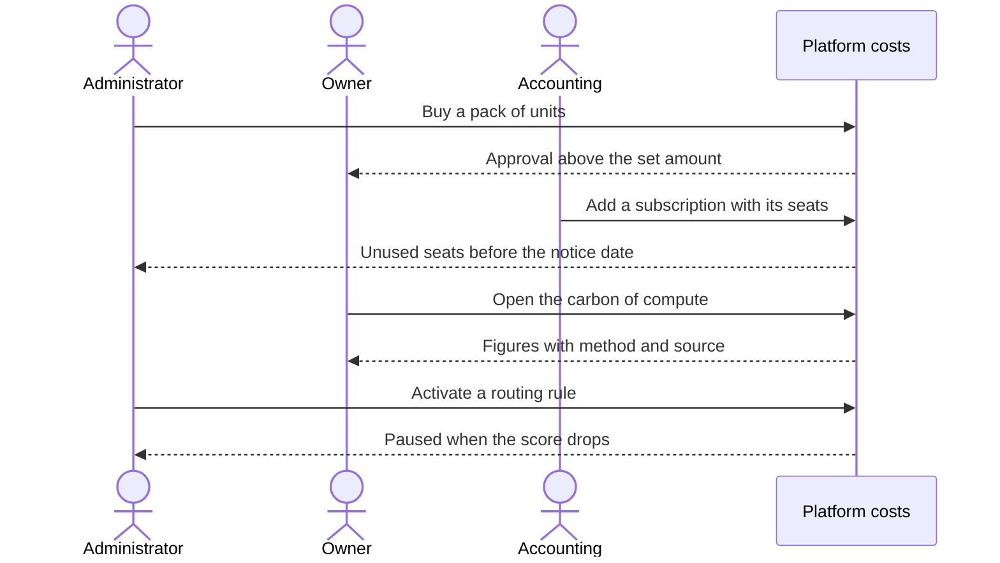

🏠 [Specs](../../../README.md) › 🧩 [Functional capabilities](../../README.md) ›
💸 [F22 Unified platform cost management](../README.md) › 🔀 [Flows](README.md) ›
🔀 FL-F22-08 Credits, SaaS subscriptions, carbon and routing

# 🔀 FL-F22-08 Credits, SaaS subscriptions, carbon and routing

**Status:** ✅ specified

## Summary

The administrator buys prepaid credit packs that top up only inside the budget, accounting keeps the company's software
subscriptions and flags unused seats before renewal, the owner reads the carbon of compute with each figure's method,
and the administrator routes AI tasks to cheaper models that still meet their quality bar
([D541](../../../06-decisions/f22-unified-cost-management/d541-benchmark-gaps-f22-unified-cost-management.md)).

## Personas

- [U07 Administrator](../../../01-users/personas/u07-administrator.md), who buys packs, keeps subscriptions and sets
  routing
- [U13 Owner](../../../01-users/personas/u13-owner.md), who approves purchases and reads the carbon
- [U05 Accounting](../../../01-users/personas/u05-accounting.md), who records the subscriptions

## Flowchart

## Sequence diagram

## Steps

| Step | Persona | Screen | Use case | What happens |
|---|---|---|---|---|
| 1 | [U07](../../../01-users/personas/u07-administrator.md) | [S-F22-27](../screens/08-credits-saas-and-carbon/s-f22-27-credit-packs.md) | [UC-F22-27](../use-cases/08-credits-saas-and-carbon/uc-f22-27-buy-prepaid-credit-packs.md) | The administrator buys a pack and sets a top-up that stays inside the budget |
| 2 | [U07](../../../01-users/personas/u07-administrator.md) | [S-F22-28](../screens/08-credits-saas-and-carbon/s-f22-28-saas-subscriptions.md) | [UC-F22-28](../use-cases/08-credits-saas-and-carbon/uc-f22-28-manage-saas-subscriptions.md) | Accounting records a subscription and the administrator reduces its unused seats |
| 3 | [U13](../../../01-users/personas/u13-owner.md) | [S-F22-29](../screens/08-credits-saas-and-carbon/s-f22-29-compute-carbon.md) | [UC-F22-29](../use-cases/08-credits-saas-and-carbon/uc-f22-29-measure-the-carbon-of-compute.md) | The owner reads the carbon of the compute, each figure with its method |
| 4 | [U07](../../../01-users/personas/u07-administrator.md) | [S-F22-30](../screens/08-credits-saas-and-carbon/s-f22-30-model-routing.md) | [UC-F22-30](../use-cases/08-credits-saas-and-carbon/uc-f22-30-route-ai-tasks-to-save-costs.md) | The administrator routes a task kind to a cheaper model that meets the bar |

### Entities and screens

| Entity | States in this flow | Shown at step and screen | Aggregated view |
|---|---|---|---|
| [E-F22-19 Credit pack](../data/e-f22-19-credit-pack.md) | Ordered, Active, Cancelled, Low, Used up, Expired | 1 [S-F22-27](../screens/08-credits-saas-and-carbon/s-f22-27-credit-packs.md) | Credit packs |
| [E-F22-20 SaaS subscription](../data/e-f22-20-saas-subscription.md) | Active, Renewal near, Cancelled, Ended | 2 [S-F22-28](../screens/08-credits-saas-and-carbon/s-f22-28-saas-subscriptions.md) | SaaS subscriptions |
| [E-F22-21 Routing rule](../data/e-f22-21-routing-rule.md) | Draft, Testing, Active, Paused, Retired | 4 [S-F22-30](../screens/08-credits-saas-and-carbon/s-f22-30-model-routing.md) | Routing rules |

## Errors

- **E1 The budget is reached.** The automatic top-up is not bought and the owner is told
  ([BR-F22-18](../business-rules/br-f22-18-automatic-top-ups-stay-within-the-budget.md), step 1).

## Images

Every step and error, for each persona taking part, in light and dark mode (D120). Steps are numbered as in the Steps
table; E rows are the error cases.

| Step | Persona | Device | Light | Dark |
|---|---|---|---|---|
| 1 | U07 | desktop | [light](../images/08-credits-saas-and-carbon/u07-administrator/1-credit-packs-desktop-light.png) | [dark](../images/08-credits-saas-and-carbon/u07-administrator/1-credit-packs-desktop-dark.png) |
| 1 | U13 | desktop | [light](../images/08-credits-saas-and-carbon/u13-owner/1-credit-packs-desktop-light.png) | [dark](../images/08-credits-saas-and-carbon/u13-owner/1-credit-packs-desktop-dark.png) |
| 2 | U07 | desktop | [light](../images/08-credits-saas-and-carbon/u07-administrator/2-saas-subscriptions-desktop-light.png) | [dark](../images/08-credits-saas-and-carbon/u07-administrator/2-saas-subscriptions-desktop-dark.png) |
| 2 | U05 | desktop | [light](../images/08-credits-saas-and-carbon/u05-accounting/2-saas-subscriptions-desktop-light.png) | [dark](../images/08-credits-saas-and-carbon/u05-accounting/2-saas-subscriptions-desktop-dark.png) |
| 3 | U13 | desktop | [light](../images/08-credits-saas-and-carbon/u13-owner/3-compute-carbon-desktop-light.png) | [dark](../images/08-credits-saas-and-carbon/u13-owner/3-compute-carbon-desktop-dark.png) |
| 3 | U13 | phone | [light](../images/08-credits-saas-and-carbon/u13-owner/3-compute-carbon-phone-light.png) | [dark](../images/08-credits-saas-and-carbon/u13-owner/3-compute-carbon-phone-dark.png) |
| 4 | U07 | desktop | [light](../images/08-credits-saas-and-carbon/u07-administrator/4-model-routing-desktop-light.png) | [dark](../images/08-credits-saas-and-carbon/u07-administrator/4-model-routing-desktop-dark.png) |
| E1 | U07 | desktop | [light](../images/08-credits-saas-and-carbon/u07-administrator/e1-the-budget-is-reached-desktop-light.png) | [dark](../images/08-credits-saas-and-carbon/u07-administrator/e1-the-budget-is-reached-desktop-dark.png) |

## Open questions

None.

---

⬅️ [FL-F22-07 IT provider re-billing](fl-f22-07-it-provider-re-billing.md) · ⬆️ [Up](README.md)
