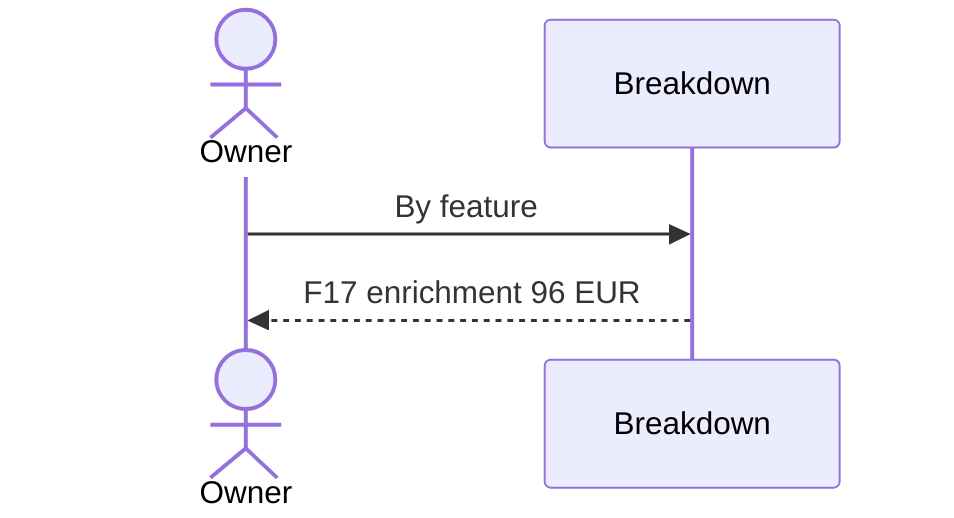

🏠 [Specs](../../../../README.md) › 🧩 [Functional capabilities](../../../README.md) ›
💸 [F22 Unified platform cost management](../../README.md) › 📝 [Use cases](../README.md) ›
📝 [Use cases: FL-F22-01 See and set up](README.md) › 📝 UC-F22-02 See costs per module, feature and provider

# 📝 UC-F22-02 See costs per module, feature and provider

**Status:** ✅ specified

## Summary

The owner groups costs by module, feature and provider and opens a line.

## Personas

- [U13 Owner](../../../../01-users/personas/u13-owner.md)

## Goal

Know what costs most.

## Trigger

Review.

## Frequency

Monthly.

## Preconditions

- Usage.

## Postconditions

- Success: read.
- Failure: none.

## Main flow

1. Open (S-F22-02).
2. Group.
3. Sort.
4. Open a line with its prices (BR-F22-03).

## Alternative flows

- 2a. By user.

## Error flows

- 4e. Price changed: past cost unchanged.
- Any step: a service does not answer; the call is retried first (BR-F3-32), then the message follows the error pattern
  (D122) and what was typed stays on the screen.

## Business rules

- [BR-F22-02 Every paid call is metered](../../business-rules/br-f22-02-every-paid-call-metered.md)
- [BR-F22-03 Prices versioned per provider](../../business-rules/br-f22-03-prices-versioned-per-provider.md)

## Entities

- [E-F22-02 Metered call record](../../data/e-f22-02-metered-call-record.md)
- [E-F22-03 Provider price list](../../data/e-f22-03-provider-price-list.md)

## Permissions

Owner.

## Notifications

- None.

## Audit events

None.

## AI involvement

Explains.

## API, MCP and A2A exposure

Through T5 and T6 with the caller's rights (BR-F3-34).

## Screens

- [S-F22-02 Cost breakdown](../../screens/01-see-and-set-up/s-f22-02-cost-breakdown.md)

## Flowchart

See [FL-F22-01 See and set up](../../flows/fl-f22-01-see-and-set-up.md#flowchart).

## Sequence diagram

## Acceptance criteria

1. **Given** features **when** grouped **then** F17 first at 96.00 EUR.
2. **Given** a price change **when** opened **then** past cost unchanged.
3. **Given** by user **when** grouped **then** per user.

## Non-functional notes

D408's targets ([Performance](../../../../05-non-functional/performance.md)): 95 % of screens within 1 second; lists
paged on the server, the first page within 1 second; reports within 5 seconds or in the background.

## Regulatory references

Billing and accounting rules of the France country pack:
[CR-FR-015 Mandatory invoice mentions](../../../../10-country-packs/france/invoicing/cr-fr-015-invoice-mandatory-mentions.md),
[CR-FR-016 Electronic invoicing](../../../../10-country-packs/france/invoicing/cr-fr-016-electronic-invoicing.md),
[CR-FR-100 VAT on services to clients abroad](../../../../10-country-packs/france/tax-and-vat/cr-fr-100-vat-on-services-abroad.md),
[CR-FR-002 Accounting records kept 10 years](../../../../10-country-packs/france/accounting/cr-fr-002-accounting-records-kept-ten-years.md),
[CR-FR-202 Price reductions on invoices](../../../../10-country-packs/france/invoicing/cr-fr-202-price-reductions-on-invoices.md),
[CR-FR-049 Processors and transfers outside the EU](../../../../10-country-packs/france/data-protection/cr-fr-049-processors-and-transfers.md).

## Related use cases

- [UC-F22-23 Act on savings recommendations](../06-savings-and-kpis/uc-f22-23-act-on-savings-recommendations.md)

## Open questions

None.

---

⬅️ [UC-F22-01 See all platform costs in one place](uc-f22-01-see-all-platform-costs-in-one-place.md) ·
⬆️ [Up](README.md) · ➡️ [UC-F22-03](../04-accounting/uc-f22-03-see-costs-per-department-project-and-client.md)
