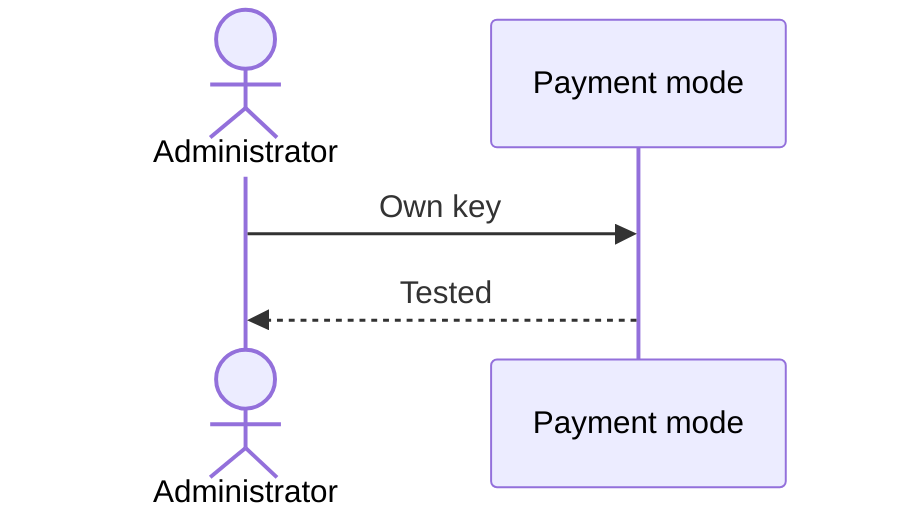

🏠 [Specs](../../../../README.md) › 🧩 [Functional capabilities](../../../README.md) ›
💸 [F22 Unified platform cost management](../../README.md) › 📝 [Use cases](../README.md) ›
📝 [Use cases: FL-F22-01 See and set up](README.md) › 📝 UC-F22-05 Bring own keys or use the hosted quota

# 📝 UC-F22-05 Bring own keys or use the hosted quota

**Status:** ✅ specified

## Summary

The administrator chooses own keys or the hosted quota per provider.

## Personas

- [U07 Administrator](../../../../01-users/personas/u07-administrator.md)
- [U13 Owner](../../../../01-users/personas/u13-owner.md)

## Goal

Right payment mode.

## Trigger

Set-up.

## Frequency

Rare.

## Preconditions

- Provider.

## Postconditions

- Success: mode set.
- Failure: key refused.

## Main flow

1. Open (S-F22-05).
2. Choose.
3. Store key in the vault.
4. Test.

## Alternative flows

- 2a. Quota.

## Error flows

- 4e. Key refused.
- Any step: a service does not answer; the call is retried first (BR-F3-32), then the message follows the error pattern
  (D122) and what was typed stays on the screen.

## Business rules

- [BR-F22-10 Own keys: billed by the provider](../../business-rules/br-f22-10-own-keys-billed-by-the-provider.md)
- [BR-F22-09 Hosted: quota, then units](../../business-rules/br-f22-09-hosted-quota-then-units.md)

## Entities

- [E-F22-04 Paid provider](../../data/e-f22-04-paid-provider.md)
- [E-F22-05 Hosted quota](../../data/e-f22-05-hosted-quota.md)

## Permissions

Administrator; owner approves.

## Notifications

- None.

## Audit events

Changes.

## AI involvement

None.

## API, MCP and A2A exposure

Through T5 and T6 with the caller's rights (BR-F3-34).

## Screens

- [S-F22-05 Payment mode](../../screens/01-see-and-set-up/s-f22-05-payment-mode.md)

## Flowchart

See [FL-F22-01 See and set up](../../flows/fl-f22-01-see-and-set-up.md#flowchart).

## Sequence diagram

## Acceptance criteria

1. **Given** own key **when** used **then** provider bills directly.
2. **Given** quota **when** used **then** counted.
3. **Given** refused key **when** tested **then** error.

## Non-functional notes

D408's targets ([Performance](../../../../05-non-functional/performance.md)): 95 % of screens within 1 second; lists
paged on the server, the first page within 1 second; reports within 5 seconds or in the background.

## Regulatory references

Billing and accounting rules of the France country pack:
[CR-FR-015 Mandatory invoice mentions](../../../../10-country-packs/france/invoicing/cr-fr-015-invoice-mandatory-mentions.md),
[CR-FR-016 Electronic invoicing](../../../../10-country-packs/france/invoicing/cr-fr-016-electronic-invoicing.md),
[CR-FR-100 VAT on services to clients abroad](../../../../10-country-packs/france/tax-and-vat/cr-fr-100-vat-on-services-abroad.md),
[CR-FR-002 Accounting records kept 10 years](../../../../10-country-packs/france/accounting/cr-fr-002-accounting-records-kept-ten-years.md),
[CR-FR-202 Price reductions on invoices](../../../../10-country-packs/france/invoicing/cr-fr-202-price-reductions-on-invoices.md),
[CR-FR-049 Processors and transfers outside the EU](../../../../10-country-packs/france/data-protection/cr-fr-049-processors-and-transfers.md).

## Related use cases

- [UC-F22-15 See the hosted quota and units billed](../05-billing/uc-f22-15-see-the-hosted-quota-and-units-billed.md)

## Open questions

None.

---

⬅️ [UC-F22-04 Register a paid provider and its prices](uc-f22-04-register-a-paid-provider-and-its-prices.md) ·
⬆️ [Up](README.md) ·
➡️ [UC-F22-06 Set budgets at every level](../02-budgets-and-stops/uc-f22-06-set-budgets-at-every-level.md)
