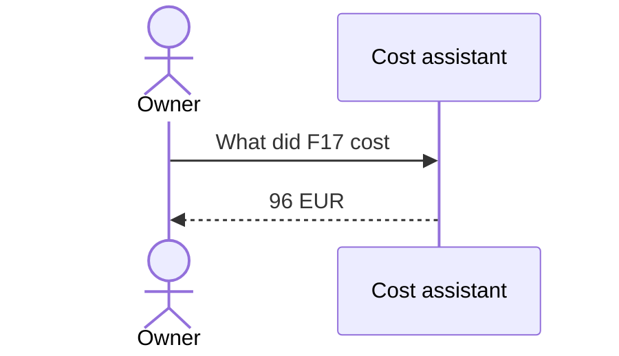

🏠 [Specs](../../../../README.md) › 🧩 [Functional capabilities](../../../README.md) ›
💸 [F22 Unified platform cost management](../../README.md) › 📝 [Use cases](../README.md) ›
📝 [Use cases: FL-F22-01 See and set up](README.md) › 📝 UC-F22-20 Ask the AI assistant about costs

# 📝 UC-F22-20 Ask the AI assistant about costs

**Status:** ✅ specified

## Summary

The owner and managers ask the AI assistant about costs.

## Personas

- [U13 Owner](../../../../01-users/personas/u13-owner.md)
- [U02 Manager](../../../../01-users/personas/u02-manager.md)

## Goal

Answers.

## Trigger

Question.

## Frequency

Occasional.

## Preconditions

- None.

## Postconditions

- Success: answered.
- Failure: refused.

## Main flow

1. Ask (S-F22-20).
2. Answer with figures.
3. Act after confirmation.
4. Logged.

## Alternative flows

- 2a. Savings asked.

## Error flows

- 2e. Beyond rights.
- Any step: a service does not answer; the call is retried first (BR-F3-32), then the message follows the error pattern
  (D122) and what was typed stays on the screen.

## Business rules

- [BR-F22-04 Budgets at every level](../../business-rules/br-f22-04-budgets-at-every-level.md)
- [BR-F22-02 Every paid call is metered](../../business-rules/br-f22-02-every-paid-call-metered.md)

## Entities

- [E-F22-02 Metered call record](../../data/e-f22-02-metered-call-record.md)
- [E-F22-06 Cost budget](../../data/e-f22-06-cost-budget.md)

## Permissions

Within rights.

## Notifications

- None.

## Audit events

Questions.

## AI involvement

Answers.

## API, MCP and A2A exposure

Through T5 and T6 with the caller's rights (BR-F3-34).

## Screens

- [S-F22-20 Cost assistant](../../screens/01-see-and-set-up/s-f22-20-cost-assistant.md)

## Flowchart

See [FL-F22-01 See and set up](../../flows/fl-f22-01-see-and-set-up.md#flowchart).

## Sequence diagram

## Acceptance criteria

1. **Given** F17 **when** asked **then** 96.00 EUR.
2. **Given** a manager **when** asking other teams **then** refused.
3. **Given** raise asked **when** confirmed **then** raised.

## Non-functional notes

D408's targets ([Performance](../../../../05-non-functional/performance.md)): 95 % of screens within 1 second; lists
paged on the server, the first page within 1 second; reports within 5 seconds or in the background.

## Regulatory references

Billing and accounting rules of the France country pack:
[CR-FR-015 Mandatory invoice mentions](../../../../10-country-packs/france/invoicing/cr-fr-015-invoice-mandatory-mentions.md),
[CR-FR-016 Electronic invoicing](../../../../10-country-packs/france/invoicing/cr-fr-016-electronic-invoicing.md),
[CR-FR-100 VAT on services to clients abroad](../../../../10-country-packs/france/tax-and-vat/cr-fr-100-vat-on-services-abroad.md),
[CR-FR-002 Accounting records kept 10 years](../../../../10-country-packs/france/accounting/cr-fr-002-accounting-records-kept-ten-years.md),
[CR-FR-202 Price reductions on invoices](../../../../10-country-packs/france/invoicing/cr-fr-202-price-reductions-on-invoices.md),
[CR-FR-049 Processors and transfers outside the EU](../../../../10-country-packs/france/data-protection/cr-fr-049-processors-and-transfers.md).

## Related use cases

- [UC-F22-23 Act on savings recommendations](../06-savings-and-kpis/uc-f22-23-act-on-savings-recommendations.md)

## Open questions

None.

---

⬅️ [UC-F22-19 Export and report costs](../04-accounting/uc-f22-19-export-and-report-costs.md) · ⬆️ [Up](README.md) ·
➡️ [UC-F22-21](uc-f22-21-record-a-providers-prices-in-a-foreign-currency.md)
