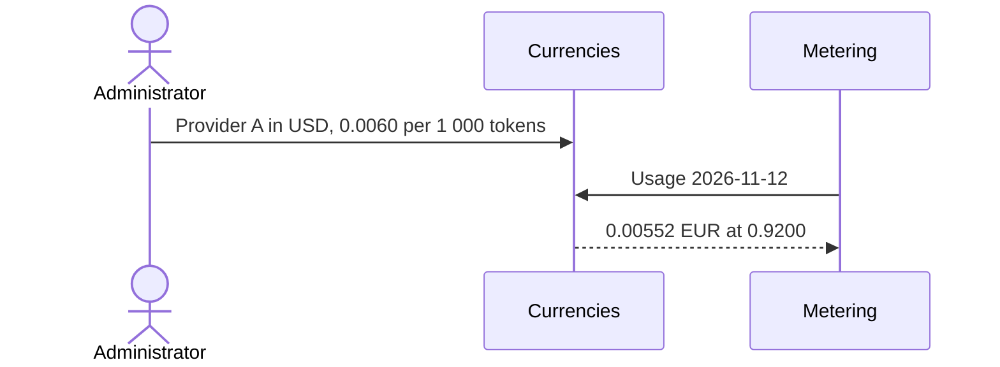

🏠 [Specs](../../../../README.md) › 🧩 [Functional capabilities](../../../README.md) ›
💸 [F22 Unified platform cost management](../../README.md) › 📝 [Use cases](../README.md) ›
📝 [Use cases: FL-F22-01 See and set up](README.md) › 📝 UC-F22-21 Record a provider's prices in a foreign currency

# 📝 UC-F22-21 Record a provider's prices in a foreign currency

**Status:** ✅ specified

## Summary

The administrator records a provider's prices in its own currency; each usage is converted at the day's rate, both
amounts are kept, and the provider's invoice in that currency is matched in it.

## Personas

- [U07 Administrator](../../../../01-users/personas/u07-administrator.md)
- [U05 Accounting](../../../../01-users/personas/u05-accounting.md), who matches the invoice

## Goal

Costs right in euros even when providers bill in dollars.

## Trigger

A provider billing in a foreign currency.

## Frequency

Once per provider; daily conversions.

## Preconditions

- The provider is registered (UC-F22-04).

## Postconditions

- Success: usage converted daily; invoices matched in the original currency.
- Failure: a missing rate flagged.

## Main flow

1. The administrator opens Currencies (S-F22-21) and sets the provider's currency to USD.
2. They enter the USD prices with their dates.
3. Each usage keeps USD and its EUR cost at the day's rate (BR-F22-14).
4. Reports show EUR with USD on demand.
5. Accounting matches the USD invoice against metered USD (UC-F22-13).

## Alternative flows

- 3a. Rate missing that day: the previous rate, flagged.

## Error flows

- 2e. A price without currency: refused.
- Any step: a service does not answer; the call is retried first (BR-F3-32), then the message follows the error pattern
  (D122) and what was typed stays on the screen.

## Business rules

- [BR-F22-14 Foreign prices converted at the day's rate](../../business-rules/br-f22-14-foreign-prices-converted-at-the-days-rate.md)
- [BR-F22-03 Prices versioned per provider](../../business-rules/br-f22-03-prices-versioned-per-provider.md)

## Entities

- [E-F22-14 Exchange rate](../../data/e-f22-14-exchange-rate.md)
- [E-F22-03 Provider price list](../../data/e-f22-03-provider-price-list.md)

## Permissions

Administrator; accounting reads.

## Notifications

- Accounting when a rate was missing.

## Audit events

Prices and currency changes.

## AI involvement

None.

## API, MCP and A2A exposure

Through the API (T5) and as AI assistant tools (T6), with the caller's rights (BR-F3-34).

## Screens

- [S-F22-21 Currencies](../../screens/01-see-and-set-up/s-f22-21-currencies.md)

## Flowchart

See [FL-F22-01 See and set up](../../flows/fl-f22-01-see-and-set-up.md#flowchart).

## Sequence diagram

## Acceptance criteria

1. **Given** 1 000 tokens at 0.0060 USD on 2026-11-12 at 0.9200 **when** metered **then** 0.00552 EUR is recorded with
   0.0060 USD.
2. **Given** no rate on a holiday **when** converted **then** the previous rate is used and flagged.
3. **Given** a USD invoice of 205.00 **when** matched **then** compared with metered USD.

## Non-functional notes

D408's targets ([Performance](../../../../05-non-functional/performance.md)): 95 % of screens within 1 second; lists
paged on the server, the first page within 1 second; reports within 5 seconds or in the background.

## Regulatory references

None.

## Related use cases

- [UC-F22-04 Register a paid provider and its prices](uc-f22-04-register-a-paid-provider-and-its-prices.md)
- [UC-F22-13 Match suppliers' invoices in accounting](../04-accounting/uc-f22-13-match-suppliers-invoices-in-accounting.md)

## Open questions

None.

---

⬅️ [UC-F22-20 Ask the AI assistant about costs](uc-f22-20-ask-the-assistant-about-costs.md) · ⬆️ [Up](README.md) ·
➡️ [UC-F22-22 Count the cost of self-hosted compute](uc-f22-22-count-the-cost-of-self-hosted-compute.md)
