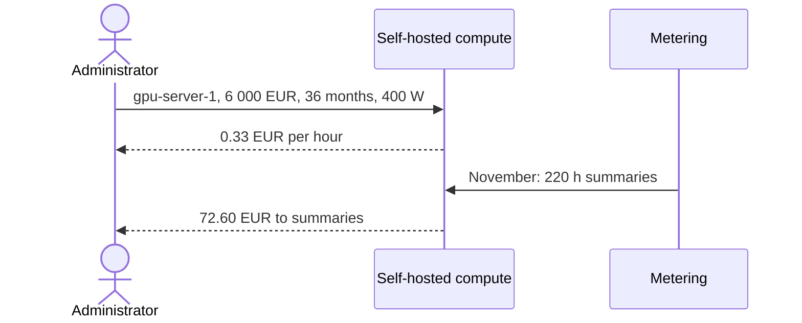

🏠 [Specs](../../../../README.md) › 🧩 [Functional capabilities](../../../README.md) ›
💸 [F22 Unified platform cost management](../../README.md) › 📝 [Use cases](../README.md) ›
📝 [Use cases: FL-F22-01 See and set up](README.md) › 📝 UC-F22-22 Count the cost of self-hosted compute

# 📝 UC-F22-22 Count the cost of self-hosted compute

**Status:** ✅ specified

## Summary

The administrator records the machines running local models with purchase price, life, power and electricity price;
their hourly cost is allocated to the features that used them and shown next to paid providers.

## Personas

- [U07 Administrator](../../../../01-users/personas/u07-administrator.md)
- [U48 Hosting engineer](../../../../01-users/personas/u48-hosting-engineer.md), who sets the machines of the hosted
  platform

## Goal

Compare local and paid models on real cost.

## Trigger

Local models in use (D440).

## Frequency

Once per machine; monthly allocation.

## Preconditions

- Local models run on known machines.

## Postconditions

- Success: compute cost allocated per feature.
- Failure: flagged machines without price.

## Main flow

1. The administrator opens Self-hosted compute (S-F22-22) and adds a machine.
2. They enter purchase price, life, power and electricity price.
3. SimpleERP computes the cost per hour (BR-F22-15).
4. Each month the hours used per feature are costed.
5. The costs overview shows the local model's cost next to paid ones.

## Alternative flows

- 2a. A machine shared with other uses: its share only.

## Error flows

- 2e. No purchase price: electricity only, flagged.
- Any step: a service does not answer; the call is retried first (BR-F3-32), then the message follows the error pattern
  (D122) and what was typed stays on the screen.

## Business rules

- [BR-F22-15 Self-hosted compute has a cost](../../business-rules/br-f22-15-self-hosted-compute-has-a-cost.md)

## Entities

- [E-F22-15 Compute machine](../../data/e-f22-15-compute-machine.md)
- [E-F22-02 Metered call record](../../data/e-f22-02-metered-call-record.md)

## Permissions

Administrator; hosting engineer for the platform.

## Notifications

- None.

## Audit events

Machine changes.

## AI involvement

None.

## API, MCP and A2A exposure

Through the API (T5) and as AI assistant tools (T6), with the caller's rights (BR-F3-34).

## Screens

- [S-F22-22 Self-hosted compute](../../screens/01-see-and-set-up/s-f22-22-self-hosted-compute.md)

## Flowchart

See [FL-F22-01 See and set up](../../flows/fl-f22-01-see-and-set-up.md#flowchart).

## Sequence diagram

## Acceptance criteria

1. **Given** 6 000.00 EUR over 36 months and 400 W at 0.25 EUR **when** computed **then** the hourly cost is shown.
2. **Given** 220 hours for summaries **when** the month closes **then** their cost goes to that feature.
3. **Given** no purchase price **when** saved **then** electricity only, flagged.

## Non-functional notes

D408's targets ([Performance](../../../../05-non-functional/performance.md)): 95 % of screens within 1 second; lists
paged on the server, the first page within 1 second; reports within 5 seconds or in the background.

## Regulatory references

None.

## Related use cases

- [UC-F22-23 Act on savings recommendations](../06-savings-and-kpis/uc-f22-23-act-on-savings-recommendations.md)
- [UC-F22-02 See costs per module, feature and provider](uc-f22-02-see-costs-per-module-feature-and-provider.md)

## Open questions

None.

---

⬅️ [UC-F22-21](uc-f22-21-record-a-providers-prices-in-a-foreign-currency.md) · ⬆️ [Up](README.md) ·
➡️ [UC-F22-23 Act on savings recommendations](../06-savings-and-kpis/uc-f22-23-act-on-savings-recommendations.md)
