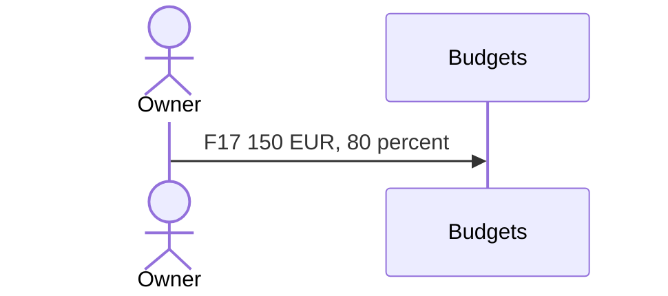

🏠 [Specs](../../../../README.md) › 🧩 [Functional capabilities](../../../README.md) ›
💸 [F22 Unified platform cost management](../../README.md) › 📝 [Use cases](../README.md) ›
📝 [Use cases: FL-F22-02 Budgets and stops](README.md) › 📝 UC-F22-06 Set budgets at every level

# 📝 UC-F22-06 Set budgets at every level

**Status:** ✅ specified

## Summary

The owner and managers set budgets at every level with thresholds.

## Personas

- [U13 Owner](../../../../01-users/personas/u13-owner.md)
- [U02 Manager](../../../../01-users/personas/u02-manager.md)

## Goal

Costs capped.

## Trigger

Set-up.

## Frequency

Monthly.

## Preconditions

- None.

## Postconditions

- Success: budgets.
- Failure: none.

## Main flow

1. Open (S-F22-06).
2. Choose level.
3. Set amount.
4. Set thresholds (BR-F22-05).

## Alternative flows

- 2a. User level.

## Error flows

- 3e. Negative: refused.
- Any step: a service does not answer; the call is retried first (BR-F3-32), then the message follows the error pattern
  (D122) and what was typed stays on the screen.

## Business rules

- [BR-F22-04 Budgets at every level](../../business-rules/br-f22-04-budgets-at-every-level.md)
- [BR-F22-05 Warnings at thresholds](../../business-rules/br-f22-05-warn-at-thresholds.md)

## Entities

- [E-F22-06 Cost budget](../../data/e-f22-06-cost-budget.md)

## Permissions

Owner; managers own team.

## Notifications

- None.

## Audit events

Budgets.

## AI involvement

Suggests.

## API, MCP and A2A exposure

Through T5 and T6 with the caller's rights (BR-F3-34).

## Screens

- [S-F22-06 Budgets](../../screens/02-budgets-and-stops/s-f22-06-budgets.md)

## Flowchart

See [FL-F22-02 Budgets and stops](../../flows/fl-f22-02-budgets-and-stops.md#flowchart).

## Sequence diagram

## Acceptance criteria

1. **Given** F17 150.00 EUR **when** set **then** warning at 120.00 EUR.
2. **Given** lowest budget **when** reached **then** applies first.
3. **Given** negative **when** set **then** refused.

## Non-functional notes

D408's targets ([Performance](../../../../05-non-functional/performance.md)): 95 % of screens within 1 second; lists
paged on the server, the first page within 1 second; reports within 5 seconds or in the background.

## Regulatory references

Billing and accounting rules of the France country pack:
[CR-FR-015 Mandatory invoice mentions](../../../../10-country-packs/france/invoicing/cr-fr-015-invoice-mandatory-mentions.md),
[CR-FR-016 Electronic invoicing](../../../../10-country-packs/france/invoicing/cr-fr-016-electronic-invoicing.md),
[CR-FR-100 VAT on services to clients abroad](../../../../10-country-packs/france/tax-and-vat/cr-fr-100-vat-on-services-abroad.md),
[CR-FR-002 Accounting records kept 10 years](../../../../10-country-packs/france/accounting/cr-fr-002-accounting-records-kept-ten-years.md),
[CR-FR-202 Price reductions on invoices](../../../../10-country-packs/france/invoicing/cr-fr-202-price-reductions-on-invoices.md),
[CR-FR-049 Processors and transfers outside the EU](../../../../10-country-packs/france/data-protection/cr-fr-049-processors-and-transfers.md).

## Related use cases

- [UC-F22-07 Receive warnings at thresholds](uc-f22-07-receive-warnings-at-thresholds.md)

## Open questions

None.

---

⬅️ [UC-F22-05](../01-see-and-set-up/uc-f22-05-bring-own-keys-or-use-the-hosted-quota.md) · ⬆️ [Up](README.md) ·
➡️ [UC-F22-07 Receive warnings at thresholds](uc-f22-07-receive-warnings-at-thresholds.md)
