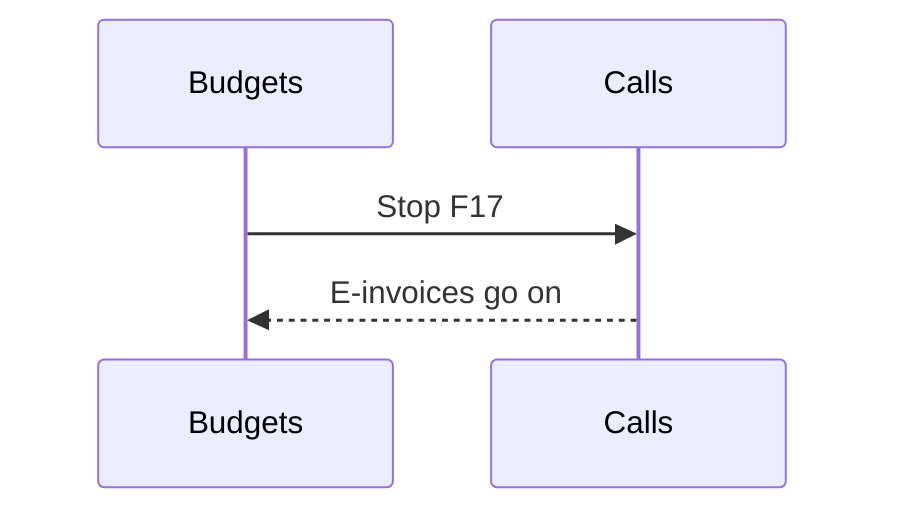

🏠 [Specs](../../../../README.md) › 🧩 [Functional capabilities](../../../README.md) ›
💸 [F22 Unified platform cost management](../../README.md) › 📝 [Use cases](../README.md) ›
📝 [Use cases: FL-F22-02 Budgets and stops](README.md) › 📝 UC-F22-08 Stop paid calls at 100 %, legal duties kept

# 📝 UC-F22-08 Stop paid calls at 100 %, legal duties kept

**Status:** ✅ specified

## Summary

At 100 % new paid calls stop; legal duties go on.

## Personas

- [U07 Administrator](../../../../01-users/personas/u07-administrator.md)

## Goal

No overspend.

## Trigger

Budget reached.

## Frequency

Rare.

## Preconditions

- Budget.

## Postconditions

- Success: stopped.
- Failure: none.

## Main flow

1. Budget reached.
2. New paid calls stop (BR-F22-06).
3. Legal duties go on.
4. Shown on Budget stop (S-F22-08).

## Alternative flows

- 2a. Runs end cleanly (BR-F22-07).

## Error flows

- 2e. A legal call: goes on, recorded.
- Any step: a service does not answer; the call is retried first (BR-F3-32), then the message follows the error pattern
  (D122) and what was typed stays on the screen.

## Business rules

- [BR-F22-06 Stop at the budget, legal duties kept](../../business-rules/br-f22-06-stop-at-budget-legal-duties-kept.md)
- [BR-F22-07 Runs stop cleanly](../../business-rules/br-f22-07-runs-stop-cleanly.md)

## Entities

- [E-F22-06 Cost budget](../../data/e-f22-06-cost-budget.md)
- [E-F22-08 Budget approval](../../data/e-f22-08-budget-approval.md)

## Permissions

Administrator.

## Notifications

- Owner.

## Audit events

Stops.

## AI involvement

None.

## API, MCP and A2A exposure

Through T5 and T6 with the caller's rights (BR-F3-34).

## Screens

- [S-F22-08 Budget stop](../../screens/02-budgets-and-stops/s-f22-08-budget-stop.md)

## Flowchart

See [FL-F22-02 Budgets and stops](../../flows/fl-f22-02-budgets-and-stops.md#flowchart).

## Sequence diagram

## Acceptance criteria

1. **Given** 100 % **when** reached **then** new calls stop.
2. **Given** an e-invoice **when** sent **then** goes on.
3. **Given** a run **when** stopped **then** clean.

## Non-functional notes

D408's targets ([Performance](../../../../05-non-functional/performance.md)): 95 % of screens within 1 second; lists
paged on the server, the first page within 1 second; reports within 5 seconds or in the background.

## Regulatory references

Billing and accounting rules of the France country pack:
[CR-FR-015 Mandatory invoice mentions](../../../../10-country-packs/france/invoicing/cr-fr-015-invoice-mandatory-mentions.md),
[CR-FR-016 Electronic invoicing](../../../../10-country-packs/france/invoicing/cr-fr-016-electronic-invoicing.md),
[CR-FR-100 VAT on services to clients abroad](../../../../10-country-packs/france/tax-and-vat/cr-fr-100-vat-on-services-abroad.md),
[CR-FR-002 Accounting records kept 10 years](../../../../10-country-packs/france/accounting/cr-fr-002-accounting-records-kept-ten-years.md),
[CR-FR-202 Price reductions on invoices](../../../../10-country-packs/france/invoicing/cr-fr-202-price-reductions-on-invoices.md),
[CR-FR-049 Processors and transfers outside the EU](../../../../10-country-packs/france/data-protection/cr-fr-049-processors-and-transfers.md).

## Related use cases

- [UC-F22-09 Raise a budget or approve a run](uc-f22-09-raise-a-budget-or-approve-a-run.md)

## Open questions

None.

---

⬅️ [UC-F22-07 Receive warnings at thresholds](uc-f22-07-receive-warnings-at-thresholds.md) · ⬆️ [Up](README.md) ·
➡️ [UC-F22-09 Raise a budget or approve a run](uc-f22-09-raise-a-budget-or-approve-a-run.md)
